# Eddy3D Component list

Setup

Pre

<a href="/components/Manual_Inflow_Profile/" class="GhComponentItem" below-dataComment="Manual Inflow Profile">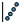</a>

<a href="/components/Mesh_Settings/" class="GhComponentItem" below-dataComment="Mesh Settings">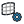</a>

Outdoor

<a href="/components/Building_Material/" class="GhComponentItem" above-dataComment="Building Material">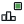</a>

<a href="/components/Terrain_Mesh_Settings/" class="GhComponentItem" above-dataComment="Terrain Mesh Settings">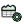</a>

<a href="/components/Vegetation_Properties/" class="GhComponentItem" below-dataComment="Vegetation Properties">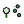</a>

<a href="/components/Simulation_Mesh_Settings/" class="GhComponentItem" below-dataComment="Simulation Mesh Settings">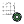</a>

<a href="/components/ViewFactors/" class="GhComponentItem" above-dataComment="ViewFactors">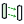</a>

Outdoor+

<a href="/components/Indoor_Inlet/" class="GhComponentItem" above-dataComment="Indoor Inlet">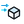</a>

Indoor

Sun Shadow Daylight

<a href="/components/Tree_Settings/" class="GhComponentItem" below-dataComment="Tree Settings">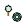</a>
<a href="/components/Vegetation_Settings/" class="GhComponentItem" above-dataComment="Vegetation Settings">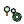</a>

MRT

Post

<a href="/components/Thermal_Comfort/" class="GhComponentItem" below-dataComment="Thermal Comfort">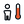</a>

Post Comfort

Stormwater

<a href="/components/FluidX3D_Run_Settings/" class="GhComponentItem" above-dataComment="FluidX3D Run Settings">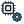</a>

LBM

<a href="/components/Wind_Predictor/" class="GhComponentItem" below-dataComment="Wind Predictor">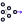</a>

<a href="/components/Interpolate_UMag/" class="GhComponentItem" above-dataComment="Interpolate UMag">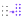</a>

ML

CHT

WRF

PALM-4U

Noise

Earthworks

<h2 id="00-setup">00 Setup</h2>
<h4 id="main-components">Main Components</h4>

    <a href="/components/Eddy3D_Setup/" style="text-decoration: none;">
        

            

                 Eddy3D Setup
            

            
Opens the Eddy3D setup window: what each simulation capability needs, what is missing on this machine, and how to install it. Replaces the Install Engines components.

        

    </a>
    <a href="/components/Esinti/" style="text-decoration: none;">
        

            

                 Esinti
            

            
Open the native Eddy3D assistant in Codex, Claude, or Antigravity. Esinti discusses simulation goals, explains workflow tradeoffs, and can apply confirmed component, wiring, geometry, or template changes to this Grasshopper canvas.

        

    </a>
    <a href="/components/Select_Template/" style="text-decoration: none;">
        

            

                 Select Template
            

            
Load example Grasshopper definitions for common workflows.  Templates include microclimate simulations, outdoor comfort studies, and CFD analysis setups.  Version: 1.22.0.827

        

    </a>

<h2 id="01-pre">01 Pre</h2>
<h4 id="main-components">Main Components</h4>

    <a href="/components/Convert_Units/" style="text-decoration: none;">
        

            

                 Convert Units
            

            
Convert values between the units Eddy3D works in — any unit into any other of the same kind, a single value or a whole hourly list. Temperature (°C, K, °F), speed (m/s, km/h, mph, kn), length, area, volume, pressure (Pa, hPa, inHg, psi), radiation (W/m², Btu/h·ft², kWh/m²), energy and power (kWh, Btu, kW, TR), mass, air flow (m³/s, cfm), rain rate, illuminance, humidity ratio (g/kg, gr/lb), enthalpy, U-value and conductivity, angle and time. EPW and every Eddy3D comfort input are in SI, OpenFOAM temperature fields are Kelvin: wire the values in, pick From and To.

        

    </a>
    <a href="/components/Download_Weather/" style="text-decoration: none;">
        

            

                 Download Weather
            

            
Pick an EPW weather file from a bundled catalog of 60,867 climate files — every TMYx station on climate.onebuilding.org plus the EnergyPlus store (IWEC, TMY3, CWEC, SWERA, …) — with your own folders and Morph Weather results listed alongside them; its second list, Built for this site, holds the sources that build a file for your site (Open-Meteo, PVGIS, NASA POWER, Copernicus CDS, NSRDB). Click the Station widget and choose Weather file (catalog)… for a searchable table with a map, or type a name, WMO id or direct URL. The catalog is searched offline; only the chosen file is downloaded, once, into the weather cache. The catalog browser's unit setting (SI or Imperial) changes only what is displayed — the Message strip, the match list and the Info text; the EPW file and every number this component outputs stay SI, so wire them to other components as before.

        

    </a>
    <a href="/components/Morph_Settings/" style="text-decoration: none;">
        

            

                 Morph Settings
            

            
Engine settings for Morph Weather: the method (Future Weather Generator or the World Bank CCKP anomalies), climate products, spatial interpolation, uncertainty case and solar methods. Every value left empty stays on the Future Weather Generator's own default; the CCKP methods ignore the generator-only settings.

        

    </a>
    <a href="/components/Morph_Weather/" style="text-decoration: none;">
        

            

                 Morph Weather
            

            
Morph a present-day EPW into future-climate EPWs with the Future Weather Generator (future-weather-generator.adai.pt), then feed the result to any Eddy3D workflow. Needs Java 17+ and the generator's .jar, which Eddy3D does not ship: download the distribution you need (CMIP6 Global, CORDEX-CMIP5 Europe, …) into ~/Eddy3D/FWG. The tool is licensed CC BY-NC-SA 4.0 — noncommercial use, attribution required. Alternatively set Morph Settings' Method to a CCKP entry: the World Bank Climate Change Knowledge Portal's CMIP6 ensemble (0.25°, no key, no Java, no jar) is read for the site's grid cell and applied to the file as monthly shifts and stretches.

        

    </a>
    <a href="/components/Compare_Weather/" style="text-decoration: none;">
        

            

                 Compare Weather
            

            
Puts two weather files of one site side by side before one of them drives a study: a station's typical year (an EPW from the climate browser) against a reanalysis year (ERA5, Open-Meteo, NASA POWER), or the same place from two providers. Dry-bulb temperature, relative humidity and wind speed as means, global horizontal radiation and precipitation as sums, for the year and each month.  An EPW's missing-value codes are left out, so a typical-year file without a rain column says it carries none instead of reading as a dry climate. It measures the difference; it does not pick a file. For the wind's DIRECTIONS use Compare Wind Climates.

        

    </a>
    <a href="/components/Compare_Wind_Climates/" style="text-decoration: none;">
        

            

                 Compare Wind Climates
            

            
Puts two wind climates of one site side by side — a station record (ISD, EPW) against ERA5, or two stations — before one of them drives a study. Wire the Climate output of two Wind Climate components built with the same Sectors.  Rose Overlap is the share of the direction distribution the two have in common (1 = the same rose); Speed Ratio is B's mean speed over A's, over the non-calm hours. The report says which of the two differs and lists every sector. It measures the disagreement; it does not pick a source.

        

    </a>
    <a href="/components/Deconstruct_Weather/" style="text-decoration: none;">
        

            

                 Deconstruct Weather
            

            
Deconstruct a Weather object into hourly time series values. More outputs: zoom in and click + beside the outputs to pick any EPW column, derived series (solar angles, sun vector, absolute humidity) or monthly statistic; − removes one. OutdoorPlus

        

    </a>
    <a href="/components/Monthly_Climate_Chart/" style="text-decoration: none;">
        

            

                 Monthly Climate Chart
            

            
Visualize monthly dry-bulb temperature and relative humidity from Eddy3D Weather as two aligned min/mean/max charts.

        

    </a>
    <a href="/components/Weather/" style="text-decoration: none;">
        

            

                 Weather
            

            
Read an EPW file and create a Weather object for the simulation. OutdoorPlus

        

    </a>
    <a href="/components/Wind_Climate/" style="text-decoration: none;">
        

            

                 Wind Climate
            

            
Long-term directional wind statistics for pedestrian comfort: for every direction sector (36 × 10° by default) and season (year + Dec-Feb, Mar-May, Jun-Aug, Sep-Nov, named for the hemisphere), the sector probability, the calm share and a Weibull c, k fitted by maximum likelihood to the non-calm hours of a MULTI-YEAR record — ERA5 via Open-Meteo (any coordinate, no key), the nearest NOAA ISD or GHCNh station, local EPW files or a CSV — or the City of London Annex A table. A typical year cannot carry a safety criterion: Lawson's 15 m/s for 0.022 % of the year is about two hours, and a TMY holds two hours of one composite year. Wire the Wind Climate output into Pedestrian Wind Comfort (with VAF's Speed Ratios) to classify from P(U > u) = Σ p·exp(−(u/(r·c))^k); the report says whether the record is long enough to measure the safety tail. Downloads run off the canvas and are cached per year in WeatherCache/WindRecords inside the Eddy3D folder of your local app data.Sources: ERA5 (Hersbach et al. 2020, Copernicus C3S) via Open-Meteo; NOAA NCEI Integrated Surface Database (ISD-Lite) and its successor GHCNh; City of London Wind Microclimate Guidelines (2019), Annex A.

        

    </a>
    <a href="/components/Geometry_Repair/" style="text-decoration: none;">
        

            

                 Geometry Repair
            

            
Check building geometry and repair it for snappyHexMesh: weld split vertices, remove degenerate and duplicate faces (and the shared walls of touching solids), orient every closed piece outward, optionally fill small holes and drop specks, then optionally rebuild it as a closed, manifold voxel WRAP — overlapping buildings fuse into one solid, courtyards open to the sky stay open, gaps narrower than about the wrap cell close. Runs in-process (no Python service). The case components already run the safe part automatically before meshing; use this to see what is wrong, to fill holes, or to wrap.

        

    </a>
    <a href="/components/Land_Cover_Roughness/" style="text-decoration: none;">
        

            

                 Land Cover Roughness
            

            
Fetch land-cover polygons around a location from OpenStreetMap (open data, Overpass API) — plus surface car parks, pedestrian areas and bare ground — and classify each into an aerodynamic roughness length via the Davenport-Wieringa terrain classification, with the terrain elevation around the site (AWS Terrain Tiles, open data). Outputs ready-made ground roughness zones draped on a terrain mesh for the wind case.

        

    </a>
    <a href="/components/Site_Context/" style="text-decoration: none;">
        

            

                 Site Context
            

            
One click from a location to the site's context: buildings with heights, bare-earth terrain, tree crowns, land-cover ground zones with their roughness, and the inlet z0 per wind direction — fetched in the background from open data and placed in a local frame centred on the location (Rhino model units). Sources: OpenStreetMap buildings (ODbL; height from the height tag or building:levels x 3 m, else the Fallback Height — never guessed silently: every building's height KIND is in the report), GEDTM30 bare-earth DTM (CC BY 4.0), the Meta/WRI 1 m canopy height map plus OSM street trees (CC BY 4.0 / ODbL), and ESA WorldCover 2021 (CC BY 4.0). Buildings come from GlobalBuildingAtlas LoD1 (TUM, CC BY-NC 4.0 — heights PREDICTED by a model, every one labelled so) or from OpenStreetMap (ODbL — the height tag or building:levels x 3 m, else the Fallback Height), chosen on Building Source. Results are cached on disk, so a reopened document shows its context without a new fetch; pressing Fetch again, or Refresh from the sources on the right-click menu, downloads anew.

        

    </a>
    <a href="/components/Site_Picker/" style="text-decoration: none;">
        

            

                 Site Picker
            

            
Pick a site on a satellite map: search an address or place (Nominatim / Photon, OpenStreetMap data), click or drag the pin, then "Use this location". The map window stays in front of Rhino and Grasshopper while it is open. Latitude and Longitude (WGS84 degrees) go into LiDAR Site, Site Context or any component that takes a site. The pick is saved with the document. The last 20 places you searched for or used are kept on this machine (~/Eddy3D/site-picker-recent.json): Recent in the map window, and "Recent sites" in this component's right-click menu sets one without opening the map. Imagery: Esri World Imagery; map: © OpenStreetMap contributors. Needs an internet connection.

        

    </a>
    <a href="/components/Watertight/" style="text-decoration: none;">
        

            

                 Watertight
            

            
Combine a multi-part building mesh into a single watertight, CFD-ready solid via the bundled Python mesh service (trimesh/manifold3d/pymeshfix). The server auto-starts locally on the first run (uv-managed Python environment; first start installs it, 1-2 minutes) and is reused afterwards.

        

    </a>
    <a href="/components/Wind_Compass/" style="text-decoration: none;">
        

            

                 Wind Compass
            

            
Visualize a wind direction on a compass circle. Direction is meteorological degrees (0=N, 90=E, 180=S, 270=W); outputs the flow vector and the 16-point cardinal name.

        

    </a>
    <a href="/components/Wind_Rose_Cluster/" style="text-decoration: none;">
        

            

                 Wind Rose Cluster
            

            
Cluster annual wind conditions into a budget of representative directions using k-means over hourly wind vectors (speed x direction): frequent, strong conditions attract the budget, and each cluster reports an observed direction/speed pair plus its frequency. Without wired speeds, clusters directions alone (unit vectors). Method: Kastner & Dogan (2022), Building and Environment 212:108639, doi:10.1016/j.buildenv.2021.108639; Kastner & Dogan (2019), Building Simulation 2019, Rome 621-628, doi:10.26868/25222708.2019.210458.

        

    </a>
    <a href="/components/City_Surface/" style="text-decoration: none;">
        

            

                 City Surface
            

            
Build ONE watertight surface of terrain, buildings (LoD 1.2 boxes to LoD 2.2 roofs) and surface layers (water, roads, green) for urban CFD. Ground comes from points (wired, or class 2 of a LAS/XYZ cloud) and every footprint and layer outline is carried into its triangulation, so buildings stand IN the terrain with walls down to the ground on every side instead of boxes sunk through a plate. A roof is the footprint's Height above its median ground, or else the Roof Percentile of the roof points (class 6) inside it, or — with neither, typically a house the survey saw only as the tree canopy over it — a flat box at the median height of its five nearest reconstructed buildings (the Report counts them). Overlapping footprints are separated (the earlier one wins); flattened layers sit at one level. Outputs are split by part so each can be its own patch. Method: Pađen et al. (2022), Frontiers in Built Environment 8:899332, doi:10.3389/fbuil.2022.899332; Biljecki et al. (2016), Computers, Environment and Urban Systems 59, 25-37, doi:10.1016/j.compenvurbsys.2016.04.005.

        

    </a>
    <a href="/components/LiDAR_Site/" style="text-decoration: none;">
        

            

                 LiDAR Site
            

            
Fetch open LiDAR and building footprints for a site from its latitude and longitude, for City Surface: the footprints over a square of the given Size, the point cloud (the terrain) over a larger square, Terrain Size — the ground a CFD domain stands on reaches further than the buildings that matter. The Netherlands: AHN (Het Waterschapshuis, CC-BY 4.0) from its official sheets — a sheet is ~5 GB and is downloaded once into the cache, then every site in it is read from there — with BAG footprints (Kadaster, CC0). The United States: USGS 3DEP (public domain), only the point-cloud nodes over the site, with GlobalBuildingAtlas footprints (TUM, CC BY-NC 4.0; OpenStreetMap if it cannot be read). France (IGN LiDAR HD, Licence Ouverte), Switzerland (swissSURFACE3D, swisstopo), Bavaria (CC BY 4.0), Scotland (National LiDAR Programme, OGL), Estonia (Maa- ja Ruumiamet), Denmark (Danmarks Højdemodel), Spain (PNOA 2022-25: Aragon, Extremadura, the Canaries) and Slovenia (GURS CLSS), the last three from the open-lidar-data mirror: the 1 km tiles over the site, 65-250 MB each (Slovenia's 2024 flight up to 1 GB), cached once, with the same footprints. Everything comes out in metres around the site centre: wire Point Cloud, Footprints and Domain into City Surface. Tree Crowns are read from the cloud's own vegetation returns (one closed mesh per cluster, for the Tree component); Trees, Barriers and Furniture are for looking at and for a render (round trees; with Roads on, OpenStreetMap fences, walls, hedges and street furniture); Layer Outlines, Layer Names, Layer Roughness and Flatten are OpenStreetMap land cover (ODbL) with its Davenport z0, in the footprints' frame — wire them into the City Surface inputs of the same names. Rivers, streams and canals mapped as lines come with them as water ribbons (the OpenStreetMap width tag, else river 20 m, canal 8 m, stream 3 m).

        

    </a>
    <a href="/components/Analysis_Period/" style="text-decoration: none;">
        

            

                 Analysis Period
            

            
Define an analysis period (from/to day of year, start/end hour of day) and output the hour-of-year indices it covers, for filtering annual results.

        

    </a>
    <a href="/components/Calendar/" style="text-decoration: none;">
        

            

                 Calendar
            

            
Interactively select a month, day, and hour for annual analysis. Click the controls on the component to change the date and time.

        

    </a>
    <a href="/components/Hour_of_Year/" style="text-decoration: none;">
        

            

                 Hour of Year
            

            
Convert a start date/time and optional end date/time into hour-of-year values (1–8760) for indexing annual hourly data.

        

    </a>
    <a href="/components/Translate_Date_To_Hours/" style="text-decoration: none;">
        

            

                 Translate Date To Hours
            

            
Translate a Ladybug analysis period to hours of the year.

        

    </a>
    <a href="/components/STL_Exporter/" style="text-decoration: none;">
        

            

                 STL Exporter
            

            
Export geometry to STL format for OpenFOAM or other CFD tools. Supports meshes and Breps (auto-meshed); binary or ASCII, single or multiple files.

        

    </a>
    <a href="/components/Safety_Toggle/" style="text-decoration: none;">
        

            

                 Safety Toggle
            

            
A boolean toggle that is always FALSE when a file is opened. Useful for preventing automatic execution of heavy work. When Run is connected to several component inputs, they run one Grasshopper solution at a time in canvas order. Double-click to toggle.

        

    </a>
    <a href="/components/Settle_Data/" style="text-decoration: none;">
        

            

                 Settle Data
            

            
Hold the last output while the left mouse button is pressed, then publish the newest value when the button is released. Useful between an MD Slider and an expensive component.

        

    </a>

<h2 id="02-outdoor">02 Outdoor</h2>
<h4 id="main-components">Main Components</h4>

    <a href="/components/Atmospheric_Boundary_Layer/" style="text-decoration: none;">
        

            

                 Atmospheric Boundary Layer
            

            
Define atmospheric boundary layer inflow conditions for Eddy3D.

        

    </a>
    <a href="/components/Manual_Inflow_Profile/" style="text-decoration: none;">
        

            

                 Manual Inflow Profile
            

            
Define inflow boundary conditions from a manually entered vertical profile (z/zR, U/UR, k/UR^2) instead of the parametric ABL log-law. Writes fixedProfile inlet conditions for U, k and epsilon. epsilon is derived from the profile as epsilon(z) = Cmu^0.5 * k(z) * d(U)/dz.

        

    </a>
    <a href="/components/Uniform_Flow/" style="text-decoration: none;">
        

            

                 Uniform Flow
            

            
Create a uniform (constant velocity) inflow boundary condition for Eddy3D.

        

    </a>
    <a href="/components/Wind_Conditions/" style="text-decoration: none;">
        

            

                 Wind Conditions
            

            
Bin a year of EPW wind into direction sectors — frequency, speed histogram, mean speed and a Weibull fit per sector — with the station's origin (provider, id, period, coordinates, elevation) and the site's location in one record. Optionally transfers the station's speeds to the site's terrain per EN 1991-1-4 (the anemometer stands in open country; the site does not). Wire the record into the ABL component's Wind Directions: it supplies directions AND speeds, travels into the study manifest and the Study Report, and lets VAF scale the hourly series by the same factor.

        

    </a>
    <a href="/components/Cell_Size/" style="text-decoration: none;">
        

            

                 Cell Size
            

            
Compute the snappyHexMesh refinement level needed to reach a target cell size (each level halves the cell size).

        

    </a>
    <a href="/components/Cylinder_Domain/" style="text-decoration: none;">
        

            

                 Cylinder Domain
            

            
Define a cylindrical simulation domain for Eddy3D. One cylindrical mesh serves all wind directions; the cylinder side faces switch between inlet and outlet per direction. The auto radius and height size the domain under the blockage limits of ASCE/SEI CWE Prestandard AC 6-8b (to 2% frontal, 16% lateral and vertical, against limits of 3/17/17%), which the case component verifies. Model surrounding buildings within ~240 m of the study area (ASCE 49 proximity guidance) before trusting results near the context edge. Method: Kastner & Dogan (2020), Journal of Building Performance Simulation 13(1):59-68, doi:10.1080/19401493.2019.1692906; Kastner & Dogan (2018), eSim 2018 (IBPSA-Canada), Montréal, https://www.researchgate.net/publication/325023244_Streamlining_meshing_methodologies_for_annual_urban_CFD_simulations.

        

    </a>
    <a href="/components/Height_Bands/" style="text-decoration: none;">
        

            

                 Height Bands
            

            
Refine the mesh in BANDS OF HEIGHT above the ground — level 3 within 4 m, level 2 within 10 m, level 1 within 24 m — everywhere on the site, not only near buildings. This is how the pedestrian layer gets resolved across open plazas and streets that no building refinement reaches. The bands follow the case's ground surfaces (terrain, ground ring and roughness zones), so on a sloped site they stay the same height above the ground; only a meshing dict with no ground surface gets the flat disk Centre and Radius describe. Wire Extras into the case component's Extras input beside any Refinement Region.

        

    </a>
    <a href="/components/Mesh_Settings/" style="text-decoration: none;">
        

            

                 Mesh Settings
            

            
Configure mesh refinement, layers, and grading for Eddy3D.

        

    </a>
    <a href="/components/Refinement_Region/" style="text-decoration: none;">
        

            

                 Refinement Region
            

            
Define a custom snappyHexMesh refinement region (a box, solid or surface) — refines the cells inside/near the geometry to the chosen level. Wire Extras into a case component so the region is written every time the case is written; or wire a written Case in and press Apply to edit the dictionaries in place (which a later re-write undoes).

        

    </a>
    <a href="/components/Brep_Grid_Points/" style="text-decoration: none;">
        

            

                 Brep Grid Points
            

            
Generate centered surface samples on the actual faces of Brep, surface, or mesh geometry.

        

    </a>
    <a href="/components/Data_Coverage/" style="text-decoration: none;">
        

            

                 Data Coverage
            

            
What Eddy3D can fetch for a site before anything is fetched: one line per layer — buildings, roof shapes, terrain, fine terrain, point cloud, tree crowns, land cover, climate, natural hazards — with its provider, detail, licence and whether it covers this site. Worldwide providers always do; LiDAR (AHN in the Netherlands, USGS 3DEP in the United States) by position; the weather catalogue by its nearest station. Use it to plan the site model and see where you will have to bring your own data (a LAS/LAZ file, a survey, an EPW).

        

    </a>
    <a href="/components/Ground_Roughness/" style="text-decoration: none;">
        

            

                 Ground Roughness
            

            
Assign a multi-face ground plate to the wind tunnel: each face gets its own aerodynamic roughness length z0 and becomes its own ground patch (nutkAtmRoughWallFunction). Feed into the wind case component's Ground Roughness input.

        

    </a>
    <a href="/components/Pollutant_Source/" style="text-decoration: none;">
        

            

                 Pollutant Source
            

            
Define a pollutant emission source for the wind study: a closed volume (stack tip, traffic corridor box, exhaust vent) releasing a named species at a mass rate. Wire into the Eddy3D Case component's Sources input; the species is transported as a passive scalar with turbulent diffusivity (Sct) on every direction case, and the concentration field (kg/m3) is read back by probing the species name.

        

    </a>
    <a href="/components/Tree/" style="text-decoration: none;">
        

            

                 Tree
            

            
Represents a tree as a porous zone for wind blocking (Darcy-Forchheimer). Feed into the wind case component. Method: Kastner & Dogan (2022), Building and Environment 212:108639, doi:10.1016/j.buildenv.2021.108639.

        

    </a>
    <a href="/components/Custom_Function_Object/" style="text-decoration: none;">
        

            

                 Custom Function Object
            

            
Define a custom OpenFOAM function object the solver runs at runtime — fieldAverage, yPlus, wallShearStress, forces, surfaceFieldValue, a coded FO, etc. Wire Extras into a case component so it is written every time the case is written; or wire a written Case in and press Apply to edit controlDict in place (which a later re-write undoes).

        

    </a>
    <a href="/components/Outdoor_Case/" style="text-decoration: none;">
        

            

                 Outdoor Case
            

            
Create, write, and manage an Eddy3D outdoor wind simulation case. Method: Kastner & Dogan (2022), Building and Environment 212:108639, doi:10.1016/j.buildenv.2021.108639; Kastner & Dogan (2020), Journal of Building Performance Simulation 13(1):59-68, doi:10.1080/19401493.2019.1692906.

        

    </a>
    <a href="/components/Run_Settings/" style="text-decoration: none;">
        

            

                 Run Settings
            

            
Configure solver run controls for Eddy3D. PIMPLE (transient) writes Co below 1, three pressure correctors, turbulence on every outer corrector and unbounded convection. Method: Wolf Dynamics (2021), OpenFOAM advanced training, online session, July 2021 GT-79, GT-97, GT-100, https://www.wolfdynamics.com/training/turbulence/OF2021/turbulence_20221_OF8_guided_tutorials.pdf.

        

    </a>
    <a href="/components/Remote_Run/" style="text-decoration: none;">
        

            

                 Remote Run
            

            
Run a written wind study on another machine over SSH (a workstation, server or cloud VM with Eddy3D's CLI and a container engine). Submit packages the study's static part, copies it to <Remote Folder>/<study>-<time> under the remote home and starts `E3D run` detached; while it runs the component polls every minute and shows each direction's convergence; Fetch copies the solved study back over the local one. SSH uses key login only and never prompts: connect once in a terminal first. The remote must be Linux, macOS or WSL.

        

    </a>
    <a href="/components/Run/" style="text-decoration: none;">
        

            

                 Run
            

            
Mesh and run an OpenFOAM case on the selected engine (wind / indoor / UMF).

        

    </a>
    <a href="/components/SLURM_Runner/" style="text-decoration: none;">
        

            

                 SLURM Runner
            

            
Write SLURM batch (sbatch) files to run a wind study on an HPC cluster.

        

    </a>
    <a href="/components/Write_Run_Scripts/" style="text-decoration: none;">
        

            

                 Write Run Scripts
            

            
Writes meshing and simulation scripts (.bat / .sh) into a Scripts/ folder under the wind study, so the workflow can be launched manually outside Grasshopper. The scripts match what the Run component executes. Write the study to disk first (Wind Case 'Write').

        

    </a>

<h2 id="03-outdoor">03 Outdoor+</h2>
<h4 id="main-components">Main Components</h4>

    <a href="/components/Air_Region/" style="text-decoration: none;">
        

            

                 Air Region
            

            
Create an air region for the UMF case. OutdoorPlus

        

    </a>
    <a href="/components/Box_Domain/" style="text-decoration: none;">
        

            

                 Box Domain
            

            
Define simulation domain extents and refinement padding. OutdoorPlus

        

    </a>
    <a href="/components/Building_Material/" style="text-decoration: none;">
        

            

                 Building Material
            

            
Select a building material from the list and override its properties.

        

    </a>
    <a href="/components/Building_Mesh_Settings/" style="text-decoration: none;">
        

            

                 Building Mesh Settings
            

            
Configure mesh refinement for building regions.

        

    </a>
    <a href="/components/Building_Region/" style="text-decoration: none;">
        

            

                 Building Region
            

            
Build a solid building region for the UMF case: from the façade surface meshes, two material wall layers (outer + inner) are extruded inward to model heat and moisture transport through the building envelope.

        

    </a>
    <a href="/components/Create_Address/" style="text-decoration: none;">
        

            

                 Create Address
            

            
Create a MetaFOAM Address for entries and settings.

        

    </a>
    <a href="/components/Create_Entry_Key/" style="text-decoration: none;">
        

            

                 Create Entry Key
            

            
Create a MetaFOAM EntryKey from key segments.

        

    </a>
    <a href="/components/Create_Setting/" style="text-decoration: none;">
        

            

                 Create Setting
            

            
Create a Setting from a list of entries.

        

    </a>
    <a href="/components/Entry_from_a_Key_and_Value/" style="text-decoration: none;">
        

            

                 Entry from a Key and Value
            

            
Create an Entry from an address, key, and value.

        

    </a>
    <a href="/components/Gmsh_Mesh/" style="text-decoration: none;">
        

            

                 Gmsh Mesh
            

            
Creates a STL mesh from geometry using the gmsh application. Useful to create healthy mesh topologies for building elements.

        

    </a>
    <a href="/components/Advanced_Terrain_Mesh/" style="text-decoration: none;">
        

            

                 Advanced Terrain Mesh
            

            
Generate a multi-resolution terrain mesh from input geometry with a solid base. OutdoorPlus

        

    </a>
    <a href="/components/Grass/" style="text-decoration: none;">
        

            

                 Grass
            

            
Define grass patches and parameters for the terrain. OutdoorPlus

        

    </a>
    <a href="/components/Grass_Material/" style="text-decoration: none;">
        

            

                 Grass Material
            

            
Create a soil-backed grass surface material for the urbanMicroclimateFoam terrain heat, radiation, and evapotranspiration model. OutdoorPlus

        

    </a>
    <a href="/components/Soil_Material/" style="text-decoration: none;">
        

            

                 Soil Material
            

            
Define soil material properties for terrain layers. OutdoorPlus

        

    </a>
    <a href="/components/Terrain_Mesh_Settings/" style="text-decoration: none;">
        

            

                 Terrain Mesh Settings
            

            
Configure mesh settings for terrain and underground regions. OutdoorPlus

        

    </a>
    <a href="/components/Terrain_Region/" style="text-decoration: none;">
        

            

                 Terrain Region
            

            
Create a terrain region with materials and depth settings. OutdoorPlus

        

    </a>
    <a href="/components/Terrain_Surface_Material/" style="text-decoration: none;">
        

            

                 Terrain Surface Material
            

            
Select a terrain surface material from the list and override its properties. OutdoorPlus

        

    </a>
    <a href="/components/Water_Surface/" style="text-decoration: none;">
        

            

                 Water Surface
            

            
Coupled evaporating water surface for urbanMicroclimateFoam. The water geometry becomes a named air patch that exchanges sensible heat and moisture with the air; water motion and a moving free surface are not solved. Requires an UMF build that includes the simpleWater model.

        

    </a>
    <a href="/components/Vegetation_Mesh_Settings/" style="text-decoration: none;">
        

            

                 Vegetation Mesh Settings
            

            
Configure mesh refinement for vegetation regions. OutdoorPlus

        

    </a>
    <a href="/components/Vegetation_Properties/" style="text-decoration: none;">
        

            

                 Vegetation Properties
            

            
Define vegetation property coefficients for canopy modeling. Shows the recommended coefficients (Leaf Length, rsMin, kc) by default; right-click to show all coefficients (Cd, C, nEvapSides). OutdoorPlus

        

    </a>
    <a href="/components/Vegetation_Region/" style="text-decoration: none;">
        

            

                 Vegetation Region
            

            
Create a vegetation region from tree crown solids. Pick a Tree Type preset for a typical leaf area density and foliage drag coefficient, or choose Custom and wire your own LAD. The output drives BOTH the Outdoor+ (OpenFOAM/UMF) case and the LBM Run component's Vegetation input, with consistent canopy drag.  Library sources — LAD (crown-average, m²/m³): Sjöman et al. (2021) Arboricult. Urban For. 47(6), plant area index of 64 urban species; Klingberg et al. (2017) Urban For. Urban Green. 26, Gothenburg leaf area mapping; ENVI-met Albero plant database conventions; Zhang et al. (2018) Atmosphere 9(5):198 and Beijing For. Univ. J. (2017) ENVI-met validations for subtropical evergreens. Cd (per frontal leaf area, 0.1–0.3): Katul et al. (2004) Boundary-Layer Meteorol. 113; Mayhead (1973) Agric. Meteorol. 12, conifer wind-tunnel drag; Gillies et al. (2002) J. Geophys. Res. 107(D24), drag vs. wind speed and crown streamlining. Note: NIST TN 2039 (2019) reports Cd ≈ 2.8 against total projected area per volume — a different normalization; do not mix it with the Cd·LAD convention used here. OutdoorPlus

        

    </a>
    <a href="/components/Case_Run/" style="text-decoration: none;">
        

            

                 Case Run
            

            
Prepare and run a UMF case. OutdoorPlus

        

    </a>
    <a href="/components/Outdoor+_Case/" style="text-decoration: none;">
        

            

                 Outdoor+ Case
            

            
Create, read, and manage an Outdoor+ (UMF microclimate) case. Validated in: Rahimi et al. (2025), Building and Environment 285:113637, doi:10.1016/j.buildenv.2025.113637; Rahimi et al. (2024), IBPC 2024, https://www.researchgate.net/publication/384972164_Assessing_the_Complexity_Required_for_Enhancing_Eddy3D_Validation_of_urbanMicroclimateFoam_for_Urban_Heat_Island_Mitigation. OutdoorPlus

        

    </a>
    <a href="/components/Simulation_Mesh_Settings/" style="text-decoration: none;">
        

            

                 Simulation Mesh Settings
            

            
Configure snappyHexMesh settings for the simulation. OutdoorPlus

        

    </a>
    <a href="/components/Simulation_Settings/" style="text-decoration: none;">
        

            

                 Simulation Settings
            

            
Configure simulation control settings for UMF. OutdoorPlus

        

    </a>
    <a href="/components/Timing_Parameters/" style="text-decoration: none;">
        

            

                 Timing Parameters
            

            
Define simulation timing and optional weather-driven time series. OutdoorPlus

        

    </a>
    <a href="/components/ViewFactors/" style="text-decoration: none;">
        

            

                 ViewFactors
            

            
Configure the view-factor discretization for radiation modeling. OutdoorPlus

        

    </a>
    <a href="/components/Check_Geometry/" style="text-decoration: none;">
        

            

                 Check Geometry
            

            
Tests for buildings and trees for Eddy3D-OutdoorPlus simulation.

        

    </a>
    <a href="/components/Deconstruct_Entry/" style="text-decoration: none;">
        

            

                 Deconstruct Entry
            

            
Deconstructs an Entry instance.

        

    </a>
    <a href="/components/Deconstruct_FileContainer/" style="text-decoration: none;">
        

            

                 Deconstruct FileContainer
            

            
Deconstructs a FileContainer instance.

        

    </a>
    <a href="/components/Deconstruct_Region/" style="text-decoration: none;">
        

            

                 Deconstruct Region
            

            
Deconstruct a MetaFOAM Region instance.

        

    </a>
    <a href="/components/Deconstruct_Setting/" style="text-decoration: none;">
        

            

                 Deconstruct Setting
            

            
Deconstruct a Setting instance into its entries.

        

    </a>
    <a href="/components/Relative_Humidity/" style="text-decoration: none;">
        

            

                 Relative Humidity
            

            
Convert specific humidity (w) and temperature (T) to relative humidity (%) — reads the UMF fields w and T, so it lives with Outdoor+, not with the weather inputs.

        

    </a>

<h2 id="04-indoor">04 Indoor</h2>
<h4 id="main-components">Main Components</h4>

    <a href="/components/Facade_Wind_Pressure/" style="text-decoration: none;">
        

            

                 Facade Wind Pressure
            

            
External wind pressure on a facade per EN 1991-1-4, and the opening flow it drives.

        

    </a>
    <a href="/components/Indoor_Case/" style="text-decoration: none;">
        

            

                 Indoor Case
            

            
Build an indoor ventilation case (room + inlets + outlets + sinks + sources) for OpenFOAM 12. Isothermal by default. Wiring a Wall Temp, an Indoor Wall with a temperature or heat load, or a Heat Source switches it to the buoyant solver (foamRun -solver fluid: gravity, an energy equation and a temperature-dependent density), so temperature differences drive the flow — plumes, downdraughts, stratification, stack effect. The solve is steady unless Transient gives the buoyant solver a duration to integrate over; Write Interval sets how often it keeps a snapshot, uniformly or dense-then-sparse. Steady or transient, the solve runs on every core but one when Wind Run's Parallel is on. Method: De Simone, Kastner & Dogan (2021), Building Simulation 2021, Bruges, doi:10.26868/25222708.2021.30632.

        

    </a>
    <a href="/components/Occupant_CO2/" style="text-decoration: none;">
        

            

                 Occupant CO2
            

            
CO2 generation rate of one occupant by age, activity and sex (Persily & de Jonge 2017).

        

    </a>
    <a href="/components/Window_Air_Exchange/" style="text-decoration: none;">
        

            

                 Window Air Exchange
            

            
Air exchange through an open window (Maas 1995) and the steady-state CO2 it supports.

        

    </a>
    <a href="/components/Indoor_Inlet/" style="text-decoration: none;">
        

            

                 Indoor Inlet
            

            
Ventilation inlet — defines where air enters the room (diffuser, window, door). The case imposes the supply as a FLOW RATE on the opening's own patch: Flow Rate when given, else Speed × the surface's drawn area, so the requested air arrives whatever the mesh resolves of the opening. The air enters perpendicular to the surface, into the room, whichever way the surface faces.

        

    </a>
    <a href="/components/Indoor_Outlet/" style="text-decoration: none;">
        

            

                 Indoor Outlet
            

            
Ventilation outlet — defines where air exhausts from the room (return grille, open window).

        

    </a>
    <a href="/components/Indoor_Wall/" style="text-decoration: none;">
        

            

                 Indoor Wall
            

            
Set an indoor wall temperature (°C). Wire a room surface to give just that surface its own temperature patch; leave it empty for a single case-wide wall temperature.

        

    </a>
    <a href="/components/Manikin/" style="text-decoration: none;">
        

            

                 Manikin
            

            
A breathing occupant (LOD-0 body with a separate mouth patch) for the Indoor Species Case.

        

    </a>
    <a href="/components/CO2_Emitter/" style="text-decoration: none;">
        

            

                 CO2 Emitter
            

            
A CO2 passive-scalar source box for an indoor ventilation case.

        

    </a>
    <a href="/components/Heat_Source/" style="text-decoration: none;">
        

            

                 Heat Source
            

            
A volumetric heat source box for an indoor ventilation case. Wiring one switches Indoor Case to the buoyant solver, so the heat drives the flow (a rising plume, stratification) rather than riding along as a passive scalar.

        

    </a>
    <a href="/components/Indoor_Sink/" style="text-decoration: none;">
        

            

                 Indoor Sink
            

            
A Darcy-Forchheimer momentum sink (filter/screen) box for an indoor ventilation case.

        

    </a>
    <a href="/components/Momentum_Source/" style="text-decoration: none;">
        

            

                 Momentum Source
            

            
A fan/jet momentum source (mean velocity) box for an indoor ventilation case.

        

    </a>
    <a href="/components/Viral_Emitter/" style="text-decoration: none;">
        

            

                 Viral Emitter
            

            
An airborne-pathogen passive-scalar source box for an indoor ventilation case. Method: De Simone, Kastner & Dogan (2021), Building Simulation 2021, Bruges, doi:10.26868/25222708.2021.30632.

        

    </a>
    <a href="/components/Indoor_Species_Case/" style="text-decoration: none;">
        

            

                 Indoor Species Case
            

            
Build a CO2 species case (OpenFOAM 12 multicomponentFluid) with a breathing manikin.

        

    </a>
    <a href="/components/CO2_Air_Quality/" style="text-decoration: none;">
        

            

                 CO2 Air Quality
            

            
Grade indoor CO2 (ppm) against EN 16798-1 or another CO2-based IAQ standard.

        

    </a>
    <a href="/components/Sleep_Comfort/" style="text-decoration: none;">
        

            

                 Sleep Comfort
            

            
Sleep-adapted Gagge two-node model (Yan et al. 2022) for bedrooms.

        

    </a>
    <a href="/components/Two-Node_Comfort/" style="text-decoration: none;">
        

            

                 Two-Node Comfort
            

            
Gagge two-node thermal comfort: SET, ET, PMV, TSENS and DISC.

        

    </a>
    <a href="/components/Indoor_Comfort_Map/" style="text-decoration: none;">
        

            

                 Indoor Comfort Map
            

            
Per-point thermal comfort from probed indoor CFD fields: PMV/PPD (EN ISO 7730), operative temperature, ISO 7730 draught rate (from k when probed, else Tu = 40 %), head-to-ankle temperature difference (ISO 7730 PD and ASHRAE 55 PPD), ADPI (ASHRAE 113, cooling) and the share of points meeting ISO 7730 categories A/B/C, EN 16798-1 I-IV and ASHRAE 55. Probe the same points for T, U, k (and T again at head and ankle height). Temperatures in kelvin — what OpenFOAM writes — are converted automatically. Not assessed: radiant asymmetry, floor temperature, and ASHRAE 55's SET method for points above 0.2 m/s (reported separately). Formulas pinned against pythermalcomfort (Tartarini & Schiavon 2020) and ISO 7730 Annex D.

        

    </a>
    <a href="/components/Infection_Risk/" style="text-decoration: none;">
        

            

                 Infection Risk
            

            
Airborne infection risk by the Wells–Riley model, and the ASHRAE 241-2023 equivalent clean airflow check. Well-mixed: P = 1 − exp(−dose), with the room concentration rising from zero under outdoor air + air cleaning + deposition (0.24 /h) + viral inactivation (0.63 /h) (Buonanno, Stabile & Morawska 2020). Spatial: the Indoor Case's viral tracer, probed at the breathing zone, rescaled to quanta/m³ by what the case measured leaving the room (Exhaust Tracer × Carried Flow), or — without those — by the Viral Emitter's rate × MESHED zone volume; given both, the second cross-checks the first. Ventilation-only, as the CFD removes nothing else. The case writes the tracer per m³ of air, the carried flow in m³/s and each emitter's meshed zone volume on both the isothermal and the buoyant path, so the same wiring holds for both — wire a FINISHED solve: the cross-check tests the inputs, not convergence. ASHRAE 241: Table 5-1's ECAi per person × occupants (×2 for group vocalization, §5.1.3) against the achieved outdoor air + air cleaning (Eq. 6-1; in-duct cleaning = recirculated flow × single-pass efficiency, Eq. 7-1). CAVEATS: quanta emission rates are uncertain by orders of magnitude and depend on activity (breathing, speaking, singing) — compare designs rather than quote absolute risks; Wells–Riley covers long-range airborne transmission only; ASHRAE 241 also requires a building readiness plan and tested equipment, which this check does not cover.

        

    </a>
    <a href="/components/Ventilation_Effectiveness/" style="text-decoration: none;">
        

            

                 Ventilation Effectiveness
            

            
How well the supply reaches the occupants, from a solved Indoor case. Turn on Age of Air on the Indoor Case, probe 'age' (seconds) at the occupied points, give the room volume, and wire what the case wrote under postProcessing/ through Read Results: the flow it carried (Dataset exhaustFlow, m³/s on both the isothermal and the buoyant path), the flux-weighted exhaust age (exhaustAge) and, for a tracer, its flux-weighted exhaust value (exhaustCO2 / exhaustViral). Returns the nominal time constant τn = V/Q, the local air-change index εp = τref/τp per point, the air-change efficiency εa = τref/(2⟨τ⟩) (50 % mixing, 100 % piston; REHVA Guidebook 2, Mundt et al. 2004), ASHRAE 129's air change effectiveness E = τref/⟨τ⟩ over the breathing zone, and — from a probed tracer (CO2, viral) with its exhaust value — the contaminant removal effectiveness εc = (Ce − Cs)/(⟨C⟩ − Cs). τref is the exhaust age τe when it is wired, else τn: the Indoor case keeps the age function object's turbulent diffusion on (without it the ages follow the mesh), and with age fixed at 0 on the supply age can diffuse out through the supply opening. The isothermal case derives its supply turbulence from the opening and balances (τe/τn 0.999); the buoyant path keeps the template's fixed supply turbulence and leaks — every age reads low, τe/τn 0.891 on the 300 W reference room, 0.797 on the isothermal room at 0.15 m/s with that turbulence. τe carries the same leak, so the indices referenced to it land within a few percent of a leak-free supply (measured down to τe/τn 0.745), where V/Q-referenced ones read 27–32 % high at 0.797 (enough to move E across 1). The Exhaust Check output is τe/τn: 1.00 for pure advection, below 1 by the leak; outside the range a converged field with the case's volume and carried flow can give, E, εa and εp are WITHHELD (an Error names why) — referenced to τe they would look plausible whatever state the age field is in. Point means are volume means only on a uniform grid.

        

    </a>

<h2 id="05-sun-shadow-daylight">05 Sun Shadow Daylight</h2>
<h4 id="main-components">Main Components</h4>

    <a href="/components/Canopy/" style="text-decoration: none;">
        

            

                 Canopy
            

            
Vegetation that attenuates the sun instead of blocking it, with an optional leaf-on/leaf-off season. Feed the Canopy input of Sun Hours or Solar Irradiation.

        

    </a>
    <a href="/components/Facade_Grid/" style="text-decoration: none;">
        

            

                 Facade Grid
            

            
Analysis points with outward normals and per-cell areas over surfaces, at a spacing suited to a building rather than a district.

        

    </a>
    <a href="/components/Sun_Path/" style="text-decoration: none;">
        

            

                 Sun Path
            

            
Daily sun arcs, analemmas and sun positions as curves and points — north-aware, drawn from the same solar geometry the sun studies use.

        

    </a>
    <a href="/components/Sun_Vectors/" style="text-decoration: none;">
        

            

                 Sun Vectors
            

            
Sun positions for a period at a chosen time step (6-minute and finer), from site and clock rather than from an EPW's hourly rows.

        

    </a>
    <a href="/components/Deconstruct_Shadow/" style="text-decoration: none;">
        

            

                 Deconstruct Shadow
            

            
Per-point sun exposure (and, for an explicit HOY selection, the per-instant trees) from a Shadow Result — without putting a whole year of lit flags on the canvas.

        

    </a>
    <a href="/components/Shadow/" style="text-decoration: none;">
        

            

                 Shadow
            

            
Lit or shaded at each analysis point for one or more sun instants — the shadow's position, not accumulated sun hours.

        

    </a>
    <a href="/components/Shadow_Animation/" style="text-decoration: none;">
        

            

                 Shadow Animation
            

            
Play a daily shadow study: the day is traced once between sunrise and sunset, then Play / Time / Speed step through it. Up to eight named time ranges colour the shade and get their own statistics; Export writes the active viewport as PNG frames (and an MP4 when ffmpeg is on PATH).

        

    </a>
    <a href="/components/Sun_Hours/" style="text-decoration: none;">
        

            

                 Sun Hours
            

            
Direct sun hours and shadow by ray casting — an interactive preview, not a Radiance simulation.

        

    </a>
    <a href="/components/Daily_Light_Integral/" style="text-decoration: none;">
        

            

                 Daily Light Integral
            

            
Daily Light Integral per point in mol/m²/day — the photosynthetically active photons (400-700 nm) landing on each point per day, averaged over the analysed period.  Shares Solar Irradiation's geometry: beam plus isotropic sky plus a ground term, no interreflection. The ground albedo here is a PAR albedo and is much lower than the broadband one. Vegetation is deliberately not accepted — see the Canopy note in the docs.

        

    </a>
    <a href="/components/Deconstruct_DLI/" style="text-decoration: none;">
        

            

                 Deconstruct DLI
            

            
Per-point daily light integral — period mean and worst month — and, for an explicit Month selection, the per-month tree, from a Daily Light Integral Result.

        

    </a>
    <a href="/components/Solar_Irradiation/" style="text-decoration: none;">
        

            

                 Solar Irradiation
            

            
Cumulative incident solar energy per point in kWh/m² — beam plus isotropic sky plus ground reflection. An interactive preview, not a Radiance simulation.

        

    </a>
    <a href="/components/Annual_Daylight/" style="text-decoration: none;">
        

            

                 Annual Daylight
            

            
Climate-based annual daylight metrics from Radiance annual illuminance matrices:    sDA  spatial daylight autonomy — fraction of the grid daylit for at least half the occupied hours (LM-83 default sDA300/50%)   ASE  annual sunlight exposure — fraction of the grid seeing direct sun for more than 250 occupied hours (a glare proxy; LOWER is better)   UDI  useful daylight illuminance — fraction of occupied hours inside a useful band  ASE needs the DIRECT matrix. Without it, ASE is reported as zero and the Report says so — the total matrix would count bright overcast sky as glare.

        

    </a>
    <a href="/components/Daylight_Factor/" style="text-decoration: none;">
        

            

                 Daylight Factor
            

            
Daylight factor: interior illuminance under the CIE standard overcast sky as a percentage of the simultaneous unobstructed exterior horizontal illuminance.  Feed it the illuminance at each sensor and the exterior illuminance the sky was built for. The ratio is invariant to sky brightness, so the absolute value only has to MATCH the one used for the render — it does not have to be any particular number.

        

    </a>
    <a href="/components/Vertical_Sky_Component/" style="text-decoration: none;">
        

            

                 Vertical Sky Component
            

            
Vertical Sky Component per point, in percent: the diffuse illuminance a vertical plane receives directly from a CIE standard overcast sky, over the illuminance an unobstructed horizontal plane would receive under the same sky.  Geometry only — no weather, no orientation, no time of year. An unobstructed vertical plane reads 39.6%; BRE BR 209 reads 27% as the guideline for conventional window design.

        

    </a>
    <a href="/components/View_Target/" style="text-decoration: none;">
        

            

                 View Target
            

            
Fraction of a target's surface each observer point can see — which seats see the park, which units see the water. The target is sampled by area; rays are blocked by the context and by the target's own body.

        

    </a>
    <a href="/components/Viewshed/" style="text-decoration: none;">
        

            

                 Viewshed
            

            
Visual openness by ray casting: the unobstructed fraction of a view cone around each point's normal. A design-orientation tool for seats, windows and routes — how open does it FEEL here — not a daylight metric.

        

    </a>
    <a href="/components/Planting_Suitability/" style="text-decoration: none;">
        

            

                 Planting Suitability
            

            
Nursery-label planting suitability from a Sun Hours study: Sunny (6 h or more of direct sun a day), Part sun (4-6 h), Partial shade (2-4 h) or Shade (under 2 h) per point, flagged morning sun or afternoon sun when more than 70 % of it falls on one side of solar noon. Thresholds are editable: there is no accredited standard and some extension services draw the shade edge at 4 h. Method: Grenfell (2025), UC Master Gardeners of Placer County, University of California Agriculture and Natural Resources, https://ucanr.edu/site/uc-master-gardeners-placer-county/article/definitions-light-requirements.

        

    </a>
    <a href="/components/Sun_Stats/" style="text-decoration: none;">
        

            

                 Sun Stats
            

            
Area-weighted min/mean/median/max over a sun result, plus the area and fraction reaching a threshold.

        

    </a>
    <a href="/components/Sunlight_Compliance/" style="text-decoration: none;">
        

            

                 Sunlight Compliance
            

            
EN 17037 sunlight exposure and BRE amenity overshadowing / APSH against a sun-hours result. Design aid — thresholds are editable and not certified.

        

    </a>

<h2 id="06-mrt">06 MRT</h2>
<h4 id="main-components">Main Components</h4>

    <a href="/components/MRT_Settings/" style="text-decoration: none;">
        

            

                 MRT Settings
            

            
Configuration for the MRT + UTCI analysis. Method: Bourgeois et al. (2008), Building Research & Information 36(1):68-82, doi:10.1080/09613210701446325; Subramaniam (2017), Lawrence Berkeley National Laboratory, tutorial (Nov 2017 revision) Ch. 2, App. B, https://www.radiance-online.org/learning/tutorials/matrix-based-methods.

        

    </a>
    <a href="/components/SurfaceTemp_Material/" style="text-decoration: none;">
        

            

                 SurfaceTemp Material
            

            
Predefined multi-layer construction (assembly) for the SurfaceTemp admittance solve.

        

    </a>
    <a href="/components/Surface_Settings/" style="text-decoration: none;">
        

            

                 Surface Settings
            

            
Thermal + optical material properties for a building/ground MRT surface.

        

    </a>
    <a href="/components/Tree_Settings/" style="text-decoration: none;">
        

            

                 Tree Settings
            

            
Canopy material properties for an MRT tree surface: optics, and how the crown transmits radiation. Defaults are SOLWEIG's (Lindberg & Grimmond 2011): 3 % of the beam through a crown in leaf (Konarska et al. 2014 measured 1.3-5.3 % in leaf, 40-52 % bare), 50 % out of leaf, leaves at air temperature for longwave. Deciduous crowns follow the SITE's leaf season from the EPW air temperature (ETCCDI growing season, Zhang et al. 2011): bare through the cold spell, in leaf all year where no six-day spell drops below 5 C. A leaf area density switches the in-leaf crown to Beer-Lambert over the path inside CLOSED crown meshes. With Radiance reflections on, the crowns are partially transparent in the Radiance scene too, one scene per leaf state (a Beer-Lambert crown's sky and reflections at its mean-chord transmittance). Method: Zhang et al. (2011), WIREs Climate Change 2(6):851-870, doi:10.1002/wcc.147.

        

    </a>
    <a href="/components/Vegetation_Settings/" style="text-decoration: none;">
        

            

                 Vegetation Settings
            

            
Leaf/canopy material properties for an MRT vegetation surface.

        

    </a>
    <a href="/components/Deconstruct_SurfaceTemp/" style="text-decoration: none;">
        

            

                 Deconstruct SurfaceTemp
            

            
Point-specific statistics (and optionally the raw hours) from a SurfaceTemp Result, without putting the full 8760-hour year on the canvas.

        

    </a>
    <a href="/components/MRT/" style="text-decoration: none;">
        

            

                 MRT
            

            
Mean radiant temperature at each sensor, hour by hour. MRT = shortwave + longwave.  SHORTWAVE — what the sensor absorbs from sun and sky. Either a direct raycast (default, pure C#) or the Radiance DDS chain (MRT Settings -> Radiance Reflections), which adds diffuse sky and interreflection off the surroundings. Radiance returns annual total and direct illuminance per sensor, which are mapped onto the probes' shortwave series.  LONGWAVE — what the sensor exchanges with everything around it, weighted by view factors traced from each sensor against the scene and the sky dome.  SURFACE TEMPERATURES come from ENERGYPLUS, not Radiance — Radiance is a light transport engine and computes no temperatures at all. With MRT Settings -> EnergyPlus Surfaces on, Eddy3D builds an epJSON from the polygons that actually matter to the sensors (those inside the cumulative view-factor percentile and above the small-face cutoff; everything else is demoted to a shading surface), runs EnergyPlus against the EPW, and maps the surface-specific temperatures out of the ESO back onto the geometry. With it off, every surrounding surface is simply assumed to sit at air temperature.  SKY TEMPERATURE is always Clark-Allen from dew point, dry bulb, opaque cloud cover and relative humidity — it needs no engine.  Method: Dogan, Kastner & Mermelstein (2021), Building and Environment 196:107762, doi:10.1016/j.buildenv.2021.107762; Kastner & Dogan (2022), Building and Environment 212:108639, doi:10.1016/j.buildenv.2021.108639.

        

    </a>
    <a href="/components/MRT_Sensors/" style="text-decoration: none;">
        

            

                 MRT Sensors
            

            
Create comfort sensor probes from meshes (one probe per face center, facing the face normal) and/or points (facing corresponding Normals), mixed freely on one input.

        

    </a>
    <a href="/components/MRT_Surface/" style="text-decoration: none;">
        

            

                 MRT Surface
            

            
Tags Breps or Meshes as a radiation surface for an MRT analysis. Breps are meshed at Patch Size; Meshes are used face-for-face as given. Tree surfaces are tree CROWNS that transmit part of the radiation (SOLWEIG canopy, Lindberg & Grimmond 2011: 3 % of the beam in leaf, 50 % out of leaf, leaf season from the site latitude, leaves at air temperature for longwave) unless Tree Settings says otherwise; model them as closed crown volumes. Documents saved before canopy transmittance keep their opaque crowns (right-click).

        

    </a>
    <a href="/components/Sky_Exposure/" style="text-decoration: none;">
        

            

                 Sky Exposure
            

            
Computes the Sky View Factor (SVF) for each input point using the Tregenza 145-patch sky subdivision. Casts 145 rays toward the upper hemisphere and returns the fraction of unobstructed sky directions (0 = fully obstructed, 1 = fully open sky).

        

    </a>
    <a href="/components/SurfaceTemp_FFT/" style="text-decoration: none;">
        

            

                 SurfaceTemp FFT
            

            
Solves outdoor surface temperature per analysis point via the frequency-domain admittance method (no thermal mesh, no warm-up). Feeds a future MRT component alongside Sky Exposure.  Method: Beckett, O., Owens, S. and Acred, A. (2026). Applying Frequency Domain Methods for Calculating Outdoor Surface Temperatures. Proceedings of the 12th National Conference of IBPSA-USA, Minneapolis, MN. https://publications.ibpsa.org/conference/paper/?id=simbuild2026_1312

        

    </a>
    <a href="/components/MRT_Solve/" style="text-decoration: none;">
        

            

                 MRT Solve
            

            
Solves MRT on a prepared VF Model: shortwave (direct raycast, or Radiance DDS when MRT Settings enables reflections) + view-factor longwave. Wire the VF Model straight from MRT View Factors for ambient/FFT surface temperatures, or through SurfaceTemp (EnergyPlus) for E+ temperatures. Result feeds Deconstruct MRT and UTCI. Method: Dogan, Kastner & Mermelstein (2021), Building and Environment 196:107762, doi:10.1016/j.buildenv.2021.107762; Kastner & Dogan (2022), Building and Environment 212:108639, doi:10.1016/j.buildenv.2021.108639.

        

    </a>
    <a href="/components/MRT_View_Factors/" style="text-decoration: none;">
        

            

                 MRT View Factors
            

            
Assembles tagged surfaces + sensors into a radiation model, builds the sky dome, and solves probe-to-polygon view factors. Feed the VF Model to SurfaceTemp (EnergyPlus) and/or MRT Solve. The sweep is the expensive part of an MRT run — solving it once here lets the downstream stages re-run without repeating it. Method: Dogan, Kastner & Mermelstein (2021), Building and Environment 196:107762, doi:10.1016/j.buildenv.2021.107762.

        

    </a>
    <a href="/components/SurfaceTemp_EnergyPlus/" style="text-decoration: none;">
        

            

                 SurfaceTemp EnergyPlus
            

            
Surface temperatures via EnergyPlus, mapped onto a solved VF Model. The counterpart of the FFT SurfaceTemp component for the staged MRT pipeline: it consumes MRT View Factors' output (the E+ surface selection depends on the view factors) and its output feeds MRT Solve. Skipping this stage leaves surfaces at ambient temperature unless they carry FFT temperatures from MRT Surface. Method: Dogan, Kastner & Mermelstein (2021), Building and Environment 196:107762, doi:10.1016/j.buildenv.2021.107762.

        

    </a>
    <a href="/components/Deconstruct_MRT/" style="text-decoration: none;">
        

            

                 Deconstruct MRT
            

            
Probe-specific statistics (and optionally the raw hours) from an MRT Result, without putting the full 8760-hour year on the canvas.

        

    </a>
    <a href="/components/Deconstruct_VF_Model/" style="text-decoration: none;">
        

            

                 Deconstruct VF Model
            

            
Colors the model's surfaces by view factor: the mean each face receives from all sensors, or one chosen sensor's view factors to every face. Values output is per face, in mesh face order, for custom gradients.

        

    </a>
    <a href="/components/Fisheye_View/" style="text-decoration: none;">
        

            

                 Fisheye View
            

            
Equal-angle fisheye of the hemisphere above one sensor, as a colored mesh — a flat disk or a 3D dome (Display dropdown): sky, building, ground and vegetation per direction, plus the sensor's cosine-weighted sky view fraction.

        

    </a>

<h2 id="07-post">07 Post</h2>
<h4 id="main-components">Main Components</h4>

    <a href="/components/Deconstruct_Case/" style="text-decoration: none;">
        

            

                 Deconstruct Case
            

            
Inspect any Eddy3D case: Outdoor wind study, Indoor case, or OutdoorPlus (UMF) case.

        

    </a>
    <a href="/components/Load_Wind_Case/" style="text-decoration: none;">
        

            

                 Load Wind Case
            

            
Reference an existing wind case folder (mesh/ + case_NNN) for post-processing.

        

    </a>
    <a href="/components/Probe/" style="text-decoration: none;">
        

            

                 Probe
            

            
Sample fields at points on a solved case, post-hoc. With Run it writes a probes function and runs postProcess on the requested Time (latest by default), then reads the results; without Run it reads existing results. Works on a wind case (one sub-result per direction) or a loaded case.

        

    </a>
    <a href="/components/Streamlines/" style="text-decoration: none;">
        

            

                 Streamlines
            

            
Extract solver-side streamlines from a solved case with OpenFOAM's streamlines function object (particles tracked through the actual mesh — accurate in refined near-building cells, unlike tracing a probed field). With Run it writes the function-object dict and runs postProcess on the requested Time, then reads the tracks; without Run it reads existing tracks.

        

    </a>
    <a href="/components/Airflow_Network_Cp/" style="text-decoration: none;">
        

            

                 Airflow Network Cp
            

            
Export probed facade pressure coefficients into the EnergyPlus AirflowNetwork as an .idf snippet: WindPressureCoefficientArray (the simulated directions), per-node WindPressureCoefficientValues and ExternalNode objects, ready to paste/merge into a Ladybug Tools (or hand-built) AirflowNetwork model. Enable Pressure Coefficient in Run Settings, probe the Cp field at facade points, and wire the probe tree here. Method: Dogan & Kastner (2021), Building Simulation 14(4):1189-1200, doi:10.1007/s12273-020-0727-x; Dogan & Kastner (2018), IBPC 2018, Syracuse NY 1139-1144, doi:10.14305/ibpc.2018.ms-5.05.

        

    </a>
    <a href="/components/Analysis_Results/" style="text-decoration: none;">
        

            

                 Analysis Results
            

            
Reads any Eddy3D result object as points and values: an annual wind field or VAF, an MRT, UTCI or PET result, a surface temperature, shadow or daily-light-integral result, a noise result or a stormwater run. One branch per field, with the analysis, the quantity and the unit beside it, so one definition can colour, filter or compare any of them, and it updates when the analysis re-runs.  A result that is a series over hours is reduced to its mean per point (stormwater: the peak); use the result's own Deconstruct component to pick hours or a statistic.

        

    </a>
    <a href="/components/Deconstruct_Wind/" style="text-decoration: none;">
        

            

                 Deconstruct Wind
            

            
Probe-specific statistics, per-hour values, a colored probe mesh and an inline legend from an annual wind field or Annual VAF object, without putting the full 8760-hour year on the canvas.

        

    </a>
    <a href="/components/Flow_Rates/" style="text-decoration: none;">
        

            

                 Flow Rates
            

            
Compute volumetric flow rates (m³/s) across a mesh, treating its vertices as velocity probes. Per face: average vertex velocities × face area × cos(angle to face normal).

        

    </a>
    <a href="/components/Velocity_Amplification_Factors_VAF/" style="text-decoration: none;">
        

            

                 Velocity Amplification Factors VAF
            

            
Compute Velocity Amplification Factors (VAF) and annual wind speed at probes from CFD or ML wind-prediction results and EPW weather data. VAF (the term used in the wind-engineering literature for what Eddy3D historically called "wind factors") is the local wind speed normalized by the reference speed. Method: Kastner & Dogan (2022), Building and Environment 212:108639, doi:10.1016/j.buildenv.2021.108639; Kastner & Dogan (2019), Building Simulation 2019, Rome 621-628, doi:10.26868/25222708.2019.210458.

        

    </a>
    <a href="/components/Create_Mesh/" style="text-decoration: none;">
        

            

                 Create Mesh
            

            
Create a visualization mesh from polyMesh point/face data. OutdoorPlus

        

    </a>
    <a href="/components/Cull_Ground_Mesh/" style="text-decoration: none;">
        

            

                 Cull Ground Mesh
            

            
Cut building footprints out of a ground mesh to make an analysis ground mesh. The ground is quad-remeshed to Target Face Count (or taken as wired when that is 0), then every vertex under a building is removed together with the faces that use it.

        

    </a>
    <a href="/components/Flex_Legend/" style="text-decoration: none;">
        

            

                 Flex Legend
            

            
Create a metric-aware color legend and an optional colored mesh from point/value samples. Supports wind, solar, sun-hours, temperature and other environmental data.

        

    </a>
    <a href="/components/Read_Cells/" style="text-decoration: none;">
        

            

                 Read Cells
            

            
Read cell connectivity and cell zones for a region. OutdoorPlus

        

    </a>
    <a href="/components/Scalar_Field_Viewer/" style="text-decoration: none;">
        

            

                 Scalar Field Viewer
            

            
Visualize a probed scalar field — CO2, temperature, age of air, Cp, pressure — as a colored point cloud, a heatmap mesh, or a translucent volumetric cloud. Feed the Probe component's points and one value per point. For velocity, use the Vector Field Viewer.

        

    </a>
    <a href="/components/Vector_Field_Viewer/" style="text-decoration: none;">
        

            

                 Vector Field Viewer
            

            
Visualize a probed vector field: colored velocity arrows, a point cloud, a heatmap mesh, streamlines, volumetric smoke, a streamline map (speed heatmap under black arrowed streamlines) or LIC (the heatmap under thin white strands gliding with the flow); pick via Display Mode. Feed the Probe component's points + velocity vectors (Field = U), or any points + vectors. For a field without direction — CO2, temperature, age of air, Cp — use the Scalar Field Viewer.

        

    </a>
    <a href="/components/Create_OBJ/" style="text-decoration: none;">
        

            

                 Create OBJ
            

            
Export an OBJ mesh from a polyMesh description. OutdoorPlus

        

    </a>
    <a href="/components/Export_to_Visualizer/" style="text-decoration: none;">
        

            

                 Export to Visualizer
            

            
Write probed wind results as a CSV for the Eddy3D Visualizer (https://viz.eddy3d.com/): columns X, Y, Z_relative, U_at_z, mag_U, U_x, U_y, U_z — one row per probe point. Upload the file at https://viz.eddy3d.com/ to view the 3D field, coloured by velocity magnitude, with the vector components powering the viewer's particle-flow overlay.

        

    </a>
    <a href="/components/Open_In_ParaView/" style="text-decoration: none;">
        

            

                 Open In ParaView
            

            
Open a wind case's direction cases in ParaView. All directions are added to the ParaView pipeline browser; click Apply on the ones you want to load (nothing is loaded automatically).

        

    </a>
    <a href="/components/Share_Pack/" style="text-decoration: none;">
        

            

                 Share Pack
            

            
Write results as files anyone can open without Rhino: ONE self-contained HTML viewer (top-down map with pan/zoom and an orbiting 3D view, sets and layers, legend, hover readout, KPI tables, wind rose, swipe and difference comparison between sets, print to PDF — works offline from the file), glTF binaries (.glb, one per layer, for web/VR/AR viewers), float32 GeoTIFFs (UTM when the site latitude/longitude is given), a PDF report and slide-ready PNGs. Wire one Values branch per layer over the Points (or a Mesh with per-vertex or per-face values). Every file states that the results were computed by the solver and that Eddy3D is the front end.

        

    </a>
    <a href="/components/Site_Report/" style="text-decoration: none;">
        

            

                 Site Report
            

            
Write a client-ready PDF site report from a weather file and the Rhino viewports: climate key statistics, wind rose and Weibull, climograph, psychrometric chart, hour-by-day year charts of solar radiation, wind speed and UTCI, the weather-only comfort scenarios (no sun / no wind / full protection), captured views, methodology and glossary, plus the natural-hazard record around the station (earthquakes from USGS, storms, floods, wildfires, volcanoes and landslides from NASA EONET, tsunami run-ups from NOAA NCEI; Hazards switches it off). Every sentence is assembled from the measured numbers by fixed rules. Results from other components that implement the report seam add their own chapters.

        

    </a>
    <a href="/components/CheckMesh/" style="text-decoration: none;">
        

            

                 CheckMesh
            

            
Run the OpenFOAM checkMesh command for a case region. OutdoorPlus

        

    </a>
    <a href="/components/Face_Warnings/" style="text-decoration: none;">
        

            

                 Face Warnings
            

            
Visualize faces that fail tet decomposition during topoSet. OutdoorPlus

        

    </a>
    <a href="/components/Live_Residuals/" style="text-decoration: none;">
        

            

                 Live Residuals
            

            
Draws a case's residual convergence directly on the Grasshopper canvas, with lightweight timed updates. Wire the case and toggle 'Live' to monitor a running simulation without an external plotter window. When a warm-up ramp is enabled the solver restarts mid-run and writes a separate residual file per phase; all phases are stitched into one continuous curve so you see the full history (warm-up + main), not just the latest phase. An Outdoor+ (UMF) case solves its air region to convergence inside each time step, so its curve counts fluid iterations and the strip reads 'step 3/24 · iter 51'.

        

    </a>
    <a href="/components/Meshing_Progress/" style="text-decoration: none;">
        

            

                 Meshing Progress
            

            
Monitor blockMesh, surfaceFeatures, and snappyHexMesh progress from the mesh case logs.

        

    </a>
    <a href="/components/Parse_Case_Logs/" style="text-decoration: none;">
        

            

                 Parse Case Logs
            

            
Parses log files in a case folder and reports any FOAM errors. OutdoorPlus

        

    </a>
    <a href="/components/Plot_Residuals/" style="text-decoration: none;">
        

            

                 Plot Residuals
            

            
Open the web-based residual plotter for a wind case's convergence history (one trace per direction).

        

    </a>
    <a href="/components/Read_Results/" style="text-decoration: none;">
        

            

                 Read Results
            

            
Read what a case's function objects wrote under postProcessing/ — forces, force coefficients, y+, flow rates, volume/surface field values, probe histories, sampled profiles — as columns of numbers, with per-column statistics. One grammar reads every tabular file OpenFOAM writes there, including function objects Eddy3D has never heard of. Restart slices of a time series are stitched with the later run winning; a sampled profile is one snapshot per time.

        

    </a>
    <a href="/components/Read_checkMesh/" style="text-decoration: none;">
        

            

                 Read checkMesh
            

            
Read and visualize sets produced by checkMesh. OutdoorPlus

        

    </a>
    <a href="/components/Ponding_Report/" style="text-decoration: none;">
        

            

                 Ponding Report
            

            
One row per puddle: where it is, how much water, how deep, when it peaked and how long it took to drain — against the capacity of the hollow it sits in, so an overflowing depression is visible as such.

        

    </a>
    <a href="/components/Study_Report/" style="text-decoration: none;">
        

            

                 Study Report
            

            
Generate a Markdown report documenting the wind case to the QA discipline of the ASCE/SEI CWE Prestandard (within its steady-RANS pedestrian-comfort allowance): solver and OpenFOAM version, domain and blockage, boundary conditions, numerics and the 2nd-order verdict, mesh quality, convergence, y+, Reynolds, an optional comfort section, limitations, and a compliance summary table. Optionally a scheme comparison (Wind Comfort Compare) and a planning authority's CFD-method checklist with its submission outline (City of London 2019).

        

    </a>
    <a href="/components/Sun_Report/" style="text-decoration: none;">
        

            

                 Sun Report
            

            
Assemble the Sunlight-results chapter for the Site Report from per-date sun results: wire one Sun Hours, Solar Irradiation and Shadow per report date (equinox, summer and winter solstice — the Date dropdown on each), one branch per date, and connect Report to Site Report's Results. Per date: the share of points per band of sun hours, per bin of kWh/m² and per shade pattern (sun all day, morning shade, afternoon shade, shade all day); then the % of the grid in shade at 9, 12, 15 and 18 h across the dates.

        

    </a>
    <a href="/components/Ventilation_Comfort_Report/" style="text-decoration: none;">
        

            

                 Ventilation Comfort Report
            

            
One page per room: thermal comfort (EN ISO 7730 / EN 16798-1 category shares, ASHRAE 55, draught, stratification, ADPI), ventilation effectiveness (age of air, air change effectiveness, contaminant removal) and airborne infection risk (Wells–Riley) with the ASHRAE 241 equivalent-clean-airflow check — each number beside the reference it is read against, and the caveats that belong to it. Always outputs the Markdown and HTML text; Write saves <Room>.md and a self-contained <Room>.html (no external assets) into the Folder. Sections left unwired are reported as not evaluated.

        

    </a>

<h2 id="08-post-comfort">08 Post Comfort</h2>
<h4 id="main-components">Main Components</h4>

    <a href="/components/PET_Simulation/" style="text-decoration: none;">
        

            

                 PET Simulation
            

            
Compute annual probe-specific PET (Höppe) from simulation outputs: MRT and wind-speed data trees, plus air temperature, relative humidity and the person. Solves in the background; cancel from the right-click menu. For a single point, use "Thermal Comfort".

        

    </a>
    <a href="/components/Thermal_Comfort/" style="text-decoration: none;">
        

            

                 Thermal Comfort
            

            
Compute a thermal comfort metric at a point: UTCI (Ta, RH, wind, MRT), PET (adds the personal inputs), NOAA Heat Index (Ta, RH only), outdoor WBGT (Ta, RH, wind at the subject, MRT: ISO 7243 outdoor weighting with the globe temperature derived from the MRT and Stull's wet bulb, as ECMWF thermofeel computes it; bands of the Japanese heat-stroke guideline) or SET* (the Gagge two-node Standard Effective Temperature with the MRT as the radiant field; adds activity and clothing), or Environment Canada's Humidex (Ta, RH) and Wind Chill (Ta, wind; the formula is calibrated on 10 m wind and defined from -50 to 0 °C), or SPMV (Standard Predicted Mean Vote: the EN ISO 7730 vote evaluated at the SET* of the same Ta, RH, wind, MRT, activity and clothing, so solar load and humidity enter through the two-node model). Pick the metric from the dropdown — the inputs adapt. Wire hourly lists (e.g. EPW series) to compute annual values.

        

    </a>
    <a href="/components/UTCI_Simulation/" style="text-decoration: none;">
        

            

                 UTCI Simulation
            

            
Compute annual probe-specific UTCI from simulation outputs: MRT and wind-speed data trees, plus air temperature and relative humidity. For a weather-only calculator, use "UTCI (Weather)". Method: Kastner & Dogan (2022), Building and Environment 212:108639, doi:10.1016/j.buildenv.2021.108639; Kastner & Dogan (2019), Building Simulation 2019, Rome 621-628, doi:10.26868/25222708.2019.210458.

        

    </a>
    <a href="/components/Deconstruct_UTCI/" style="text-decoration: none;">
        

            

                 Deconstruct UTCI
            

            
Probe-specific statistics and comfort hours/% from a UTCI or PET (Simulation) Result, without putting the full 8760-hour year on the canvas. Data only — wire the Result (or these outputs) into the Thermal Comfort Legend to draw a map.

        

    </a>
    <a href="/components/Pedestrian_Wind_Comfort/" style="text-decoration: none;">
        

            

                 Pedestrian Wind Comfort
            

            
Classifies pedestrian wind comfort per point from an annual hourly wind-speed series (the Wind Speed output of the Velocity Amplification Factors (VAF) component) against a comfort criterion (Lawson, Davenport, NEN8100). Returns the comfort category, class letter, and activity description for each point. Within about 1.5 building heights leeward of a building a steady-RANS comfort or safety verdict is OPTIMISTIC (too calm): on AIJ Cases A and B the solver reattaches at 1.3–1.5 H (Case B 3.27 H) against the tunnel's 0.38–0.75 H (Case B 1.88–2.62 H) and reads the 88 wake points at 0.30 U_H against the measured 0.451 (FB +0.29; above the roof +0.06). SST URANS and DES do not fix it (0.286 and 0.292 U_H).

        

    </a>
    <a href="/components/Wind_Comfort_Compare/" style="text-decoration: none;">
        

            

                 Wind Comfort Compare
            

            
Compares pedestrian wind comfort between schemes — existing (baseline), proposed and optionally mitigated — at the same probe points: per-probe class transition, change in exceedance hours, suitability for the intended use, the City of London significance grade (on-site / off-site receptor tables: negligible, moderate or major, beneficial or adverse, and whether mitigation is required), Wellington WIND-S2 (no increase in hours at or above 2.5 m/s against the existing scheme), and count- or area-weighted summaries. Probes are matched by position; the Comparison output feeds Study Report.

        

    </a>
    <a href="/components/Wind_Comfort_Criteria/" style="text-decoration: none;">
        

            

                 Wind Comfort Criteria
            

            
Builds a pedestrian wind-comfort criterion from lists — one class per item, best (most comfortable) first — so a jurisdiction's own standard can be classified without shipping code. Each class is a speed threshold, the share of the year it may be exceeded, an operator (< comfort class achieved when exceeded LESS than the share; > / >= hazard class tripped when exceeded MORE), and whether it reads the hourly mean or the 3-second gust. Wire the Criteria output into Pedestrian Wind Comfort or Study Report. Pick a Preset to start from a shipped table (e.g. Wellington) and edit it.

        

    </a>
    <a href="/components/Comfort_Hours/" style="text-decoration: none;">
        

            

                 Comfort Hours
            

            
Bin an hourly point-specific series (e.g. UTCI) into a comfort range or the UTCI thermal-stress categories, per analysis period, and report hours/percent in each band. Feed it a point-specific DataTree (e.g. the UTCI component's output) and, optionally, one Analysis Period per branch (see the Analysis Period / Analysis Period To Hours components); an unwired period covers the whole series as one implicit Annual period.

        

    </a>
    <a href="/components/Thermal_Comfort_Legend/" style="text-decoration: none;">
        

            

                 Thermal Comfort Legend
            

            
Color UTCI, PET, NOAA Heat Index, WBGT (Japanese heat-stroke guideline bands) or SET* temperatures by their thermal-stress categories, or a comfort share by its own bands, and create a matching legend.

        

    </a>
    <a href="/components/Comfort_Heat_Map/" style="text-decoration: none;">
        

            

                 Comfort Heat Map
            

            
365 × 24 heat maps of one probe's UTCI or PET — sun and wind, wind without sun, sun without wind, neither — from the same MRT, wind and weather inputs as UTCI (Simulation). Sun is removed by setting MRT to the air temperature and wind by holding 0.5 m/s, exactly as the Site Report's scenarios do. Export writes SVG, PDF and PNG.

        

    </a>
    <a href="/components/UTCI_Time_Plot/" style="text-decoration: none;">
        

            

                 UTCI Time Plot
            

            
Plots temperature series over time on the UTCI thermal-stress bands — UTCI of one or more design schemes, and any other temperature (MRT, air temperature) on the same axis. One branch per line. Only the stress bands the data reaches are drawn. Export writes SVG, PDF and PNG.

        

    </a>

<h2 id="09-stormwater">09 Stormwater</h2>
<h4 id="main-components">Main Components</h4>

    <a href="/components/Design_Storm/" style="text-decoration: none;">
        

            

                 Design Storm
            

            
Builds a design-storm hyetograph from an IDF (Intensity-Duration-Frequency) curve, with an optional climate allowance. Feed it to Stormwater Run.  Give it EITHER the three coefficients of an i = a/(t+b)^c fit, OR a published depth-duration table (the form NOAA Atlas 14, KOSTRA and FEH actually distribute). The alternating-block and Chicago patterns reproduce the IDF depth at every sub-duration, which is what makes the result a design event rather than a shape.  Drainage Depth takes the share the piped drainage carries off the storm before it reaches the surface model: the total depth of the storm the sewers were designed for (2-year, 24-hour in the source study), removed in proportion from every block, after the climate allowance. It is a volume allowance, not a pipe network.  Method: Shrestha et al. (2026), Urban Systems Lab, urban-flood-modeling-workflows, https://github.com/UrbanSystemsLab/urban-flood-modeling-workflows.

        

    </a>
    <a href="/components/Land_Cover_Runoff/" style="text-decoration: none;">
        

            

                 Land Cover Runoff
            

            
Fetches land-cover polygons around a lat/lon from OpenStreetMap (open data, no key) and classifies each into a Curve Number and an overland Manning's n.  This is the same Overpass query the Land Cover Roughness component makes, read for runoff instead of for wind — so wiring both on one site costs one fetch, not two. Unmapped tags are skipped rather than guessed at.

        

    </a>
    <a href="/components/Layer_Runoff/" style="text-decoration: none;">
        

            

                 Layer Runoff
            

            
Runoff zones from the ground layers a site model already has: wire LiDAR Site's Layer Outlines and Layer Kinds, and every outline becomes a zone with the Curve Number and overland Manning's n of what the ground there is (grass, park, forest, residential, paved…). The rain then falls on the same polygons the wind study's roughness and City Surface's layers were built from, with no second fetch.  A kind takes the hydrology of its typical OpenStreetMap tag, for the chosen soil group. Roads, paved areas and paths read as paved (CN 98). An outline whose name is not a ground kind (a roughness class such as roughly_open) is skipped and counted: wire Layer Kinds, not Layer Names. Put hand-drawn Runoff Zones after these to override them.

        

    </a>
    <a href="/components/Runoff_Zones/" style="text-decoration: none;">
        

            

                 Runoff Zones
            

            
Assigns a surface MATERIAL to an area of the site. The material's runoff coefficient is the share of the rain landing there that enters the surface flow, and it brings an overland Manning's n — change the material and both swap. Wire the zones into Stormwater Grid's Zones for the ground, or its Roof Zones for roofs; a zone with no Areas is the Default for every cell no other zone covers (or, as a roof zone, every roof).  Manning's n here is the OVERLAND FLOW value, several times the channel value for the same material — at the millimetre depths of sheet flow the surface texture is the whole channel, and using a channel roughness makes runoff arrive far too fast.  A Curve Number (1–100) replaces the coefficient with losses that grow through a storm as the ground wets up.  A Soil replaces both with Green-Ampt infiltration: all the rain reaches the ground and the soil takes water from whatever stands on it — run-on from upslope included, and ponds after the rain has stopped — at a rate that falls from unlimited toward the soil's saturated conductivity as it wets. Solved on the CPU.  Overland Manning's n after Engman (1986), J. Irrig. Drain. Eng. 112(1):39-53. Green-Ampt soil parameters as tabulated in the HEC-RAS 2D User's Manual, ported with the source study's workflow.  Method: DIN 1986-100:2016-12 (2016), DIN Media, Berlin Table 9, doi:10.31030/2586228; Green & Ampt (1911), Journal of Agricultural Science 4(1):1-24, doi:10.1017/S0021859600001441; Shrestha et al. (2026), Urban Systems Lab, urban-flood-modeling-workflows, https://github.com/UrbanSystemsLab/urban-flood-modeling-workflows.

        

    </a>
    <a href="/components/Deconstruct_Stormwater/" style="text-decoration: none;">
        

            

                 Deconstruct Stormwater
            

            
Turns a stormwater result into meshes and numbers. This is the ONLY component that materialises the field — a run holds millions of values and emitting them all as a tree would freeze the canvas, so ask here for the field and the time you want.

        

    </a>
    <a href="/components/Stormwater_Grid/" style="text-decoration: none;">
        

            

                 Stormwater Grid
            

            
Rasterises the graded terrain into the DEM the solver runs on.  Buildings become no-flow WALLS rather than raised ground: raising them fabricates a ridge at the footprint edge that sheds water in whatever direction the rasterised edge happens to face, and lets water pond on roofs.  Breaklines are how a 1 m grid stays usable. A kerb, a swale invert or a threshold is sub-cell at 1 m and every one of them controls where the water goes — sampling the terrain at cell centres averages them away. Burning them along the cell path keeps the control without paying for a fine raster over the whole site.  Surfaces: Zones set the ground cells, Roof Zones the building footprints — a roof's material wins over whatever ground is drawn under it, and with "Roofs drain to grade" its runoff coefficient decides how much of the roof's rain reaches the downpipes. Cells no zone covers take the Default.

        

    </a>
    <a href="/components/Stormwater_Run/" style="text-decoration: none;">
        

            

                 Stormwater Run
            

            
Routes a design storm over the graded terrain and reports ponding depth, flow velocity and flood hazard.  Two modes. FAST is terrain analytics only — slope, flow direction, contributing area and the capacity of every depression — which recomputes between grading edits and answers most of a grading review. FULL adds a shallow-water solve for the depths and velocities a design storm actually produces.  SURFACE ROUTING ONLY: no pipe network, no soakaways, no evapotranspiration. Use it for design-storm and cloudburst checks, not for hydraulic sizing.

        

    </a>
    <a href="/components/Stormwater_Settings/" style="text-decoration: none;">
        

            

                 Stormwater Settings
            

            
Solver controls for Stormwater Run. The defaults suit a 1–5 m urban raster; leave this unconnected unless a run misbehaves.

        

    </a>
    <a href="/components/Stormwater_Flowlines/" style="text-decoration: none;">
        

            

                 Stormwater Flowlines
            

            
Traces where the runoff goes, as curves over the graded surface. From a full run these are the solved velocity paths; from a fast run they are steepest-descent paths down the depression-filled terrain.

        

    </a>
    <a href="/components/Stormwater_Legend/" style="text-decoration: none;">
        

            

                 Stormwater Legend
            

            
A legend for a stormwater mesh: swatches, labels and a title, placed on a plane.

        

    </a>

<h2 id="10-lbm">10 LBM</h2>
<h4 id="main-components">Main Components</h4>

    <a href="/components/FluidX3D_Run_Settings/" style="text-decoration: none;">
        

            

                 FluidX3D Run Settings
            

            
Solver controls for the FluidX3D GPU engine (memory, simulated time, export interval, an interactive real-time window, and an optional fixed lattice spacing). Memory 0 = detected from this machine's GPU.

        

    </a>
    <a href="/components/LBM_Case/" style="text-decoration: none;">
        

            

                 LBM Case
            

            
Build a lattice-Boltzmann wind case from the ABL, the geometry and a settings object, and write it to disk. Wire 'LBM Run Settings' for OpenLB or 'FluidX3D Run Settings' for FluidX3D (nothing = OpenLB). Feed the Case output to LBM Run, then to Probe, LBM Field or FluidX3D Live View — the same Case → Run → Probe chain as the OpenFOAM wind study.

        

    </a>
    <a href="/components/LBM_Run/" style="text-decoration: none;">
        

            

                 LBM Run
            

            
Launch a lattice-Boltzmann case from the LBM Case component (OpenLB in a container or natively, or FluidX3D on the GPU — whichever the case was built with). Writes the case first if it has not been written, then starts the solver in a terminal window (untick 'Show solver window' in the right-click menu to run it in the background) and follows it: a progress bar with the time left, live warnings, and a refresh of everything downstream when the run moves on or finishes. A case already solving is followed, never started twice. Right-click to stop the run, list what is running on this machine, or open its log. Read results with Probe (points), LBM Field (the probe layer) or FluidX3D Live View.

        

    </a>
    <a href="/components/LBM_Run_Settings/" style="text-decoration: none;">
        

            

                 LBM Run Settings
            

            
Solver controls for the container-based LBM wind engine (grid spacing, warmup and averaging windows, probe layer, GPU, container runtime).

        

    </a>
    <a href="/components/FluidX3D_Live_View/" style="text-decoration: none;">
        

            

                 FluidX3D Live View
            

            
Watch a FluidX3D wind solve live in the viewport: colors an analysis mesh with the velocity magnitude of the newest frame while the GPU solver runs, updating as each frame lands. Source 'VTK frames' reads the exported frames (also the final field of a completed run); Source 'Live server' reads the solver's memory-mapped slice once a second (Run Settings → Live) and sends a changed Buildings mesh to the running solver.  Wire either the Run component's Case or Folder output into Case, and supply the mesh to read the wind on (e.g. a pedestrian-level plane).

        

    </a>
    <a href="/components/LBM_Field/" style="text-decoration: none;">
        

            

                 LBM Field
            

            
Read the time-averaged pedestrian wind field from an LBM case directory. Outputs world-frame points and velocity vectors — plug both into the Vector Field Viewer.

        

    </a>
    <a href="/components/LBM_Live_View/" style="text-decoration: none;">
        

            

                 LBM Live View
            

            
Watch an OpenLB wind solve live in the viewport: colors an analysis mesh with the wind speed of the newest probe snapshot while the solver runs, repainting as each snapshot lands. The solver writes the instantaneous field during warm-up, the running average after, and the final average at the end. Also shows the final field of a completed run.  Wire the LBM Run component's Case output into Case, and a mesh lying on the probe layer (the horizontal plane the solver samples: Probe Height on LBM Run Settings, 1.5 m above the ground by default) into Mesh. A vertex is read by interpolating the probes around it; vertices off the layer stay grey.  Record keeps every snapshot that lands (results/snapshots/), and Frame plays the recording back: -1 shows the newest snapshot, 0 the first recorded one. Animate a slider on Frame for a replay; Window Start/End show the MEAN over a frame range instead; Video renders every recorded frame through the active viewport into an MP4 (ffmpeg on PATH).

        

    </a>
    <a href="/components/Wind_Flowlines/" style="text-decoration: none;">
        

            

                 Wind Flowlines
            

            
Record wind flowlines through an LBM case's velocity frames (or a steady Points + Vectors field), save the recording in the case folder, and play it back. Each emitter releases particles evenly in time; when the wind direction turns past the restart angle the lines start again from the emitters. Playback restyles with Range and Thickness without re-tracing.

        

    </a>
    <a href="/components/Live_Wind_Tunnel/" style="text-decoration: none;">
        

            

                 Live Wind Tunnel
            

            
Sketch a site against the wind: a 2D lattice-Boltzmann wind tunnel that runs continuously and paints the flow into the viewport while you move buildings and probes. Nothing restarts when geometry moves.  For an urban block, cut the buildings at pedestrian height (Cut Height ≈ 1.75 m) and wire the ABL Flow the wind studies use into ABL: the tunnel then runs in that profile's speed at the cut, in its first wind direction.  A SKETCH tool: the site is a section through infinitely tall buildings (no flow over or under anything, no buoyancy), and the solver's viscosity floor runs it at a far lower Reynolds number than real air. Compare variants of a site layout with it, with Mean on (a single frame of a wake is gusty); take numbers you report from an OpenFOAM or LBM Case run.

        

    </a>

<h2 id="11-ml">11 ML</h2>
<h4 id="main-components">Main Components</h4>

    <a href="/components/ML_Model/" style="text-decoration: none;">
        

            

                 ML Model
            

            
Download an ONNX wind-prediction model from HuggingFace for the Wind Predictor component. Yel 2.0 is public; Esen 1.0 and Poyraz 1.0 need a HuggingFace token. All are 8-channel Wind Predictor models. (Yel 1.0 is a different architecture — the GAN image model the hosted Wind Predictor (Cloud) component runs via its API — and cannot be loaded here.) Models cache in ~/Eddy3D/Models/ and are reused on subsequent runs (a model already downloaded to the old ~/SUS_LAB/ folder is moved over, not re-fetched). Method: Kastner et al. (2026), SSRN preprint 6401886, doi:10.2139/ssrn.6401886.

        

    </a>
    <a href="/components/Prediction_Confidence/" style="text-decoration: none;">
        

            

                 Prediction Confidence
            

            
Score an ML wind prediction per point: red outside the model's training window, where a feature lies outside the training envelope, or where models disagree by more than 25 %; amber near the window edge, in the envelope's outer 10 %, or where models differ by more than 10 %; green otherwise. The envelope is measured from Dataset Curator CSVs or Verify Prediction logs — none is shipped for the bundled models, because none is published. ML screening prediction, not CFD: use it to compare options, then confirm anything that matters with a Wind Study (planning authorities do not accept surrogate results).

        

    </a>
    <a href="/components/Verify_Prediction/" style="text-decoration: none;">
        

            

                 Verify Prediction
            

            
Compare an ML wind prediction with a CFD result at the same points: VDI 3783-9 hit rate (D = 0.25, W = 0.05·U_ref; ≥ 0.66 passes), FAC2, Willmott's index of agreement, R, bias, MAE and RMSE per direction and overall, plus the per-point deviation. Write appends the compared points to a verification log (Dataset Curator columns + U_pred + U_cfd) that is retraining data and a training envelope for Prediction Confidence. ML screening prediction, not CFD: use it to compare options, then confirm anything that matters with a Wind Study (planning authorities do not accept surrogate results).

        

    </a>
    <a href="/components/Wind_Predictor/" style="text-decoration: none;">
        

            

                 Wind Predictor
            

            
Run ONNX wind-field prediction end-to-end. Computes SDF, building height, Zrelative, U/Uref, direction features from geometry, assembles the 8-channel input tensor, runs ONNX inference, and outputs predicted wind speeds. Supports legacy 1ch (U), 2ch (U + k) and new 4ch (U + k + Uroof + kroof) models. ML screening prediction, not CFD: use it to compare options, then confirm anything that matters with a Wind Study (planning authorities do not accept surrogate results). Check a result with Prediction Confidence and Verify Prediction. Method: Kastner et al. (2026), SSRN preprint 6401886, doi:10.2139/ssrn.6401886.

        

    </a>
    <a href="/components/Wind_Predictor_Cloud/" style="text-decoration: none;">
        

            

                 Wind Predictor Cloud
            

            
Predict a pedestrian wind-speed field from buildings without running CFD, using the hosted Eddy3D model (Yel 1.0, a 512x512 image GAN). Rasterizes the buildings and the analysis plane into the model's input image, sends it to the API, and returns the predicted wind speeds plus a colored result mesh. Runs on Eddy3D's server: needs internet, no GPU and no model download, and the free server may need a minute to wake up. For a local GPU run over arbitrary points and multiple wind directions, use Wind Predictor with a model from ML Model instead. ML screening prediction, not CFD: use it to compare options, then confirm anything that matters with a Wind Study (planning authorities do not accept surrogate results). Method: Kastner & Dogan (2023), Building and Environment 242:110384, doi:10.1016/j.buildenv.2023.110384.

        

    </a>
    <a href="/components/Wind_Comfort_Predictor_ML/" style="text-decoration: none;">
        

            

                 Wind Comfort Predictor ML
            

            
Calculate Pedestrian Wind Comfort using predicted wind fields from the ONNX model. ML screening prediction, not CFD: use it to compare options, then confirm anything that matters with a Wind Study (planning authorities do not accept surrogate results). Method: Kastner et al. (2026), SSRN preprint 6401886, doi:10.2139/ssrn.6401886.

        

    </a>
    <a href="/components/Dataset_Curator/" style="text-decoration: none;">
        

            

                 Dataset Curator
            

            
Compute and export wind dataset features from analysis points and building geometry.

        

    </a>
    <a href="/components/Dataset_Reader/" style="text-decoration: none;">
        

            

                 Dataset Reader
            

            
Read processed CSV datasets back into Grasshopper. Supports mag_U and all spatial features.

        

    </a>
    <a href="/components/Interpolate_UMag/" style="text-decoration: none;">
        

            

                 Interpolate UMag
            

            
Resample direction-specific wind-magnitude fields onto a new point grid (nearest-neighbour average, with direction-specific rotation). Prepares grids for GAN applications.

        

    </a>
    <a href="/components/MRT_Dataset_Curator/" style="text-decoration: none;">
        

            

                 MRT Dataset Curator
            

            
Export the solved MRT field as a machine-learning dataset: one row per sensor per hour with spatial features, hourly climate drivers and the MRT/UTCI targets.

        

    </a>

<h2 id="12-cht">12 CHT</h2>
<h4 id="main-components">Main Components</h4>

    <a href="/components/CHT_Air_Cavity/" style="text-decoration: none;">
        

            

                 CHT Air Cavity
            

            
A closed air cavity: solved as buoyant air (natural convection), coupled to the solids around it.

        

    </a>
    <a href="/components/CHT_Boundary/" style="text-decoration: none;">
        

            

                 CHT Boundary
            

            
Boundary condition on one face of the analysis box: fixed surface temperature, convective film (h + air temperature), or adiabatic. Unassigned faces are adiabatic.

        

    </a>
    <a href="/components/CHT_Exterior_Air/" style="text-decoration: none;">
        

            

                 CHT Exterior Air
            

            
A volume of air that is meshed but never solved: the solids facing it get the surface film set here. Cheaper and steadier than solving a cavity, and the ISO 10211 convention.

        

    </a>
    <a href="/components/CHT_Material/" style="text-decoration: none;">
        

            

                 CHT Material
            

            
Solid material for CHT heat transfer analysis. Catalog values (ISO 10456 / Incropera) seed the properties; wire a number to override one.

        

    </a>
    <a href="/components/CHT_Solid/" style="text-decoration: none;">
        

            

                 CHT Solid
            

            
A solid region of the CHT assembly: closed Brep/Mesh + material. The union of all solids and cavities must fill a rectangular box (the analysis domain).

        

    </a>
    <a href="/components/CHT_Case/" style="text-decoration: none;">
        

            

                 CHT Case
            

            
Build a conjugate heat transfer case from solids, air cavities, exterior air and boundaries. Wire the Case output into the Run component (Containerized engine). Method: Kastner & Dogan (2020), SimAUD 2020 405-412, https://www.researchgate.net/publication/346039320_Solving_Thermal_Bridging_Problems_for_Architectural_Applications_with_OpenFOAM.

        

    </a>
    <a href="/components/HAM_Climate/" style="text-decoration: none;">
        

            

                 HAM Climate
            

            
Air conditions on one face of a HAM wall. One value per input is a constant; a list is a stepped schedule (one entry per step, hourly by default).

        

    </a>
    <a href="/components/HAM_Material/" style="text-decoration: none;">
        

            

                 HAM Material
            

            
Porous material for a HAM wall: a hamFoam material model plus density, specific heat and conductivity. The five HAMSTAD benchmark models arrive with their published properties; the rest supply curves only, so wire rho, c and lambda1.

        

    </a>
    <a href="/components/HAM_Wall/" style="text-decoration: none;">
        

            

                 HAM Wall
            

            
Layered build-up for a HAM case, OUTSIDE layer first. Materials and thicknesses are read in parallel, so their counts must match.

        

    </a>
    <a href="/components/HAM_Case/" style="text-decoration: none;">
        

            

                 HAM Case
            

            
Build a heat-and-moisture case for a layered wall. Wire the Case output into the Run component (Containerized engine — hamFoam ships only in the container). Pick a Preset to reproduce one of the two HAMSTAD benchmark tutorials.

        

    </a>

<h2 id="13-wrf">13 WRF</h2>
<h4 id="main-components">Main Components</h4>

    <a href="/components/WRF_Geo_Data/" style="text-decoration: none;">
        

            

                 WRF Geo Data
            

            
Check and download the WPS static geographical data geogrid needs. Reports what is installed against the mandatory field list, and fetches the bundle that closes the gap.

        

    </a>
    <a href="/components/WRF_Met_Data/" style="text-decoration: none;">
        

            

                 WRF Met Data
            

            
Download the meteorological GRIB files that drive a WRF run. The file list and the Vtable are shown before you fetch anything, so a window can be checked first.

        

    </a>
    <a href="/components/WRF_Domain/" style="text-decoration: none;">
        

            

                 WRF Domain
            

            
Define a WRF domain and the parent grids nested around it. Domains are specified INNERMOST-FIRST: the grid you set here is the finest one, and each nest ratio adds a coarser parent around it. Outputs the project the WRF Namelist component writes, and the domain extents as rectangles centred on the innermost domain.

        

    </a>
    <a href="/components/WRF_Namelist/" style="text-decoration: none;">
        

            

                 WRF Namelist
            

            
Write namelist.wps for a WRF project. The text is produced on every solve; the Write toggle saves it to <Working Directory>/run_wps/namelist.wps.

        

    </a>
    <a href="/components/WRF_Progress/" style="text-decoration: none;">
        

            

                 WRF Progress
            

            
Progress of the WRF pipeline in the working directory, with an expected time to completion once wrf.exe is stepping. Toggle Live to re-poll once a second.

        

    </a>
    <a href="/components/WRF_Run/" style="text-decoration: none;">
        

            

                 WRF Run
            

            
Run the WRF pipeline in the two launches it needs: the WPS half (geogrid, ungrib, metgrid), then run_wrf/namelist.input, built from that output, then the WRF half (real, wrf). Writes one script per launch into the project folder. The scripts and commands are always shown, even before you run, so a failing run can be reproduced by hand.

        

    </a>
    <a href="/components/WRF_Animate/" style="text-decoration: none;">
        

            

                 WRF Animate
            

            
Loop through a WRF run's history frames while Play is on. Wire Frame into the WRF Probe's Frame input; each tick advances one frame and recomputes the display.

        

    </a>
    <a href="/components/WRF_Map/" style="text-decoration: none;">
        

            

                 WRF Map
            

            
Lat/lon graticule with labels, the run's own coastline from LANDMASK, and a site marker — in the same plane as the WRF Probe points and WRF Domain rectangles. Wire Labels + Label Points (and Site Label + Site Point) to a Text Tag to draw the annotations.

        

    </a>
    <a href="/components/WRF_Probe/" style="text-decoration: none;">
        

            

                 WRF Probe
            

            
Sample a surface field of a WRF run over the whole domain, one point per grid cell. Points are in metres about the domain centre, matching the WRF Domain rectangles. Wire Points + Values into the Scalar Field Viewer, or Points + Vectors into the Vector Field Viewer, for the display.

        

    </a>
    <a href="/components/WRF_ABL/" style="text-decoration: none;">
        

            

                 WRF ABL
            

            
Build an atmospheric boundary layer from a WRF site series. The output plugs into the same socket as Outdoor's ABL, so it drives the wind study, Outdoor+, FluidX3D and LBM alike. Note this is uniform in plan: one log-law profile at the site, not a spatially varying inflow.

        

    </a>
    <a href="/components/WRF_Weather/" style="text-decoration: none;">
        

            

                 WRF Weather
            

            
Read a WRF run at a site and build the weather an Eddy3D case needs. Feed the Weather output to Timing Parameters and urbanMicroclimateFoam runs on WRF instead of an EPW. Start HOY and Duration describe the window the run actually covers — wire them too, because every hour outside it is deliberately NaN and will stop OpenFOAM rather than quietly simulate a day of 0 degC.

        

    </a>

<h2 id="14-palm-4u">14 PALM-4U</h2>
<h4 id="main-components">Main Components</h4>

    <a href="/components/PALM_Domain/" style="text-decoration: none;">
        

            

                 PALM Domain
            

            
Define the PALM-4U grid: cells, spacing and the site's latitude/longitude. The domain's lower-left corner sits at the Origin point in the Rhino model (world origin by default), with y pointing north. Feed the output to PALM Case and PALM Run.

        

    </a>
    <a href="/components/PALM_Land_Cover/" style="text-decoration: none;">
        

            

                 PALM Land Cover
            

            
Fetch OpenStreetMap land cover over the PALM domain and classify it into PALM surface types. Feed the output into PALM Case's Land Cover input. Urban block polygons are skipped and reported — paint those by hand.

        

    </a>
    <a href="/components/PALM_Case/" style="text-decoration: none;">
        

            

                 PALM Case
            

            
Write the PALM-4U case: the static driver (terrain, buildings, tree canopies and the ground surface mosaic, rasterized onto the domain grid) and the _p3d namelist that runs it. Geometry inputs take trees of meshes/Breps; branches are flattened — everything wired belongs to ONE scene. Ground not covered by any input takes the Ground Cover class. The viewport shows the domain, its boundary conditions and the rasterized surface the solver will actually see.

        

    </a>
    <a href="/components/PALM_Settings/" style="text-decoration: none;">
        

            

                 PALM Settings
            

            
Steer the PALM-4U run: duration, wind, temperature and outputs. Forcing is idealized (constant wind, cyclic boundaries). Comfort switches on radiation and the biometeorology module, whose PET/UTCI/MRT maps are PALM-4U's point.

        

    </a>
    <a href="/components/PALM_Progress/" style="text-decoration: none;">
        

            

                 PALM Progress
            

            
Progress of the PALM run in the case folder, from its RUN_CONTROL table. Toggle Live to re-poll once a second.

        

    </a>
    <a href="/components/PALM_Run/" style="text-decoration: none;">
        

            

                 PALM Run
            

            
Run PALM-4U. Writes a launch script into the case PALM Case wrote, then starts the published PALM container. The script and command are always shown, even before you run, so a failing run can be reproduced by hand.

        

    </a>
    <a href="/components/PALM_Results/" style="text-decoration: none;">
        

            

                 PALM Results
            

            
Read a PALM output field: one variable, one time frame, as values and a colored mesh over the domain. Variables and times available in the case are listed on every solve.

        

    </a>

<h2 id="15-noise">15 Noise</h2>
<h4 id="main-components">Main Components</h4>

    <a href="/components/Noise_Area_Emitter/" style="text-decoration: none;">
        

            

                 Noise Area Emitter
            

            
A fixed AREA source of sound for Noise Run, to ask "what if": a car park, a courtyard, a loading yard, a market. Give it a closed curve (its z is the source height, m) and a sound power level dB(A) PER SQUARE METRE — or a data sheet's eight octave levels per square metre — and the hours it runs in the day (12 h), evening (4 h) and night (8 h). The area is cut into point sources that share it, so the total power is the area times the level, whatever the grid. No directivity, no reflection off the walls round it. For one unit use Noise Emitter, for a line Noise Line Emitter.

        

    </a>
    <a href="/components/Noise_Emitter/" style="text-decoration: none;">
        

            

                 Noise Emitter
            

            
A fixed point source of sound for Noise Run, to ask "what if": a rooftop plant, a generator, a car park gate, an event stage. Give it a point (its z is the source height, m) and a sound power level dB(A) — or a data sheet's eight octave levels, 63 Hz to 8 kHz, which win — and the hours it runs in the day (12 h), evening (4 h) and night (8 h). It radiates equally in every direction, with no reflection off the wall or roof beside it. Wire it next to the road sources and compare two runs, with and without it.

        

    </a>
    <a href="/components/Noise_Line_Emitter/" style="text-decoration: none;">
        

            

                 Noise Line Emitter
            

            
A fixed LINE source of sound for Noise Run, to ask "what if": a conveyor, a rail spur, a row of loading bays, a queue. Give it a curve (its z is the source height, m) and a sound power level dB(A) PER METRE — or a data sheet's eight octave levels per metre — and the hours it runs in the day (12 h), evening (4 h) and night (8 h). It is cut into point sources like a road, with no directivity and no reflection off the wall beside it. For one unit at one place use Noise Emitter.

        

    </a>
    <a href="/components/Noise_Receivers/" style="text-decoration: none;">
        

            

                 Noise Receivers
            

            
Where the levels are asked for: a ground grid inside a disc at pedestrian height (1.5 m; set 4 m to match an END strategic map), and a point in front of every facade at every storey of the buildings wired in. Facade levels are free-field, without the reflection off the facade they stand before, as CNOSSOS and the END define them.

        

    </a>
    <a href="/components/Road_Source/" style="text-decoration: none;">
        

            

                 Road Source
            

            
A road as a CNOSSOS-EU line source: its centreline, a daily traffic total, the heavy-vehicle share and a speed. One item per curve, or one value for all of them. Feed the sources to Noise Run.  The daily total is split 70/20/10 % over day (07-19), evening (19-23) and night (23-07), and heavies half-and-half between two-axle and multi-axle trucks — the neutral defaults when a count says no more.

        

    </a>
    <a href="/components/Roads_From_OSM/" style="text-decoration: none;">
        

            

                 Roads From OSM
            

            
Every driveable road around a site from OpenStreetMap, as Road Sources with STREET-TYPE DEFAULTS for traffic: a residential street a few hundred vehicles a day, a primary road fifteen thousand, a motorway sixty thousand. A posted maxspeed wins over the class speed; four lanes carry twice the two-lane default. These are placeholders for a count — override the roads that matter with Road Source. Roads are placed in metres east/north of the site, at z = 0.

        

    </a>
    <a href="/components/Noise_Run/" style="text-decoration: none;">
        

            

                 Noise Run
            

            
Road-traffic noise after CNOSSOS-EU (Directive 2015/996, 2021/1226 coefficients): the emission of every road and the propagation to every receiver — divergence, air absorption, the ground effect on the mean plane, diffraction over roofs and crests — summed per octave band and period into Lday, Levening, Lnight and Lden. Lden (L_den) is the day-evening-night level of the EU Environmental Noise Directive 2002/49/EC: the long-term A-weighted level in dB(A) over a whole day, with the 4 h evening counted +5 dB and the 8 h night +10 dB (the day is 12 h), so night and evening noise weigh more than their hours.  PROTOTYPE LIMITS: homogeneous atmospheric conditions only (no favourable-propagation share, so distant levels run a little low); no facade reflections; no path around a corner (a receiver behind a block gets the over-the-roof path only, which reads low); one ground factor for the whole site; no rail, aircraft or industry. Not a compliance calculation.  Method: CNOSSOS-EU, Commission Directive (EU) 2015/996 Annex II (road emission §2.2, propagation §2.5), coefficients per Delegated Directive (EU) 2021/1226, https://eur-lex.europa.eu/eli/dir/2015/996/oj — pinned against NoiseModelling (Université Gustave Eiffel) on the ISO/TR 17534-4 cases.

        

    </a>
    <a href="/components/Noise_Map/" style="text-decoration: none;">
        

            

                 Noise Map
            

            
Colours a run's receivers in the END 5 dB bands (yellow from 50-55, orange at 60, red at 65, blue above 80): a ground mesh of the grid, a vertical quad per facade receiver, and the points, values and colours behind them for custom tagging. Pick Lden or a single period. Lden (L_den) is the day-evening-night level of the EU Environmental Noise Directive 2002/49/EC: the long-term A-weighted level in dB(A) over a whole day, with the 4 h evening counted +5 dB and the 8 h night +10 dB (the day is 12 h), so night and evening noise weigh more than their hours.

        

    </a>

<h2 id="16-earthworks">16 Earthworks</h2>
<h4 id="main-components">Main Components</h4>

    <a href="/components/Cut_Fill/" style="text-decoration: none;">
        

            

                 Cut Fill
            

            
Cut and fill between the existing ground and a proposed grading: where the proposed surface sits below the ground is CUT (red), where it sits above is FILL (blue), and the volumes come with the mesh. Compare design options on one depth scale (Depth Range), read the balance (Net: positive = material to bring in), and the bands say how deep the work goes.  Both surfaces are sampled at the centre of every raster cell inside the proposed surface's footprint; a cell's volume is depth × cell area, so halve the cell size where the grading is finer than the cells. Ground the proposed surface does not reach is not earthworks; a cell the existing ground misses is left out and counted. Depths within 5 mm of zero are unchanged.

        

    </a>
    <a href="/components/Terrain_Diagram/" style="text-decoration: none;">
        

            

                 Terrain Diagram
            

            
The diagrams a grading is read by, off one raster of the ground: elevation or slope bands as a coloured mesh, contours with major lines and their level labels, and spot levels with a downhill arrow at any points you wire. Set Range to hold one colour scale while the ground is edited or design options are compared, and Slope Bands to the gradients that matter (2 % drainage, 5 % and 8.33 % access ramps, 33 % mowing).  The ground is sampled once at the centre of every cell; slope is Horn's 3 x 3 gradient in percent (100 % = 45°), and reads low in the outermost ring of cells, where a neighbour is missing. Contour levels are multiples of the interval counted from elevation 0, so a line keeps its level when the ground changes.

        

    </a>

