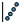
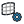

{!toolbar.md!}

# 02 Outdoor
<h4 id="main-components">Main Components</h4>

    <a href="/components/Atmospheric_Boundary_Layer/" style="text-decoration: none;">
        

            

                 Atmospheric Boundary Layer
            

            
Define atmospheric boundary layer inflow conditions for Eddy3D.

        

    </a>
    <a href="/components/Manual_Inflow_Profile/" style="text-decoration: none;">
        

            

                 Manual Inflow Profile
            

            
Define inflow boundary conditions from a manually entered vertical profile (z/zR, U/UR, k/UR^2) instead of the parametric ABL log-law. Writes fixedProfile inlet conditions for U, k and epsilon. epsilon is derived from the profile as epsilon(z) = Cmu^0.5 * k(z) * d(U)/dz.

        

    </a>
    <a href="/components/Uniform_Flow/" style="text-decoration: none;">
        

            

                 Uniform Flow
            

            
Create a uniform (constant velocity) inflow boundary condition for Eddy3D.

        

    </a>
    <a href="/components/Wind_Conditions/" style="text-decoration: none;">
        

            

                 Wind Conditions
            

            
Bin a year of EPW wind into direction sectors — frequency, speed histogram, mean speed and a Weibull fit per sector — with the station's origin (provider, id, period, coordinates, elevation) and the site's location in one record. Optionally transfers the station's speeds to the site's terrain per EN 1991-1-4 (the anemometer stands in open country; the site does not). Wire the record into the ABL component's Wind Directions: it supplies directions AND speeds, travels into the study manifest and the Study Report, and lets VAF scale the hourly series by the same factor.

        

    </a>
    <a href="/components/Cell_Size/" style="text-decoration: none;">
        

            

                 Cell Size
            

            
Compute the snappyHexMesh refinement level needed to reach a target cell size (each level halves the cell size).

        

    </a>
    <a href="/components/Cylinder_Domain/" style="text-decoration: none;">
        

            

                 Cylinder Domain
            

            
Define a cylindrical simulation domain for Eddy3D. One cylindrical mesh serves all wind directions; the cylinder side faces switch between inlet and outlet per direction. The auto radius and height size the domain under the blockage limits of ASCE/SEI CWE Prestandard AC 6-8b (to 2% frontal, 16% lateral and vertical, against limits of 3/17/17%), which the case component verifies. Model surrounding buildings within ~240 m of the study area (ASCE 49 proximity guidance) before trusting results near the context edge. Method: Kastner & Dogan (2020), Journal of Building Performance Simulation 13(1):59-68, doi:10.1080/19401493.2019.1692906; Kastner & Dogan (2018), eSim 2018 (IBPSA-Canada), Montréal, https://www.researchgate.net/publication/325023244_Streamlining_meshing_methodologies_for_annual_urban_CFD_simulations.

        

    </a>
    <a href="/components/Height_Bands/" style="text-decoration: none;">
        

            

                 Height Bands
            

            
Refine the mesh in BANDS OF HEIGHT above the ground — level 3 within 4 m, level 2 within 10 m, level 1 within 24 m — everywhere on the site, not only near buildings. This is how the pedestrian layer gets resolved across open plazas and streets that no building refinement reaches. The bands follow the case's ground surfaces (terrain, ground ring and roughness zones), so on a sloped site they stay the same height above the ground; only a meshing dict with no ground surface gets the flat disk Centre and Radius describe. Wire Extras into the case component's Extras input beside any Refinement Region.

        

    </a>
    <a href="/components/Mesh_Settings/" style="text-decoration: none;">
        

            

                 Mesh Settings
            

            
Configure mesh refinement, layers, and grading for Eddy3D.

        

    </a>
    <a href="/components/Refinement_Region/" style="text-decoration: none;">
        

            

                 Refinement Region
            

            
Define a custom snappyHexMesh refinement region (a box, solid or surface) — refines the cells inside/near the geometry to the chosen level. Wire Extras into a case component so the region is written every time the case is written; or wire a written Case in and press Apply to edit the dictionaries in place (which a later re-write undoes).

        

    </a>
    <a href="/components/Brep_Grid_Points/" style="text-decoration: none;">
        

            

                 Brep Grid Points
            

            
Generate centered surface samples on the actual faces of Brep, surface, or mesh geometry.

        

    </a>
    <a href="/components/Data_Coverage/" style="text-decoration: none;">
        

            

                 Data Coverage
            

            
What Eddy3D can fetch for a site before anything is fetched: one line per layer — buildings, roof shapes, terrain, fine terrain, point cloud, tree crowns, land cover, climate, natural hazards — with its provider, detail, licence and whether it covers this site. Worldwide providers always do; LiDAR (AHN in the Netherlands, USGS 3DEP in the United States) by position; the weather catalogue by its nearest station. Use it to plan the site model and see where you will have to bring your own data (a LAS/LAZ file, a survey, an EPW).

        

    </a>
    <a href="/components/Ground_Roughness/" style="text-decoration: none;">
        

            

                 Ground Roughness
            

            
Assign a multi-face ground plate to the wind tunnel: each face gets its own aerodynamic roughness length z0 and becomes its own ground patch (nutkAtmRoughWallFunction). Feed into the wind case component's Ground Roughness input.

        

    </a>
    <a href="/components/Pollutant_Source/" style="text-decoration: none;">
        

            

                 Pollutant Source
            

            
Define a pollutant emission source for the wind study: a closed volume (stack tip, traffic corridor box, exhaust vent) releasing a named species at a mass rate. Wire into the Eddy3D Case component's Sources input; the species is transported as a passive scalar with turbulent diffusivity (Sct) on every direction case, and the concentration field (kg/m3) is read back by probing the species name.

        

    </a>
    <a href="/components/Tree/" style="text-decoration: none;">
        

            

                 Tree
            

            
Represents a tree as a porous zone for wind blocking (Darcy-Forchheimer). Feed into the wind case component. Method: Kastner & Dogan (2022), Building and Environment 212:108639, doi:10.1016/j.buildenv.2021.108639.

        

    </a>
    <a href="/components/Custom_Function_Object/" style="text-decoration: none;">
        

            

                 Custom Function Object
            

            
Define a custom OpenFOAM function object the solver runs at runtime — fieldAverage, yPlus, wallShearStress, forces, surfaceFieldValue, a coded FO, etc. Wire Extras into a case component so it is written every time the case is written; or wire a written Case in and press Apply to edit controlDict in place (which a later re-write undoes).

        

    </a>
    <a href="/components/Outdoor_Case/" style="text-decoration: none;">
        

            

                 Outdoor Case
            

            
Create, write, and manage an Eddy3D outdoor wind simulation case. Method: Kastner & Dogan (2022), Building and Environment 212:108639, doi:10.1016/j.buildenv.2021.108639; Kastner & Dogan (2020), Journal of Building Performance Simulation 13(1):59-68, doi:10.1080/19401493.2019.1692906.

        

    </a>
    <a href="/components/Run_Settings/" style="text-decoration: none;">
        

            

                 Run Settings
            

            
Configure solver run controls for Eddy3D. PIMPLE (transient) writes Co below 1, three pressure correctors, turbulence on every outer corrector and unbounded convection. Method: Wolf Dynamics (2021), OpenFOAM advanced training, online session, July 2021 GT-79, GT-97, GT-100, https://www.wolfdynamics.com/training/turbulence/OF2021/turbulence_20221_OF8_guided_tutorials.pdf.

        

    </a>
    <a href="/components/Remote_Run/" style="text-decoration: none;">
        

            

                 Remote Run
            

            
Run a written wind study on another machine over SSH (a workstation, server or cloud VM with Eddy3D's CLI and a container engine). Submit packages the study's static part, copies it to <Remote Folder>/<study>-<time> under the remote home and starts `E3D run` detached; while it runs the component polls every minute and shows each direction's convergence; Fetch copies the solved study back over the local one. SSH uses key login only and never prompts: connect once in a terminal first. The remote must be Linux, macOS or WSL.

        

    </a>
    <a href="/components/Run/" style="text-decoration: none;">
        

            

                 Run
            

            
Mesh and run an OpenFOAM case on the selected engine (wind / indoor / UMF).

        

    </a>
    <a href="/components/SLURM_Runner/" style="text-decoration: none;">
        

            

                 SLURM Runner
            

            
Write SLURM batch (sbatch) files to run a wind study on an HPC cluster.

        

    </a>
    <a href="/components/Write_Run_Scripts/" style="text-decoration: none;">
        

            

                 Write Run Scripts
            

            
Writes meshing and simulation scripts (.bat / .sh) into a Scripts/ folder under the wind study, so the workflow can be launched manually outside Grasshopper. The scripts match what the Run component executes. Write the study to disk first (Wind Case 'Write').

        

    </a>

