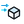

{!toolbar.md!}

# 04 Indoor
<h4 id="main-components">Main Components</h4>

    <a href="/components/Facade_Wind_Pressure/" style="text-decoration: none;">
        

            

                 Facade Wind Pressure
            

            
External wind pressure on a facade per EN 1991-1-4, and the opening flow it drives.

        

    </a>
    <a href="/components/Indoor_Case/" style="text-decoration: none;">
        

            

                 Indoor Case
            

            
Build an indoor ventilation case (room + inlets + outlets + sinks + sources) for OpenFOAM 12. Isothermal by default. Wiring a Wall Temp, an Indoor Wall with a temperature or heat load, or a Heat Source switches it to the buoyant solver (foamRun -solver fluid: gravity, an energy equation and a temperature-dependent density), so temperature differences drive the flow — plumes, downdraughts, stratification, stack effect. The solve is steady unless Transient gives the buoyant solver a duration to integrate over; Write Interval sets how often it keeps a snapshot, uniformly or dense-then-sparse. Steady or transient, the solve runs on every core but one when Wind Run's Parallel is on. Method: De Simone, Kastner & Dogan (2021), Building Simulation 2021, Bruges, doi:10.26868/25222708.2021.30632.

        

    </a>
    <a href="/components/Occupant_CO2/" style="text-decoration: none;">
        

            

                 Occupant CO2
            

            
CO2 generation rate of one occupant by age, activity and sex (Persily & de Jonge 2017).

        

    </a>
    <a href="/components/Window_Air_Exchange/" style="text-decoration: none;">
        

            

                 Window Air Exchange
            

            
Air exchange through an open window (Maas 1995) and the steady-state CO2 it supports.

        

    </a>
    <a href="/components/Indoor_Inlet/" style="text-decoration: none;">
        

            

                 Indoor Inlet
            

            
Ventilation inlet — defines where air enters the room (diffuser, window, door). The case imposes the supply as a FLOW RATE on the opening's own patch: Flow Rate when given, else Speed × the surface's drawn area, so the requested air arrives whatever the mesh resolves of the opening. The air enters perpendicular to the surface, into the room, whichever way the surface faces.

        

    </a>
    <a href="/components/Indoor_Outlet/" style="text-decoration: none;">
        

            

                 Indoor Outlet
            

            
Ventilation outlet — defines where air exhausts from the room (return grille, open window).

        

    </a>
    <a href="/components/Indoor_Wall/" style="text-decoration: none;">
        

            

                 Indoor Wall
            

            
Set an indoor wall temperature (°C). Wire a room surface to give just that surface its own temperature patch; leave it empty for a single case-wide wall temperature.

        

    </a>
    <a href="/components/Manikin/" style="text-decoration: none;">
        

            

                 Manikin
            

            
A breathing occupant (LOD-0 body with a separate mouth patch) for the Indoor Species Case.

        

    </a>
    <a href="/components/CO2_Emitter/" style="text-decoration: none;">
        

            

                 CO2 Emitter
            

            
A CO2 passive-scalar source box for an indoor ventilation case.

        

    </a>
    <a href="/components/Heat_Source/" style="text-decoration: none;">
        

            

                 Heat Source
            

            
A volumetric heat source box for an indoor ventilation case. Wiring one switches Indoor Case to the buoyant solver, so the heat drives the flow (a rising plume, stratification) rather than riding along as a passive scalar.

        

    </a>
    <a href="/components/Indoor_Sink/" style="text-decoration: none;">
        

            

                 Indoor Sink
            

            
A Darcy-Forchheimer momentum sink (filter/screen) box for an indoor ventilation case.

        

    </a>
    <a href="/components/Momentum_Source/" style="text-decoration: none;">
        

            

                 Momentum Source
            

            
A fan/jet momentum source (mean velocity) box for an indoor ventilation case.

        

    </a>
    <a href="/components/Viral_Emitter/" style="text-decoration: none;">
        

            

                 Viral Emitter
            

            
An airborne-pathogen passive-scalar source box for an indoor ventilation case. Method: De Simone, Kastner & Dogan (2021), Building Simulation 2021, Bruges, doi:10.26868/25222708.2021.30632.

        

    </a>
    <a href="/components/Indoor_Species_Case/" style="text-decoration: none;">
        

            

                 Indoor Species Case
            

            
Build a CO2 species case (OpenFOAM 12 multicomponentFluid) with a breathing manikin.

        

    </a>
    <a href="/components/CO2_Air_Quality/" style="text-decoration: none;">
        

            

                 CO2 Air Quality
            

            
Grade indoor CO2 (ppm) against EN 16798-1 or another CO2-based IAQ standard.

        

    </a>
    <a href="/components/Sleep_Comfort/" style="text-decoration: none;">
        

            

                 Sleep Comfort
            

            
Sleep-adapted Gagge two-node model (Yan et al. 2022) for bedrooms.

        

    </a>
    <a href="/components/Two-Node_Comfort/" style="text-decoration: none;">
        

            

                 Two-Node Comfort
            

            
Gagge two-node thermal comfort: SET, ET, PMV, TSENS and DISC.

        

    </a>
    <a href="/components/Indoor_Comfort_Map/" style="text-decoration: none;">
        

            

                 Indoor Comfort Map
            

            
Per-point thermal comfort from probed indoor CFD fields: PMV/PPD (EN ISO 7730), operative temperature, ISO 7730 draught rate (from k when probed, else Tu = 40 %), head-to-ankle temperature difference (ISO 7730 PD and ASHRAE 55 PPD), ADPI (ASHRAE 113, cooling) and the share of points meeting ISO 7730 categories A/B/C, EN 16798-1 I-IV and ASHRAE 55. Probe the same points for T, U, k (and T again at head and ankle height). Temperatures in kelvin — what OpenFOAM writes — are converted automatically. Not assessed: radiant asymmetry, floor temperature, and ASHRAE 55's SET method for points above 0.2 m/s (reported separately). Formulas pinned against pythermalcomfort (Tartarini & Schiavon 2020) and ISO 7730 Annex D.

        

    </a>
    <a href="/components/Infection_Risk/" style="text-decoration: none;">
        

            

                 Infection Risk
            

            
Airborne infection risk by the Wells–Riley model, and the ASHRAE 241-2023 equivalent clean airflow check. Well-mixed: P = 1 − exp(−dose), with the room concentration rising from zero under outdoor air + air cleaning + deposition (0.24 /h) + viral inactivation (0.63 /h) (Buonanno, Stabile & Morawska 2020). Spatial: the Indoor Case's viral tracer, probed at the breathing zone, rescaled to quanta/m³ by what the case measured leaving the room (Exhaust Tracer × Carried Flow), or — without those — by the Viral Emitter's rate × MESHED zone volume; given both, the second cross-checks the first. Ventilation-only, as the CFD removes nothing else. The case writes the tracer per m³ of air, the carried flow in m³/s and each emitter's meshed zone volume on both the isothermal and the buoyant path, so the same wiring holds for both — wire a FINISHED solve: the cross-check tests the inputs, not convergence. ASHRAE 241: Table 5-1's ECAi per person × occupants (×2 for group vocalization, §5.1.3) against the achieved outdoor air + air cleaning (Eq. 6-1; in-duct cleaning = recirculated flow × single-pass efficiency, Eq. 7-1). CAVEATS: quanta emission rates are uncertain by orders of magnitude and depend on activity (breathing, speaking, singing) — compare designs rather than quote absolute risks; Wells–Riley covers long-range airborne transmission only; ASHRAE 241 also requires a building readiness plan and tested equipment, which this check does not cover.

        

    </a>
    <a href="/components/Ventilation_Effectiveness/" style="text-decoration: none;">
        

            

                 Ventilation Effectiveness
            

            
How well the supply reaches the occupants, from a solved Indoor case. Turn on Age of Air on the Indoor Case, probe 'age' (seconds) at the occupied points, give the room volume, and wire what the case wrote under postProcessing/ through Read Results: the flow it carried (Dataset exhaustFlow, m³/s on both the isothermal and the buoyant path), the flux-weighted exhaust age (exhaustAge) and, for a tracer, its flux-weighted exhaust value (exhaustCO2 / exhaustViral). Returns the nominal time constant τn = V/Q, the local air-change index εp = τref/τp per point, the air-change efficiency εa = τref/(2⟨τ⟩) (50 % mixing, 100 % piston; REHVA Guidebook 2, Mundt et al. 2004), ASHRAE 129's air change effectiveness E = τref/⟨τ⟩ over the breathing zone, and — from a probed tracer (CO2, viral) with its exhaust value — the contaminant removal effectiveness εc = (Ce − Cs)/(⟨C⟩ − Cs). τref is the exhaust age τe when it is wired, else τn: the Indoor case keeps the age function object's turbulent diffusion on (without it the ages follow the mesh), and with age fixed at 0 on the supply age can diffuse out through the supply opening. The isothermal case derives its supply turbulence from the opening and balances (τe/τn 0.999); the buoyant path keeps the template's fixed supply turbulence and leaks — every age reads low, τe/τn 0.891 on the 300 W reference room, 0.797 on the isothermal room at 0.15 m/s with that turbulence. τe carries the same leak, so the indices referenced to it land within a few percent of a leak-free supply (measured down to τe/τn 0.745), where V/Q-referenced ones read 27–32 % high at 0.797 (enough to move E across 1). The Exhaust Check output is τe/τn: 1.00 for pure advection, below 1 by the leak; outside the range a converged field with the case's volume and carried flow can give, E, εa and εp are WITHHELD (an Error names why) — referenced to τe they would look plausible whatever state the age field is in. Point means are volume means only on a uniform grid.

        

    </a>

