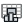

{!toolbar.md!}

# 07 Post
<h4 id="main-components">Main Components</h4>

    <a href="/components/Deconstruct_Case/" style="text-decoration: none;">
        

            

                 Deconstruct Case
            

            
Inspect any Eddy3D case: Outdoor wind study, Indoor case, or OutdoorPlus (UMF) case.

        

    </a>
    <a href="/components/Load_Wind_Case/" style="text-decoration: none;">
        

            

                 Load Wind Case
            

            
Reference an existing wind case folder (mesh/ + case_NNN) for post-processing.

        

    </a>
    <a href="/components/Probe/" style="text-decoration: none;">
        

            

                 Probe
            

            
Sample fields at points on a solved case, post-hoc. With Run it writes a probes function and runs postProcess on the requested Time (latest by default), then reads the results; without Run it reads existing results. Works on a wind case (one sub-result per direction) or a loaded case.

        

    </a>
    <a href="/components/Streamlines/" style="text-decoration: none;">
        

            

                 Streamlines
            

            
Extract solver-side streamlines from a solved case with OpenFOAM's streamlines function object (particles tracked through the actual mesh — accurate in refined near-building cells, unlike tracing a probed field). With Run it writes the function-object dict and runs postProcess on the requested Time, then reads the tracks; without Run it reads existing tracks.

        

    </a>
    <a href="/components/Airflow_Network_Cp/" style="text-decoration: none;">
        

            

                 Airflow Network Cp
            

            
Export probed facade pressure coefficients into the EnergyPlus AirflowNetwork as an .idf snippet: WindPressureCoefficientArray (the simulated directions), per-node WindPressureCoefficientValues and ExternalNode objects, ready to paste/merge into a Ladybug Tools (or hand-built) AirflowNetwork model. Enable Pressure Coefficient in Run Settings, probe the Cp field at facade points, and wire the probe tree here. Method: Dogan & Kastner (2021), Building Simulation 14(4):1189-1200, doi:10.1007/s12273-020-0727-x; Dogan & Kastner (2018), IBPC 2018, Syracuse NY 1139-1144, doi:10.14305/ibpc.2018.ms-5.05.

        

    </a>
    <a href="/components/Analysis_Results/" style="text-decoration: none;">
        

            

                 Analysis Results
            

            
Reads any Eddy3D result object as points and values: an annual wind field or VAF, an MRT, UTCI or PET result, a surface temperature, shadow or daily-light-integral result, a noise result or a stormwater run. One branch per field, with the analysis, the quantity and the unit beside it, so one definition can colour, filter or compare any of them, and it updates when the analysis re-runs.  A result that is a series over hours is reduced to its mean per point (stormwater: the peak); use the result's own Deconstruct component to pick hours or a statistic.

        

    </a>
    <a href="/components/Deconstruct_Wind/" style="text-decoration: none;">
        

            

                 Deconstruct Wind
            

            
Probe-specific statistics, per-hour values, a colored probe mesh and an inline legend from an annual wind field or Annual VAF object, without putting the full 8760-hour year on the canvas.

        

    </a>
    <a href="/components/Flow_Rates/" style="text-decoration: none;">
        

            

                 Flow Rates
            

            
Compute volumetric flow rates (m³/s) across a mesh, treating its vertices as velocity probes. Per face: average vertex velocities × face area × cos(angle to face normal).

        

    </a>
    <a href="/components/Velocity_Amplification_Factors_VAF/" style="text-decoration: none;">
        

            

                 Velocity Amplification Factors VAF
            

            
Compute Velocity Amplification Factors (VAF) and annual wind speed at probes from CFD or ML wind-prediction results and EPW weather data. VAF (the term used in the wind-engineering literature for what Eddy3D historically called "wind factors") is the local wind speed normalized by the reference speed. Method: Kastner & Dogan (2022), Building and Environment 212:108639, doi:10.1016/j.buildenv.2021.108639; Kastner & Dogan (2019), Building Simulation 2019, Rome 621-628, doi:10.26868/25222708.2019.210458.

        

    </a>
    <a href="/components/Create_Mesh/" style="text-decoration: none;">
        

            

                 Create Mesh
            

            
Create a visualization mesh from polyMesh point/face data. OutdoorPlus

        

    </a>
    <a href="/components/Cull_Ground_Mesh/" style="text-decoration: none;">
        

            

                 Cull Ground Mesh
            

            
Cut building footprints out of a ground mesh to make an analysis ground mesh. The ground is quad-remeshed to Target Face Count (or taken as wired when that is 0), then every vertex under a building is removed together with the faces that use it.

        

    </a>
    <a href="/components/Flex_Legend/" style="text-decoration: none;">
        

            

                 Flex Legend
            

            
Create a metric-aware color legend and an optional colored mesh from point/value samples. Supports wind, solar, sun-hours, temperature and other environmental data.

        

    </a>
    <a href="/components/Read_Cells/" style="text-decoration: none;">
        

            

                 Read Cells
            

            
Read cell connectivity and cell zones for a region. OutdoorPlus

        

    </a>
    <a href="/components/Scalar_Field_Viewer/" style="text-decoration: none;">
        

            

                 Scalar Field Viewer
            

            
Visualize a probed scalar field — CO2, temperature, age of air, Cp, pressure — as a colored point cloud, a heatmap mesh, or a translucent volumetric cloud. Feed the Probe component's points and one value per point. For velocity, use the Vector Field Viewer.

        

    </a>
    <a href="/components/Vector_Field_Viewer/" style="text-decoration: none;">
        

            

                 Vector Field Viewer
            

            
Visualize a probed vector field: colored velocity arrows, a point cloud, a heatmap mesh, streamlines, volumetric smoke, a streamline map (speed heatmap under black arrowed streamlines) or LIC (the heatmap under thin white strands gliding with the flow); pick via Display Mode. Feed the Probe component's points + velocity vectors (Field = U), or any points + vectors. For a field without direction — CO2, temperature, age of air, Cp — use the Scalar Field Viewer.

        

    </a>
    <a href="/components/Create_OBJ/" style="text-decoration: none;">
        

            

                 Create OBJ
            

            
Export an OBJ mesh from a polyMesh description. OutdoorPlus

        

    </a>
    <a href="/components/Export_to_Visualizer/" style="text-decoration: none;">
        

            

                 Export to Visualizer
            

            
Write probed wind results as a CSV for the Eddy3D Visualizer (https://viz.eddy3d.com/): columns X, Y, Z_relative, U_at_z, mag_U, U_x, U_y, U_z — one row per probe point. Upload the file at https://viz.eddy3d.com/ to view the 3D field, coloured by velocity magnitude, with the vector components powering the viewer's particle-flow overlay.

        

    </a>
    <a href="/components/Open_In_ParaView/" style="text-decoration: none;">
        

            

                 Open In ParaView
            

            
Open a wind case's direction cases in ParaView. All directions are added to the ParaView pipeline browser; click Apply on the ones you want to load (nothing is loaded automatically).

        

    </a>
    <a href="/components/Share_Pack/" style="text-decoration: none;">
        

            

                 Share Pack
            

            
Write results as files anyone can open without Rhino: ONE self-contained HTML viewer (top-down map with pan/zoom and an orbiting 3D view, sets and layers, legend, hover readout, KPI tables, wind rose, swipe and difference comparison between sets, print to PDF — works offline from the file), glTF binaries (.glb, one per layer, for web/VR/AR viewers), float32 GeoTIFFs (UTM when the site latitude/longitude is given), a PDF report and slide-ready PNGs. Wire one Values branch per layer over the Points (or a Mesh with per-vertex or per-face values). Every file states that the results were computed by the solver and that Eddy3D is the front end.

        

    </a>
    <a href="/components/Site_Report/" style="text-decoration: none;">
        

            

                 Site Report
            

            
Write a client-ready PDF site report from a weather file and the Rhino viewports: climate key statistics, wind rose and Weibull, climograph, psychrometric chart, hour-by-day year charts of solar radiation, wind speed and UTCI, the weather-only comfort scenarios (no sun / no wind / full protection), captured views, methodology and glossary, plus the natural-hazard record around the station (earthquakes from USGS, storms, floods, wildfires, volcanoes and landslides from NASA EONET, tsunami run-ups from NOAA NCEI; Hazards switches it off). Every sentence is assembled from the measured numbers by fixed rules. Results from other components that implement the report seam add their own chapters.

        

    </a>
    <a href="/components/CheckMesh/" style="text-decoration: none;">
        

            

                 CheckMesh
            

            
Run the OpenFOAM checkMesh command for a case region. OutdoorPlus

        

    </a>
    <a href="/components/Face_Warnings/" style="text-decoration: none;">
        

            

                 Face Warnings
            

            
Visualize faces that fail tet decomposition during topoSet. OutdoorPlus

        

    </a>
    <a href="/components/Live_Residuals/" style="text-decoration: none;">
        

            

                 Live Residuals
            

            
Draws a case's residual convergence directly on the Grasshopper canvas, with lightweight timed updates. Wire the case and toggle 'Live' to monitor a running simulation without an external plotter window. When a warm-up ramp is enabled the solver restarts mid-run and writes a separate residual file per phase; all phases are stitched into one continuous curve so you see the full history (warm-up + main), not just the latest phase. An Outdoor+ (UMF) case solves its air region to convergence inside each time step, so its curve counts fluid iterations and the strip reads 'step 3/24 · iter 51'.

        

    </a>
    <a href="/components/Meshing_Progress/" style="text-decoration: none;">
        

            

                 Meshing Progress
            

            
Monitor blockMesh, surfaceFeatures, and snappyHexMesh progress from the mesh case logs.

        

    </a>
    <a href="/components/Parse_Case_Logs/" style="text-decoration: none;">
        

            

                 Parse Case Logs
            

            
Parses log files in a case folder and reports any FOAM errors. OutdoorPlus

        

    </a>
    <a href="/components/Plot_Residuals/" style="text-decoration: none;">
        

            

                 Plot Residuals
            

            
Open the web-based residual plotter for a wind case's convergence history (one trace per direction).

        

    </a>
    <a href="/components/Read_Results/" style="text-decoration: none;">
        

            

                 Read Results
            

            
Read what a case's function objects wrote under postProcessing/ — forces, force coefficients, y+, flow rates, volume/surface field values, probe histories, sampled profiles — as columns of numbers, with per-column statistics. One grammar reads every tabular file OpenFOAM writes there, including function objects Eddy3D has never heard of. Restart slices of a time series are stitched with the later run winning; a sampled profile is one snapshot per time.

        

    </a>
    <a href="/components/Read_checkMesh/" style="text-decoration: none;">
        

            

                 Read checkMesh
            

            
Read and visualize sets produced by checkMesh. OutdoorPlus

        

    </a>
    <a href="/components/Ponding_Report/" style="text-decoration: none;">
        

            

                 Ponding Report
            

            
One row per puddle: where it is, how much water, how deep, when it peaked and how long it took to drain — against the capacity of the hollow it sits in, so an overflowing depression is visible as such.

        

    </a>
    <a href="/components/Study_Report/" style="text-decoration: none;">
        

            

                 Study Report
            

            
Generate a Markdown report documenting the wind case to the QA discipline of the ASCE/SEI CWE Prestandard (within its steady-RANS pedestrian-comfort allowance): solver and OpenFOAM version, domain and blockage, boundary conditions, numerics and the 2nd-order verdict, mesh quality, convergence, y+, Reynolds, an optional comfort section, limitations, and a compliance summary table. Optionally a scheme comparison (Wind Comfort Compare) and a planning authority's CFD-method checklist with its submission outline (City of London 2019).

        

    </a>
    <a href="/components/Sun_Report/" style="text-decoration: none;">
        

            

                 Sun Report
            

            
Assemble the Sunlight-results chapter for the Site Report from per-date sun results: wire one Sun Hours, Solar Irradiation and Shadow per report date (equinox, summer and winter solstice — the Date dropdown on each), one branch per date, and connect Report to Site Report's Results. Per date: the share of points per band of sun hours, per bin of kWh/m² and per shade pattern (sun all day, morning shade, afternoon shade, shade all day); then the % of the grid in shade at 9, 12, 15 and 18 h across the dates.

        

    </a>
    <a href="/components/Ventilation_Comfort_Report/" style="text-decoration: none;">
        

            

                 Ventilation Comfort Report
            

            
One page per room: thermal comfort (EN ISO 7730 / EN 16798-1 category shares, ASHRAE 55, draught, stratification, ADPI), ventilation effectiveness (age of air, air change effectiveness, contaminant removal) and airborne infection risk (Wells–Riley) with the ASHRAE 241 equivalent-clean-airflow check — each number beside the reference it is read against, and the caveats that belong to it. Always outputs the Markdown and HTML text; Write saves <Room>.md and a self-contained <Room>.html (no external assets) into the Folder. Sections left unwired are reported as not evaluated.

        

    </a>

