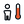

{!toolbar.md!}

# 08 Post Comfort
<h4 id="main-components">Main Components</h4>

    <a href="/components/PET_Simulation/" style="text-decoration: none;">
        

            

                 PET Simulation
            

            
Compute annual probe-specific PET (Höppe) from simulation outputs: MRT and wind-speed data trees, plus air temperature, relative humidity and the person. Solves in the background; cancel from the right-click menu. For a single point, use "Thermal Comfort".

        

    </a>
    <a href="/components/Thermal_Comfort/" style="text-decoration: none;">
        

            

                 Thermal Comfort
            

            
Compute a thermal comfort metric at a point: UTCI (Ta, RH, wind, MRT), PET (adds the personal inputs), NOAA Heat Index (Ta, RH only), outdoor WBGT (Ta, RH, wind at the subject, MRT: ISO 7243 outdoor weighting with the globe temperature derived from the MRT and Stull's wet bulb, as ECMWF thermofeel computes it; bands of the Japanese heat-stroke guideline) or SET* (the Gagge two-node Standard Effective Temperature with the MRT as the radiant field; adds activity and clothing), or Environment Canada's Humidex (Ta, RH) and Wind Chill (Ta, wind; the formula is calibrated on 10 m wind and defined from -50 to 0 °C), or SPMV (Standard Predicted Mean Vote: the EN ISO 7730 vote evaluated at the SET* of the same Ta, RH, wind, MRT, activity and clothing, so solar load and humidity enter through the two-node model). Pick the metric from the dropdown — the inputs adapt. Wire hourly lists (e.g. EPW series) to compute annual values.

        

    </a>
    <a href="/components/UTCI_Simulation/" style="text-decoration: none;">
        

            

                 UTCI Simulation
            

            
Compute annual probe-specific UTCI from simulation outputs: MRT and wind-speed data trees, plus air temperature and relative humidity. For a weather-only calculator, use "UTCI (Weather)". Method: Kastner & Dogan (2022), Building and Environment 212:108639, doi:10.1016/j.buildenv.2021.108639; Kastner & Dogan (2019), Building Simulation 2019, Rome 621-628, doi:10.26868/25222708.2019.210458.

        

    </a>
    <a href="/components/Deconstruct_UTCI/" style="text-decoration: none;">
        

            

                 Deconstruct UTCI
            

            
Probe-specific statistics and comfort hours/% from a UTCI or PET (Simulation) Result, without putting the full 8760-hour year on the canvas. Data only — wire the Result (or these outputs) into the Thermal Comfort Legend to draw a map.

        

    </a>
    <a href="/components/Pedestrian_Wind_Comfort/" style="text-decoration: none;">
        

            

                 Pedestrian Wind Comfort
            

            
Classifies pedestrian wind comfort per point from an annual hourly wind-speed series (the Wind Speed output of the Velocity Amplification Factors (VAF) component) against a comfort criterion (Lawson, Davenport, NEN8100). Returns the comfort category, class letter, and activity description for each point. Within about 1.5 building heights leeward of a building a steady-RANS comfort or safety verdict is OPTIMISTIC (too calm): on AIJ Cases A and B the solver reattaches at 1.3–1.5 H (Case B 3.27 H) against the tunnel's 0.38–0.75 H (Case B 1.88–2.62 H) and reads the 88 wake points at 0.30 U_H against the measured 0.451 (FB +0.29; above the roof +0.06). SST URANS and DES do not fix it (0.286 and 0.292 U_H).

        

    </a>
    <a href="/components/Wind_Comfort_Compare/" style="text-decoration: none;">
        

            

                 Wind Comfort Compare
            

            
Compares pedestrian wind comfort between schemes — existing (baseline), proposed and optionally mitigated — at the same probe points: per-probe class transition, change in exceedance hours, suitability for the intended use, the City of London significance grade (on-site / off-site receptor tables: negligible, moderate or major, beneficial or adverse, and whether mitigation is required), Wellington WIND-S2 (no increase in hours at or above 2.5 m/s against the existing scheme), and count- or area-weighted summaries. Probes are matched by position; the Comparison output feeds Study Report.

        

    </a>
    <a href="/components/Wind_Comfort_Criteria/" style="text-decoration: none;">
        

            

                 Wind Comfort Criteria
            

            
Builds a pedestrian wind-comfort criterion from lists — one class per item, best (most comfortable) first — so a jurisdiction's own standard can be classified without shipping code. Each class is a speed threshold, the share of the year it may be exceeded, an operator (< comfort class achieved when exceeded LESS than the share; > / >= hazard class tripped when exceeded MORE), and whether it reads the hourly mean or the 3-second gust. Wire the Criteria output into Pedestrian Wind Comfort or Study Report. Pick a Preset to start from a shipped table (e.g. Wellington) and edit it.

        

    </a>
    <a href="/components/Comfort_Hours/" style="text-decoration: none;">
        

            

                 Comfort Hours
            

            
Bin an hourly point-specific series (e.g. UTCI) into a comfort range or the UTCI thermal-stress categories, per analysis period, and report hours/percent in each band. Feed it a point-specific DataTree (e.g. the UTCI component's output) and, optionally, one Analysis Period per branch (see the Analysis Period / Analysis Period To Hours components); an unwired period covers the whole series as one implicit Annual period.

        

    </a>
    <a href="/components/Thermal_Comfort_Legend/" style="text-decoration: none;">
        

            

                 Thermal Comfort Legend
            

            
Color UTCI, PET, NOAA Heat Index, WBGT (Japanese heat-stroke guideline bands) or SET* temperatures by their thermal-stress categories, or a comfort share by its own bands, and create a matching legend.

        

    </a>
    <a href="/components/Comfort_Heat_Map/" style="text-decoration: none;">
        

            

                 Comfort Heat Map
            

            
365 × 24 heat maps of one probe's UTCI or PET — sun and wind, wind without sun, sun without wind, neither — from the same MRT, wind and weather inputs as UTCI (Simulation). Sun is removed by setting MRT to the air temperature and wind by holding 0.5 m/s, exactly as the Site Report's scenarios do. Export writes SVG, PDF and PNG.

        

    </a>
    <a href="/components/UTCI_Time_Plot/" style="text-decoration: none;">
        

            

                 UTCI Time Plot
            

            
Plots temperature series over time on the UTCI thermal-stress bands — UTCI of one or more design schemes, and any other temperature (MRT, air temperature) on the same axis. One branch per line. Only the stress bands the data reaches are drawn. Export writes SVG, PDF and PNG.

        

    </a>

