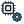
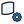

{!toolbar.md!}

# 10 LBM
<h4 id="main-components">Main Components</h4>

    <a href="/components/FluidX3D_Run_Settings/" style="text-decoration: none;">
        

            

                 FluidX3D Run Settings
            

            
Solver controls for the FluidX3D GPU engine (memory, simulated time, export interval, an interactive real-time window, and an optional fixed lattice spacing). Memory 0 = detected from this machine's GPU.

        

    </a>
    <a href="/components/LBM_Case/" style="text-decoration: none;">
        

            

                 LBM Case
            

            
Build a lattice-Boltzmann wind case from the ABL, the geometry and a settings object, and write it to disk. Wire 'LBM Run Settings' for OpenLB or 'FluidX3D Run Settings' for FluidX3D (nothing = OpenLB). Feed the Case output to LBM Run, then to Probe, LBM Field or FluidX3D Live View — the same Case → Run → Probe chain as the OpenFOAM wind study.

        

    </a>
    <a href="/components/LBM_Run/" style="text-decoration: none;">
        

            

                 LBM Run
            

            
Launch a lattice-Boltzmann case from the LBM Case component (OpenLB in a container or natively, or FluidX3D on the GPU — whichever the case was built with). Writes the case first if it has not been written, then starts the solver in a terminal window (untick 'Show solver window' in the right-click menu to run it in the background) and follows it: a progress bar with the time left, live warnings, and a refresh of everything downstream when the run moves on or finishes. A case already solving is followed, never started twice. Right-click to stop the run, list what is running on this machine, or open its log. Read results with Probe (points), LBM Field (the probe layer) or FluidX3D Live View.

        

    </a>
    <a href="/components/LBM_Run_Settings/" style="text-decoration: none;">
        

            

                 LBM Run Settings
            

            
Solver controls for the container-based LBM wind engine (grid spacing, warmup and averaging windows, probe layer, GPU, container runtime).

        

    </a>
    <a href="/components/FluidX3D_Live_View/" style="text-decoration: none;">
        

            

                 FluidX3D Live View
            

            
Watch a FluidX3D wind solve live in the viewport: colors an analysis mesh with the velocity magnitude of the newest frame while the GPU solver runs, updating as each frame lands. Source 'VTK frames' reads the exported frames (also the final field of a completed run); Source 'Live server' reads the solver's memory-mapped slice once a second (Run Settings → Live) and sends a changed Buildings mesh to the running solver.  Wire either the Run component's Case or Folder output into Case, and supply the mesh to read the wind on (e.g. a pedestrian-level plane).

        

    </a>
    <a href="/components/LBM_Field/" style="text-decoration: none;">
        

            

                 LBM Field
            

            
Read the time-averaged pedestrian wind field from an LBM case directory. Outputs world-frame points and velocity vectors — plug both into the Vector Field Viewer.

        

    </a>
    <a href="/components/LBM_Live_View/" style="text-decoration: none;">
        

            

                 LBM Live View
            

            
Watch an OpenLB wind solve live in the viewport: colors an analysis mesh with the wind speed of the newest probe snapshot while the solver runs, repainting as each snapshot lands. The solver writes the instantaneous field during warm-up, the running average after, and the final average at the end. Also shows the final field of a completed run.  Wire the LBM Run component's Case output into Case, and a mesh lying on the probe layer (the horizontal plane the solver samples: Probe Height on LBM Run Settings, 1.5 m above the ground by default) into Mesh. A vertex is read by interpolating the probes around it; vertices off the layer stay grey.  Record keeps every snapshot that lands (results/snapshots/), and Frame plays the recording back: -1 shows the newest snapshot, 0 the first recorded one. Animate a slider on Frame for a replay; Window Start/End show the MEAN over a frame range instead; Video renders every recorded frame through the active viewport into an MP4 (ffmpeg on PATH).

        

    </a>
    <a href="/components/Wind_Flowlines/" style="text-decoration: none;">
        

            

                 Wind Flowlines
            

            
Record wind flowlines through an LBM case's velocity frames (or a steady Points + Vectors field), save the recording in the case folder, and play it back. Each emitter releases particles evenly in time; when the wind direction turns past the restart angle the lines start again from the emitters. Playback restyles with Range and Thickness without re-tracing.

        

    </a>
    <a href="/components/Live_Wind_Tunnel/" style="text-decoration: none;">
        

            

                 Live Wind Tunnel
            

            
Sketch a site against the wind: a 2D lattice-Boltzmann wind tunnel that runs continuously and paints the flow into the viewport while you move buildings and probes. Nothing restarts when geometry moves.  For an urban block, cut the buildings at pedestrian height (Cut Height ≈ 1.75 m) and wire the ABL Flow the wind studies use into ABL: the tunnel then runs in that profile's speed at the cut, in its first wind direction.  A SKETCH tool: the site is a section through infinitely tall buildings (no flow over or under anything, no buoyancy), and the solver's viscosity floor runs it at a far lower Reynolds number than real air. Compare variants of a site layout with it, with Mean on (a single frame of a wake is gusty); take numbers you report from an OpenFOAM or LBM Case run.

        

    </a>

