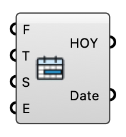

#  Analysis Period - [[source code]](https://github.com/Eddy3D-Dev/Eddy3D/search?q=%22Analysis%20Period%22)

Define an analysis period (from/to day of year, start/end hour of day) and output the hour-of-year indices it covers, for filtering annual results.

#### Input

| Name | Nickname | Description | Type |
| ---- | -------- | ----------- | ---- |
| From |  | From day of year [1-365]. An hour of year from Calendar or Hour of Year is read as the day it falls on. | `Integer` |
| To |  | To day of year [1-365]. An hour of year from Calendar or Hour of Year is read as the day it falls on. | `Integer` |
| Start |  | Start hour of day [1-24]. An hour of year from Calendar or Hour of Year is read as its hour of the day. | `Integer` |
| End |  | End hour of day [1-24]. An hour of year from Calendar or Hour of Year is read as its hour of the day. | `Integer` |

#### Output

| Name | Nickname | Description | Type |
| ---- | -------- | ----------- | ---- |
| Hours of Year | HOY | Hour-of-year indices in the period. | `Integer` |
| Date Times | Dates | The corresponding DateTime values. | `Generic Data` |