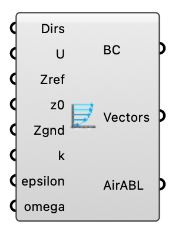

#  Atmospheric Boundary Layer - [[source code]](https://github.com/Eddy3D-Dev/Eddy3D/search?q=%22Atmospheric%20Boundary%20Layer%22)

Define atmospheric boundary layer inflow conditions for Eddy3D.

#### Input

| Name | Nickname | Description | Type |
| ---- | -------- | ----------- | ---- |
| Wind Directions | Dirs | Wind directions as meteorological degrees (wind-from, clockwise from north) or flow vectors. One solver case is created per direction. Optional; default is flow toward -Y (south). | `Generic Data` |
| Wind Speed | U | Wind speed at the reference height (m/s), one value per wind direction. A single value applies to all directions; a shorter list repeats its last value. Optional; default is 5. | `Number` |
| Reference Height | Zref | Reference height for wind speed (m). Optional; default is 10. | `Number` |
| Roughness Length (z0) | z0 | Aerodynamic roughness length (m). Higher values indicate rougher terrain. Optional; default is 1. | `Number` |
| Ground Height | Zgnd | zGround, the datum of the ABL log-law profile: the MODEL-SPACE elevation (m) of the ground the wind enters over — U is 0 at and below it. Leave it unwired and at 0 when the wind case has a Terrain: each wind direction then takes the ground along its own inlet (a Land Cover terrain is RELATIVE to the site, z = 0 at the site centre, so the rim is rarely at 0). Wire it, or type a non-zero value, to hold one value for every direction; without a terrain, the default is 0. | `Number` |
| Turbulent KE (k) | k | Inlet/initial turbulent kinetic energy k (m^2/s^2) for the ABL. Used by the k field and the turbulence transports; the inlet patch still uses the atmBoundaryLayer k profile. Optional; default is 0.015. | `Number` |
| Turbulent Epsilon (ε) | epsilon | Inlet/initial turbulent dissipation rate epsilon (m^2/s^3) for the k-epsilon family. The inlet patch still uses the atmBoundaryLayer epsilon profile. Optional; default is 0.135. | `Number` |
| Turbulent Omega (ω) | omega | Inlet/initial specific dissipation rate omega (1/s) for the k-omega SST model. Optional; default is 100. | `Number` |
| Terrain Type | Terrain | Upwind terrain class from the revised Davenport roughness classification (Davenport 1960; Wieringa 1992; Davenport, Grimmond, Oke & Wieringa 2000): 1 Sea 0.0002 m · 2 Smooth 0.005 m · 3 Open 0.03 m · 4 Roughly open 0.1 m · 5 Rough 0.25 m · 6 Very rough 0.5 m · 7 Skimming 1 m · 8 Chaotic 2 m; or a load-code category: EN 1991-1-4 Table 4.1 terrain 0/I/II/III/IV (0.003/0.01/0.05/0.3/1 m), ASCE 7-16 C26.7 exposure D/C/B (typical 0.005/0.02/0.3 m). Picking a class sets the roughness length z0 from the table (shown on the banner); Custom uses the Roughness Length input instead. Describe the terrain the wind CROSSES upwind of the site, not the site itself. | `Text` |
| z0 per Direction | z0 [m] | Optional roughness length z0 (m) PER WIND DIRECTION, aligned with Wind Directions. The terrain the wind crosses differs by sector — sea to the west, city to the east — and one z0 for all of them puts the wrong profile on most inlets. A single value applies to every direction; a shorter list repeats its last value. Leave empty to use Roughness Length / Terrain Type for all directions. Each direction case writes its own z0 into 0/ABLConditions (inlet profile AND ground wall function). | `Number` |
| Inlet Profile | Profile | The shape of the inflow. Log law (Richards & Hoxey): OpenFOAM's atmBoundaryLayer inlet, k constant with height — the default and what every earlier study used. Harris & Deaves (ESDU 01008): the strong-wind boundary layer of the UK National Annex to EN 1991-1-4, which the City of London Wind Microclimate Guidelines (2019) require — a gradient-height term on the mean speed and the measured strong-wind turbulence, written as fixedProfile tables for U, k (3/2·σu², so the gust Eddy3D reads from k is the Harris & Deaves gust) and epsilon. Each direction gets its own table from its own speed and z0. Either way the cases sample the profile approaching the model, so the Study Report plots simulated against target (as the guideline asks) and scores the ASCE CWE prestandard's ABL self-sustainment check (AC 5-9) on it. | `Text` |
| Latitude | Lat | Site latitude (degrees) for a Harris & Deaves inlet — its Coriolis parameter sets the gradient height. Optional: a Wind Conditions record on Wind Directions supplies its site's latitude, and with neither the City of London's 51.51° is used (and said). The profile is weakly sensitive to it: 10° moves U at 100 m by about 1 %. Ignored by the log law. | `Number` |
| Displacement Height | d | Displacement height d (m) for a Harris & Deaves inlet — the UK National Annex's h_dis for town terrain. Heights below it carry NO mean flow at the inlet, so keep 0 (the default) unless the approach fetch is meant to be a displaced urban surface. Ignored by the log law. | `Number` |

#### Output

| Name | Nickname | Description | Type |
| ---- | -------- | ----------- | ---- |
| Boundary Conditions | BC | Atmospheric boundary layer inflow boundary conditions (including the wind directions); plug into the wind case BC input, or into the Outdoor+ Air Region (which uses the first direction/speed because one Air Region represents one UMCF case). | `Generic Data` |
| Wind Vectors | Vectors | Resolved unit flow vectors, one per wind direction. | `Vector` |