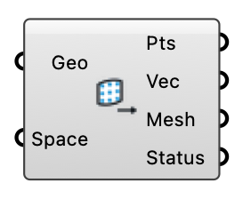

#  Brep Grid Points - [[source code]](https://github.com/Eddy3D-Dev/Eddy3D/search?q=%22Brep%20Grid%20Points%22)

Generate centered surface samples on the actual faces of Brep, surface, or mesh geometry.

#### Input

| Name | Nickname | Description | Type |
| ---- | -------- | ----------- | ---- |
| Geometry | Geo | Brep, surface, or mesh geometry to sample. | `Geometry` |
| Spacing | Space | Grid spacing in model units (meters). Optional; default is 10. | `Number` |

#### Output

| Name | Nickname | Description | Type |
| ---- | -------- | ----------- | ---- |
| Points | Pts | Centered sample points inside the actual input subsurfaces; never seeded on shared face edges. | `Point` |
| Vectors | Vec | Outward unit surface normals corresponding one-to-one with the grid points. | `Vector` |
| Mesh |  | Joined mesh representation of the sampled input geometry. | `Mesh` |
| Status |  | Status message or warnings. | `Text` |
| Cells |  | One square face per grid point, in the order of Points and lying in its surface: a mesh that takes one value per FACE, at the grid's own resolution. Wire it into Flex Legend's Analysis Mesh (or any viewer that colours faces) with the values computed at Points. Mesh is the sampled geometry and does not count the same. Past 500,000 points it is built only while this output is wired. | `Mesh` |