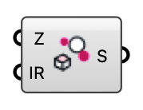

#  CO2 Emitter - [[source code]](https://github.com/Eddy3D-Dev/Eddy3D/search?q=%22CO2%20Emitter%22)

A CO2 passive-scalar source box for an indoor ventilation case.

#### Input

| Name | Nickname | Description | Type |
| ---- | -------- | ----------- | ---- |
| Zone | Z | Box zone occupied by the CO2 source. | `Box` |
| Injection Rate | IR | CO2 injection rate, SPECIFIC: per m³ of the zone per second (1/s). The case injects it into the cells whose CENTRES the box contains, so the tracer emitted is rate × the MESHED zone volume, not the drawn box — the case writes that volume (Read Results → CO2SourceVolume_0, one per emitter). | `Number` |

#### Output

| Name | Nickname | Description | Type |
| ---- | -------- | ----------- | ---- |
| Source | S | CO2 source for the Indoor Case component. | `Generic Data` |