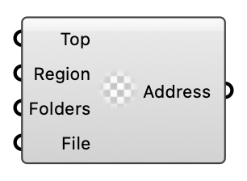

#  Create Address - [[source code]](https://github.com/Eddy3D-Dev/Eddy3D/search?q=%22Create%20Address%22)

Create a MetaFOAM Address for entries and settings.

#### Input

| Name | Nickname | Description | Type |
| ---- | -------- | ----------- | ---- |
| Top Folder | Top | Top folder index: 0=undefined, 1=root, 2=system, 3=constant, 4=zero. | `Integer` |
| Region |  | Region name. | `Text` |
| Middle Folders | Folders | Optional subfolders between region and file. | `Text` |
| File Name | File | Target file name. | `Text` |

#### Output

| Name | Nickname | Description | Type |
| ---- | -------- | ----------- | ---- |
| Address |  | Created address. | `Generic Data` |