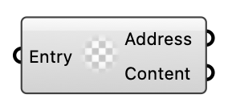

#  Deconstruct Entry - [[source code]](https://github.com/Eddy3D-Dev/Eddy3D/search?q=%22Deconstruct%20Entry%22)

Deconstructs an Entry instance.

#### Input

| Name | Nickname | Description | Type |
| ---- | -------- | ----------- | ---- |
| Entry |  | Entry to deconstruct. | `Generic Data` |

#### Output

| Name | Nickname | Description | Type |
| ---- | -------- | ----------- | ---- |
| Address |  | Entry address. | `Text` |
| Content |  | Content of the entry as key/value pairs. | `Text` |