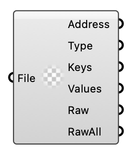

#  Deconstruct FileContainer - [[source code]](https://github.com/Eddy3D-Dev/Eddy3D/search?q=%22Deconstruct%20FileContainer%22)

Deconstructs a FileContainer instance.

#### Input

| Name | Nickname | Description | Type |
| ---- | -------- | ----------- | ---- |
| File Container | FC | FileContainer instance to deconstruct. | `Generic Data` |

#### Output

| Name | Nickname | Description | Type |
| ---- | -------- | ----------- | ---- |
| Address |  | File container address. | `Text` |
| File Type | Type | File container file type. | `Text` |
| Keys |  | File container keys. | `Generic Data` |
| Values |  | File container values. | `Generic Data` |
| Raw Content | Raw | Raw content of the file. | `Generic Data` |
| Total Raw Content | RawAll | Full raw content of the file. | `Generic Data` |