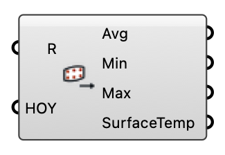

#  Deconstruct SurfaceTemp - [[source code]](https://github.com/Eddy3D-Dev/Eddy3D/search?q=%22Deconstruct%20SurfaceTemp%22)

Point-specific statistics (and optionally the raw hours) from a SurfaceTemp Result, without putting the full 8760-hour year on the canvas.

#### Input

| Name | Nickname | Description | Type |
| ---- | -------- | ----------- | ---- |
| Result | R | Result output of SurfaceTemp (FFT) — or an EnergyPlus run: the VF Model output of SurfaceTemp (EnergyPlus), the Result of MRT / MRT Solve run with EnergyPlus surface temperatures, or as text the path of its .eso file or MRT case folder. An EnergyPlus run gives one series per simulated surface (named on the Surfaces output); a run over part of the year keeps its true hours of the year. | `Generic Data` |
| HOY |  | Hour(s) of year (1-8760) to restrict to. Leave unconnected for the whole year. The statistics are reduced over exactly these hours, so a July-afternoon list gives the July-afternoon mean — no re-solve needed. An EnergyPlus run over part of the year is read at its true hours of the year (from the run period in its model); hours it did not simulate give nothing. | `Integer` |
| Points | Pts | For an EnergyPlus run: points to read the surface temperature AT, each taking the solved surface straight below it (MRT sensors stand a body height over the ground). Every output is then per point, in this order, with nothing where no solved surface lies under a point. Unwired, an MRT Result uses its own sensors; a VF Model or a path gives one value per surface. | `Point` |

#### Output

| Name | Nickname | Description | Type |
| ---- | -------- | ----------- | ---- |
| Mean | Avg | Mean surface temperature (°C) per analysis point over the selected hours — the annual average when HOY is unconnected. One value per point, in the SurfaceTemp component's point order. | `Number` |
| Min |  | Lowest surface temperature (°C) per analysis point over the selected hours. | `Number` |
| Max |  | Highest surface temperature (°C) per analysis point over the selected hours. | `Number` |
| SurfaceTemp |  | Surface temperature (°C) at each selected hour — one branch per HOY, each holding every point's value {hoy}(point count). Populated ONLY when HOY is connected; with HOY unconnected this would be the entire year, which is the tree this component exists to avoid. Note that a large HOY list is inherently expensive: every value asked for here becomes an object on the canvas. | `Number` |
| Surfaces |  | The surface each value belongs to when the Result is an EnergyPlus run: its key in the run (G_n ground, B_n building, V_n vegetation), in the order of the other outputs. Empty for a SurfaceTemp Result, whose values follow that component's points. | `Text` |
| Faces |  | The outline of each surface of an EnergyPlus run, in model coordinates and in the order of the other outputs (read from the .epJSON beside the .eso: the model that run solved). Where the surface is on the scene. A surface the model does not name gives a null; a SurfaceTemp Result gives none. | `Curve` |
| Polygon Mesh | PolyMesh | For the VF Model of SurfaceTemp (EnergyPlus): the scene's own polygons (the faces MRT Scene shows) that EnergyPlus solved, as one mesh. Wire it into Flex Legend's Analysis Mesh with Polygon Mean as Values. A polygon EnergyPlus left out (seen too little by the sensors, or too small) is not in it. | `Mesh` |
| Polygon Mean | PolyAvg | Mean surface temperature (°C) over the selected hours for each FACE of Polygon Mesh, in face order. The pieces of one split face are one EnergyPlus surface and share its value. | `Number` |