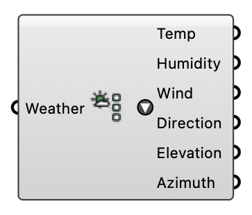

#  Deconstruct Weather - [[source code]](https://github.com/Eddy3D-Dev/Eddy3D/search?q=%22Deconstruct%20Weather%22)

Deconstruct a Weather object into hourly time series values. More outputs: zoom in and click + beside the outputs to pick any EPW column, derived series (solar angles, sun vector, absolute humidity) or monthly statistic; − removes one. OutdoorPlus

#### Input

| Name | Nickname | Description | Type |
| ---- | -------- | ----------- | ---- |
| Weather |  | Weather object, or an EPW file path (e.g. from Download Weather), to deconstruct. | `Generic Data` |
| Period |  | Slice of the year to output: Year (default), a season, or a single month. Every hourly output is cut to that period's hours, Hour of Year included, so the HOY list can drive UTCI, Sun Hours or any other HOY input for the same hours. Seasons are named by their months (Winter = Dec-Feb), so a southern-hemisphere EPW reads unambiguously. Header values (Latitude, Elevation, ...) are not hourly and are never cut. | `Text` |

#### Output

| Name | Nickname | Description | Type |
| ---- | -------- | ----------- | ---- |
| Dry Bulb Temperature | Temp | Hourly dry-bulb temperature (deg C). | `Number` |
| Relative Humidity | Humidity | Hourly relative humidity (%). | `Number` |
| Wind Speed | Wind | Hourly wind speed (m/s). | `Number` |
| Wind Direction | Direction | Hourly wind direction (deg clockwise from north; 0 means calm). | `Integer` |
| Solar Elevation | Elevation | Hourly solar elevation (deg above the horizon). Night hours are 0, not negative — the sun is either up or it is not, and downstream components read 0 as night. | `Number` |
| Solar Azimuth | Azimuth | Hourly solar azimuth (deg clockwise from north), aligned hour for hour with Solar Elevation. 0 at night, where azimuth is meaningless. | `Number` |
| Hour of Year | HOY | 0-based hour-of-year index, aligned with every other series — feed it to the HOY-driven components. | `Integer` |