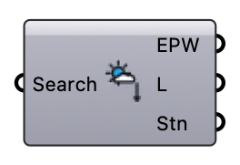

#  Download Weather - [[source code]](https://github.com/Eddy3D-Dev/Eddy3D/search?q=%22Download%20Weather%22)

Pick an EPW weather file from a bundled catalog of 60,867 climate files — every TMYx station on climate.onebuilding.org plus the EnergyPlus store (IWEC, TMY3, CWEC, SWERA, …) — with your own folders and Morph Weather results listed alongside them; its second list, Built for this site, holds the sources that build a file for your site (Open-Meteo, PVGIS, NASA POWER, Copernicus CDS, NSRDB). Click the Station widget and choose Weather file (catalog)… for a searchable table with a map, or type a name, WMO id or direct URL. The catalog is searched offline; only the chosen file is downloaded, once, into the weather cache. The catalog browser's unit setting (SI or Imperial) changes only what is displayed — the Message strip, the match list and the Info text; the EPW file and every number this component outputs stay SI, so wire them to other components as before.

#### Input

| Name | Nickname | Description | Type |
| ---- | -------- | ----------- | ---- |
| Station |  | Which climate file to use. Click the widget and choose Weather file (catalog)… to pick from the catalog with a map and a spec sheet; the value stored is the file's own name (e.g. DEU_BE_Berlin-Tempelhof.AP.103840_TMYx.2009-2023). A station name, WMO id, country or dataset year still works as a search — the best match nearest the site wins — and a direct EPW or ZIP URL is downloaded as-is. Choose Open-Meteo (ERA5) — or type Open-Meteo 2019 — to build a file for the SITE (wire Latitude/Longitude, or set the Earth Anchor Point) from ERA5 reanalysis: one actual year, last year unless one is given, on the 0.25° cell. The same menu builds PVGIS (a typical year), NASA POWER (an actual year, from 2001) and ERA5 via Copernicus CDS (an actual year with measured radiation; it needs your own free CDS token, in the ECMWF_DATASTORES_KEY environment variable or ~/.cdsapirc, and the dataset licence accepted on the CDS website) and NSRDB (GOES TMY, a typical year, or GOES aggregated, an actual year from 1998, both PSM v4 on a 4 km cell over the western hemisphere; a release of Eddy3D ships a shared NLR API key for it, which your own (a free key from developer.nlr.gov, with your name and email) replaces: NSRDB_API_KEY, NSRDB_FULL_NAME and NSRDB_EMAIL, or ~/.nsrdbrc). Credits: weather data by Open-Meteo.com (CC BY 4.0); PVGIS, European Commission Joint Research Centre; NASA Langley POWER Project; Copernicus Climate Change Service (ERA5); National Solar Radiation Database (NLR). Terms: THIRD-PARTY-NOTICES.md. | `Text` |
| Latitude | Lat | Site latitude in decimal degrees (north positive). With a site, the browser lists the nearest stations first, every row states its distance, and the map shows both. Optional, and only as a pair with Longitude: a lone latitude is not a site. Left empty, the document's Earth Anchor Point is the site when one is set; otherwise the catalog is listed in publisher order. | `Number` |
| Longitude | Lon | Site longitude in decimal degrees (east positive). See Latitude. | `Number` |
| Folders | Dirs | Extra folders of .epw files to list beside the online catalogs — a studio library, measured AMY years, or a Morph Weather output folder (whose files are labelled with their scenario and horizon). Scanned recursively; each file's own LOCATION header supplies its position. | `Text` |

#### Output

| Name | Nickname | Description | Type |
| ---- | -------- | ----------- | ---- |
| EPW File | EPW | Path to the downloaded EPW weather file. | `Text` |
| Logs | L | Execution log. | `Text` |
| Stations | Stn | The catalog entries that matched, nearest the site first. One line per file: name, dataset, source and distance. | `Text` |
| Station | S | What the chosen file is: station, period, publisher, WMO id, position, elevation, time zone, ASHRAE climate zone and the design conditions its publisher states. | `Text` |
| Extra Files | X | The .stat and .ddy files that came with the EPW, when the publisher ships them — design days and the climate summary. Empty for a file that has none. | `Text` |
| Site Latitude | Lat | Latitude of the SITE in decimal degrees (north positive): the Latitude/Longitude inputs when BOTH are given, else the document's Earth Anchor Point (which also replaces a half-given pair); empty when neither gives a full site — half a site is not a site. NOT the weather station's position — that is Deconstruct Weather's Latitude, and a station can sit tens of km from the site (an airfield, usually, whose open land cover is the wrong answer). Wire it into Land Cover Roughness's Latitude so land cover and terrain are fetched where the model is. Available as soon as the site is known, before any file is downloaded. | `Number` |
| Site Longitude | Lon | Longitude of the SITE in decimal degrees (east positive), from the same source as Site Latitude — never the weather station's. Wire it into Land Cover Roughness's Longitude. | `Number` |