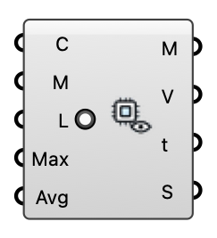

#  FluidX3D Live View - [[source code]](https://github.com/Eddy3D-Dev/Eddy3D/search?q=%22FluidX3D%20Live%20View%22)

Watch a FluidX3D wind solve live in the viewport: colors an analysis mesh with the velocity magnitude of the newest frame while the GPU solver runs, updating as each frame lands. Source 'VTK frames' reads the exported frames (also the final field of a completed run); Source 'Live server' reads the solver's memory-mapped slice once a second (Run Settings → Live) and sends a changed Buildings mesh to the running solver.  Wire either the Run component's Case or Folder output into Case, and supply the mesh to read the wind on (e.g. a pedestrian-level plane).

#### Input

| Name | Nickname | Description | Type |
| ---- | -------- | ----------- | ---- |
| Case | C | FluidX3D run — accepts either the Run component's Case (VTK) or Folder output. | `Text` |
| Mesh | M | Analysis mesh to color, sampled at its vertices. A flat mesh that dips below Live Height over terrain follows the ground at that height. | `Mesh` |
| Live | L | Keep watching the case for new frames and repaint as they land. | `Boolean` |
| Max Speed | Max | Top of the color scale in m/s. 0 = auto: grows with the largest speed seen this session, so colors stay comparable across frames instead of rescaling on every export. | `Number` |
| Avg Window | Avg | Trailing time-average window in simulated seconds (VTK frames only). 0 = show the newest frame as-is (instantaneous LES fields look gusty/patchy by nature); > 0 = average all exported frames within the last N simulated seconds, which converges toward the mean field the other engines report. Updates live as new frames land either way. | `Number` |
| Source | Src | Where the frames come from. 'VTK frames': the exported u-<step>.vtk files of a one-shot or interactive run (minutes apart on an integrated GPU). 'Live server': the memory-mapped slice of a run started with Live on Run Settings — a frame a second, one horizontal plane at Live Height, nothing written to disk. | `Text` |
| Buildings | B | Live server only: the buildings as they are NOW, in world coordinates (the same mesh LBM Run was given, moved or edited). Whenever it changes, the running solver re-voxelises it in place — the flow continues from where it was, no restart. Leave empty to keep the run's geometry. | `Mesh` |
| Appearance | Look | What the colours show. Velocity: wind speed in m/s against Max Speed. Speedup: wind speed divided by the case's ABL reference speed at reference height (the Run's u_ref), against Max Speedup — 1 is the undisturbed wind, above it the flow is accelerated. '+ LIC': the same colours with a line integral convolution of sparse noise over them — thin white strands gliding along the frame's velocity vectors (the window's mean when Avg Window is set). VTK frames only: the live server publishes speeds without a direction. | `Text` |
| Max Speedup | MaxSU | Top of the colour scale when Appearance is Speedup (0 = 1.5). | `Number` |
| Video |  | Render every exported VTK frame through the active Rhino viewport into <case>/video/live-view.mp4 (PNG frames stay beside it). Needs ffmpeg on PATH; the status says where to get it otherwise. | `Boolean` |

#### Output

| Name | Nickname | Description | Type |
| ---- | -------- | ----------- | ---- |
| Mesh | M | The analysis mesh, vertex-colored by velocity magnitude (bake to keep the colors). | `Mesh` |
| Speeds | V | Velocity magnitude per mesh vertex, m/s (aligned with the mesh's vertex order). | `Number` |
| Time | t | Physical time of the displayed frame, in simulated seconds. | `Number` |
| Status | S | Frame / watcher status. | `Text` |
| Histogram | Hist | Speed histogram of the displayed frame: 20 equal bins over 0-Max Speed, one line per bin, and the share of mesh vertices above 5 m/s. | `Text` |