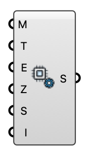

#  FluidX3D Run Settings - [[source code]](https://github.com/Eddy3D-Dev/Eddy3D/search?q=%22FluidX3D%20Run%20Settings%22)

Solver controls for the FluidX3D GPU engine (memory, simulated time, export interval, an interactive real-time window, and an optional fixed lattice spacing). Memory 0 = detected from this machine's GPU.

#### Input

| Name | Nickname | Description | Type |
| ---- | -------- | ----------- | ---- |
| Memory | M | GPU memory budget (MB), or 0 for auto. Auto detects this machine's GPU memory and takes 75% of a discrete card's VRAM / 30% of unified memory (Apple Silicon, integrated), and says so in a Remark. With Grid Spacing set this is only a cap; with Grid Spacing 0 it SIZES the lattice, so a big auto budget means a big, slow run. | `Integer` |
| Sim Time | T | Physical simulated time (s) of an Interactive run, or of a plain solve with per-interval frames; a plain solve with Warmup, Averaging or Settle set runs warm-up + averaging instead (below). | `Number` |
| Export Interval | E | VTK export interval (s, simulated time). | `Number` |
| Ground Z | Z | Ground plane Z (model units). | `Number` |
| Source Dir | S | Optional override for the FluidX3D source folder. Leave empty to use the default install path. | `Text` |
| Interactive | I | Open FluidX3D's native real-time GPU window (live render, on-the-fly camera + mode keys) while continuing periodic VTK export for Eddy3D Live View and probes. Windows: full support; macOS: requires XQuartz (X11). | `Boolean` |
| Grid Spacing | dx | Lattice spacing in meters, or 0 for auto. Auto lets FluidX3D size the lattice to the Memory budget (the spacing is whatever the domain happens to get). A value fixes the discretization: ceil(L/dx) cells per axis, Memory becomes a check. Cell count grows with 1/dx^3 — halving dx costs 8x VRAM and ~16x time. | `Number` |
| Live |  | Run FluidX3D as a LIVE SERVER: after voxelising, the solver keeps running until stopped and streams one horizontal wind-speed slice (at Live Height) into a memory-mapped file that FluidX3D Live View (Source = Live server) repaints once a second. A changed Buildings mesh on Live View is re-voxelised in place — the flow continues, no restart. No VTK frames are written in this mode (Sim Time and Export Interval are not used); stop it from LBM Run's menu. | `Boolean` |
| Live Height | LiveH | Height above the ground of the live slice, in metres (pedestrian level 1.75 m). Fixed for the run: the server streams this one slice. | `Number` |
| Synthetic Turbulence | Turb | Perturb the inflow face with zero-mean synthetic turbulence at the log law's own intensity (I_u = 1/ln((z+z0)/z0), 18 % at z = z0 x 240), so the LES is fed fluctuations instead of a steady profile. On AIJ Case A this took the wake's bias from +0.64 to +0.07 and the reattachment length from 1.3 H to 0.6 H (tunnel 0.4-0.75 H); costs ~45 % more time on a discrete GPU. Off = the steady log law (the validation control: EDDY3D_VALIDATION_INFLOW = control; on = synthetic; FluidX3D has no jitter arm). | `Boolean` |
| Warmup | W | Warm-up seconds discarded before the time mean. Setting this, Averaging or Settle switches a plain solve from Sim Time with per-interval frames to warm-up + averaging through the solver's own time mean (the final u-<step>.vtk IS the mean). 0 with Averaging or Settle set = auto: 2 flow-throughs of the domain at Uref, at least 60 s. Never used by a Live or Interactive run. | `Number` |
| Averaging | A | Averaging window seconds of the time mean (see Warmup). 0 with Warmup or Settle set = auto: 4 flow-throughs of the domain at Uref, at least 120 s. | `Number` |
| Integral Length | Lint | Eddy (integral) length of the Synthetic Turbulence in metres: the base wavelength of the inflow modes. 0 = the mixing length 0.41 x the ABL reference height. The written case's status reports the resolved length, the inlet intensity at z_ref and U(z_ref). | `Number` |
| Settle |  | Stop the run early once its running mean has settled: the mean field's change between two consecutive flow-throughs under 3 % (two pairs in a row), never before Warmup + Averaging have passed. The solver is given 4x the averaging window and stopped by LBM Run as soon as it settles; a running-mean frame lands per flow-through meanwhile. Off = run exactly the window. | `Boolean` |
| Open Faces | Open | Make the faces other than the inlet OPEN instead of pinning every face to the log-law velocity: side and top faces become free-slip (zero normal velocity; the tangential velocity and the density are the interior's next to the face) and outflow faces a pressure outlet (velocity from the interior, density 1) — the symmetry and outflow conditions AIJ and COST 732 prescribe. Upstream FluidX3D has neither, so the setup refreshes the face cells from the interior every 16 steps. On by default (AIJ Case A: no worse, the synthetic arm slightly better; stable and mass-conserving on axis and oblique wind). Off = the legacy imposed faces. | `Boolean` |
| Wall Function | Wall | Give the flat ground a rough-wall log-law wall function (z0 from the ABL) instead of a plain no-slip wall, the way OpenLB's wall model does: every step the solver sets the first cell above the ground to the log law through the wind 3 cells above it, and lets the ground take that log law's drag (it alters one function of FluidX3D's kernel.cpp for the run). Without it the lowest ~4 cells read LOW: on an empty domain with 1 m cells, 34 % low at 1.5 m; with it, within 10 % from 0.5 to 2.5 m. Buildings, roofs and terrain stay no-slip. Off = the bounce-back ground. | `Boolean` |

#### Output

| Name | Nickname | Description | Type |
| ---- | -------- | ----------- | ---- |
| Settings | S | FluidX3D run settings. | `Generic Data` |