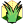
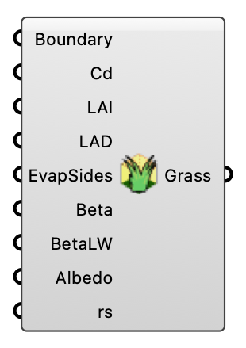

#  Grass - [[source code]](https://github.com/Eddy3D-Dev/Eddy3D/search?q=%22Grass%22)

Define grass patches and parameters for the terrain. OutdoorPlus

#### Input

| Name | Nickname | Description | Type |
| ---- | -------- | ----------- | ---- |
| Boundary |  | Closed curves for grass areas (projected onto the terrain mesh). | `Curve` |
| Drag Coefficient (Cd) | Cd | Grass drag coefficient (Cd). Optional; default is 0.2. | `Number` |
| Leaf Area Index (LAI) | LAI | Leaf area index (LAI). Optional; default is 2. | `Number` |
| Leaf Area Density (LAD) | LAD | Leaf area density (LAD). Optional; default is 20. | `Number` |
| Evaporation Sides | EvapSides | Evaporation sides parameter (nEvapSides). Optional; default is 1. | `Integer` |
| Beta |  | Beta parameter. Optional; default is 0.5. | `Number` |
| Beta Longwave | BetaLW | Longwave beta parameter (betaLW). Optional; default is 1000. | `Number` |
| Soil Albedo | Albedo | Soil albedo (albedoSoil). Optional; default is 0.4. | `Number` |
| Surface Resistance (rs) | rs | Grass surface resistance to evapotranspiration (rs) [s/m]. Optional; default is 250 (matches the OpenFOAM 12 urbanMicroclimateFoam tutorials). | `Number` |

#### Output

| Name | Nickname | Description | Type |
| ---- | -------- | ----------- | ---- |
| Grass Settings | Grass | Grass settings for the case. | `Generic Data` |