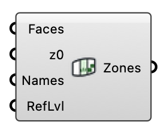

#  Ground Roughness - [[source code]](https://github.com/Eddy3D-Dev/Eddy3D/search?q=%22Ground%20Roughness%22)

Assign a multi-face ground plate to the wind tunnel: each face gets its own aerodynamic roughness length z0 and becomes its own ground patch (nutkAtmRoughWallFunction). Feed into the wind case component's Ground Roughness input.

#### Input

| Name | Nickname | Description | Type |
| ---- | -------- | ----------- | ---- |
| Faces |  | Ground plate faces (meshes, breps, or surfaces), one per roughness zone. Faces must not overlap each other; together they replace the default inner ground surface. | `Geometry` |
| Roughness Lengths | z0 | Aerodynamic roughness length z0 (m) per face; a single value applies to all faces, a short list repeats its last value. Typical: 0.0002 water, 0.03 open grass, 0.1 parks, 0.25 scattered obstacles, 0.5 suburbs, 1.0 forest/dense city. | `Number` |
| Names |  | Optional zone names (used for the OpenFOAM patch names, e.g. rough_water). | `Text` |
| Refinement Level | RefLvl | Snappy surface refinement level for the zone patches. Optional; default -1 = follow the case's own ground surface (Mesh Settings' Ground Level, else the template's), prism layers included. A level of 0 or more pins the zones to it. Documents saved before this default changed keep the level they stored (2). | `Integer` |

#### Output

| Name | Nickname | Description | Type |
| ---- | -------- | ----------- | ---- |
| Ground Zones | Zones | Ground roughness zone objects; plug into the wind case Ground Roughness input. The preview colours each zone by its z0 on the FIXED Davenport scale Land Cover Roughness and the ParaView scene use (pale = smooth, dark brown = rough). | `Generic Data` |