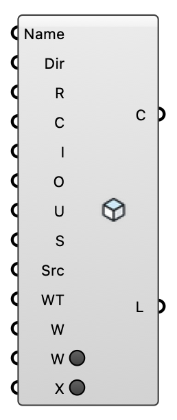

#  Indoor Case - [[source code]](https://github.com/Eddy3D-Dev/Eddy3D/search?q=%22Indoor%20Case%22)

Build an indoor ventilation case (room + inlets + outlets + sinks + sources) for OpenFOAM 12. Isothermal by default. Wiring a Wall Temp, an Indoor Wall with a temperature or heat load, or a Heat Source switches it to the buoyant solver (foamRun -solver fluid: gravity, an energy equation and a temperature-dependent density), so temperature differences drive the flow — plumes, downdraughts, stratification, stack effect. The solve is steady unless Transient gives the buoyant solver a duration to integrate over; Write Interval sets how often it keeps a snapshot, uniformly or dense-then-sparse. Steady or transient, the solve runs on every core but one when Wind Run's Parallel is on. Method: De Simone, Kastner & Dogan (2021), Building Simulation 2021, Bruges, doi:10.26868/25222708.2021.30632.

#### Input

| Name | Nickname | Description | Type |
| ---- | -------- | ----------- | ---- |
| Case Name | Name | Case name (no spaces). Leave empty for an auto-generated name (same convention as Outdoor). | `Text` |
| Working Directory | Dir | Working directory (default ~/Eddy3D/Indoor). | `Text` |
| Room | R | Closed room Brep. | `Brep` |
| Cell Size | C | Mesh cell size (m). | `Number` |
| Inlets | I | Inlet surface(s): Brep or Indoor Inlet component(s). | `Generic Data` |
| Outlets | O | Outlet surface(s): Brep or Indoor Outlet component(s). | `Generic Data` |
| Inlet Speed | U | Fallback supply speed (m/s) over each raw-Brep inlet AS DRAWN: that inlet delivers Speed × its area. Ignored for Indoor Inlet components, which carry their own Speed or Flow Rate. | `Number` |
| Sinks | S | Momentum sinks (Indoor Sink). | `Generic Data` |
| Sources | Src | Emitters: Momentum / Heat / CO2 / Viral Source components. | `Generic Data` |
| Wall Temp | WT | Optional wall temperature (°C) for every room face no Indoor Wall covers. Setting it switches the case to the buoyant solver on its own; no Heat Source is needed. A value of 150 or more is read as Kelvin, as definitions saved before this input was °C expect. | `Number` |
| Walls | W | Optional Indoor Wall components with a Surface: each gets its own patch and temperature. Room faces not covered by one keep the case-wide Wall Temp. | `Generic Data` |
| Age of Air | AoA | Solve the mean age of air (OpenFOAM 'age' function object) during the run. Age [s] is the time since the air at each point entered the room — the ventilation map: low = well flushed, high = trapped in a corner the supply never reaches. Unlike an air-change rate, which is one number for the whole room, it says WHERE the ventilation fails. Adds a cheap scalar transport solved alongside the flow at every iteration; probe the 'age' field to read it. With it the case also writes, under postProcessing/ for Read Results, the flux-weighted age of the air leaving through the outlet (exhaustAge — the reference Ventilation Effectiveness divides by). Whenever the case has Age of Air OR a CO2/viral emitter it writes the flow it carried (supplyFlow, exhaustFlow, m³/s on the isothermal and the buoyant path), and every CO2/viral emitter gets its flux-weighted exhaust value (exhaustCO2, exhaustViral, per m³ of air) and the MESHED volume of its zone (viralSourceVolume_0, m³ — Infection Risk's Emitter Volume), with or without this. Optional; default is off. | `Boolean` |
| Transient | t | Optional simulated time in SECONDS. Leave empty for the steady solve, which answers where a room settles. Set it to follow how the room gets there — a warm-up, a cool-down, a plume that never settles: the buoyant solver then integrates in time under a Courant limit and keeps 20 snapshots over the run unless Write Interval says otherwise. Buoyant cases only (it needs a Wall Temp, an Indoor Wall with a temperature or heat load, or a Heat Source), and far more expensive than the steady solve. | `Number` |
| Extras |  | Optional user additions from the Refinement Region and Custom Function Object components. Applied every time the case is written, so they survive a re-write. The indoor mesh dict is built programmatically and has no refinementRegions block of its own — one is created for a user region. | `Generic Data` |
| Location In Mesh | Loc | Optional point inside the room's AIR (snappyHexMesh's locationInMesh): the mesh keeps only the region connected to it. Leave empty to have one chosen — the room centre when that is open air, otherwise the point of the main air volume furthest from every surface. Set it when the room has several disconnected air volumes and the one to mesh is not the largest. | `Point` |
| Engine |  | OpenFOAM execution environment for this case: BlueCFD, WSL, or Containerized (Docker/Podman). Read by the Run component. | `Text` |
| Initial Temp | T0 | Optional room air temperature (°C) at the START of the solve — 0/T's internal field — separate from every boundary: wall temperatures, the supply, heat sources and the outlet's backflow keep their own values. Start a room warm and ventilate it through ambient boundaries to watch it cool by the flow alone. Buoyant cases only (it needs a Wall Temp, an Indoor Wall with a temperature or heat load, or a Heat Source); most meaningful with Transient, since a steady solve settles to the same room wherever it starts. Empty = 20 °C. A value of 150 or more is read as Kelvin. | `Number` |
| Write Interval | dt | Optional seconds between the snapshots a Transient run keeps. One number: a uniform interval (empty = 20 snapshots over the run). Several numbers: the run is split into that many EQUAL phases and each phase writes at its own interval — [1, 5, 20] on a 300 s run keeps a snapshot every 1 s to 100 s, every 5 s to 200 s and every 20 s to 300 s, dense where the room changes fastest. Each snapshot is the full set of fields on disk, so a 1 s interval over a long run costs disk and time. Ignored without Transient. | `Number` |
| Write | W | Click to write the case to disk. Resets automatically so it never re-writes on recompute. | `Boolean` |
| Clear | X | Click to delete the case folder. Resets automatically so it never re-deletes on recompute. | `Boolean` |

#### Output

| Name | Nickname | Description | Type |
| ---- | -------- | ----------- | ---- |
| Case | C | The indoor case (for the Run component). | `Generic Data` |
| Logs | L | Build / write logs. | `Text` |