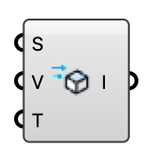

#  Indoor Inlet - [[source code]](https://github.com/Eddy3D-Dev/Eddy3D/search?q=%22Indoor%20Inlet%22)

Ventilation inlet — defines where air enters the room (diffuser, window, door). The case imposes the supply as a FLOW RATE on the opening's own patch: Flow Rate when given, else Speed × the surface's drawn area, so the requested air arrives whatever the mesh resolves of the opening. The air enters perpendicular to the surface, into the room, whichever way the surface faces.

#### Input

| Name | Nickname | Description | Type |
| ---- | -------- | ----------- | ---- |
| Surface | S | Planar surface on the room wall marking the inlet opening. | `Brep` |
| Speed | V | Supply speed (m/s) over the opening AS DRAWN: the case delivers Speed × the surface's area. Direction is perpendicular to the surface, into the room. Ignored when Flow Rate is given. | `Number` |
| Temperature | T | Inlet air temperature (°C). Applied when the case is thermal (Indoor Case has a Wall Temp, an Indoor Wall with a temperature or heat load, or a Heat Source); an isothermal case has no temperature field, and Indoor Case warns when a value other than 20 °C is dropped. | `Number` |
| Flow Rate | Q | Optional supply flow in LITRES PER SECOND (L/s) through this opening — the unit a diffuser schedule is written in (1 L/s = 3.6 m³/h). Replaces Speed when given. | `Number` |

#### Output

| Name | Nickname | Description | Type |
| ---- | -------- | ----------- | ---- |
| Inlet | I | Indoor inlet for the case component. | `Generic Data` |