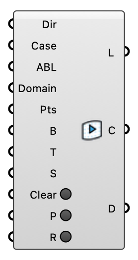

#  LBM Run - [[source code]](https://github.com/Eddy3D-Dev/Eddy3D/search?q=%22LBM%20Run%22)

Launch a lattice-Boltzmann case from the LBM Case component (OpenLB in a container or natively, or FluidX3D on the GPU — whichever the case was built with). Writes the case first if it has not been written, then starts the solver in a terminal window (untick 'Show solver window' in the right-click menu to run it in the background) and follows it: a progress bar with the time left, live warnings, and a refresh of everything downstream when the run moves on or finishes. A case already solving is followed, never started twice. Right-click to stop the run, list what is running on this machine, or open its log. Read results with Probe (points), LBM Field (the probe layer) or FluidX3D Live View.

#### Input

| Name | Nickname | Description | Type |
| ---- | -------- | ----------- | ---- |
| Case | C | The LBM case from the LBM Case component. | `Generic Data` |
| Run | R | Write the case (if needed) and launch the solver. | `Boolean` |

#### Output

| Name | Nickname | Description | Type |
| ---- | -------- | ----------- | ---- |
| Logs | L | Run log / status. | `Text` |
| Case | C | Case directory the readers resolve against (the OpenLB case, or the FluidX3D VTK export directory) — plug into Probe, LBM Field or FluidX3D Live View. | `Text` |
| Domain | D | Resolved simulation domain in world coordinates, as on the LBM Case component. | `Box` |
| Folder | F | Case root folder: the OpenLB case directory, or the FluidX3D case root holding the source tree beside the VTK export directory that Case points at. | `Text` |
| Progress |  | 0 to 1 of the simulated window (an ensemble: of all its members). | `Number` |
| Done |  | True once the run finished and wrote its results. | `Boolean` |
| Remaining | Left | Estimated seconds until the run finishes, from how fast it has been progressing. Empty until the progress has moved twice. | `Number` |
| Simulated Time | SimT | Simulated time [s] at each progress report of the run so far — the x axis for Max Speed. | `Number` |
| Max Speed | MaxU | Peak velocity [m/s] in the domain at each Simulated Time (OpenLB; FluidX3D does not report it). A run heading for instability climbs here long before it fails. | `Number` |