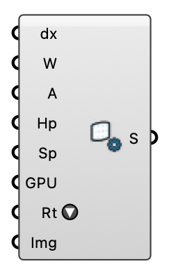

#  LBM Run Settings - [[source code]](https://github.com/Eddy3D-Dev/Eddy3D/search?q=%22LBM%20Run%20Settings%22)

Solver controls for the container-based LBM wind engine (grid spacing, warmup and averaging windows, probe layer, GPU, container runtime).

#### Input

| Name | Nickname | Description | Type |
| ---- | -------- | ----------- | ---- |
| Grid Spacing | dx | Lattice spacing in meters. Cell count grows with 1/dx^3 — halving dx costs 8x memory and ~16x time. | `Number` |
| Warmup | W | Physical seconds of simulated wind discarded before averaging starts. 0 = auto: two domain flow-throughs (length / reference speed), at least 60 s — fixed seconds quietly under-run large domains. | `Number` |
| Averaging | A | Physical seconds of simulated wind averaged into the reported field. 0 = auto: four domain flow-throughs, at least 120 s. | `Number` |
| Probe Height | Hp | Height above ground of the pedestrian-level result layer (m). | `Number` |
| Probe Spacing | Sp | Spacing of the result grid (m). 0 = auto: follows Grid Spacing (one probe per lattice cell), coarsened by powers of two if that would put more than 200,000 probes on the canvas. Sampling FINER than the grid does not resolve more — neighbouring probes then interpolate inside the same lattice cells. | `Number` |
| GPU |  | Run the CUDA build of the solver image (needs an NVIDIA GPU + container toolkit; Windows/Linux only — macOS containers have no CUDA). | `Boolean` |
| Runtime | Rt | How the solver runs. Auto prefers Podman, falls back to Docker, then to a native install; Docker and Podman run the same OCI image. Native runs a host-installed eddy3dWind executable with NO container at all — the Windows path when neither Podman nor Docker Desktop is an option. Native is CPU (OpenMP) only; the CUDA build ships as a container image. | `Text` |
| Image | Img | Container image override. Empty = docker.io/pkastner/openlb-wind:1.9.3-r4@sha256:53d487d0a60cc37786ef48fe0e443d09d79664180d3fec314a8aaf135312f764. | `Text` |
| Jitter | Jit | Slowly vary the inflow direction by a few degrees (deterministic). Seeds resolved unsteadiness a steady analytic inflow lacks, so exposed upstream areas stop reading unrealistically calm. Off = perfectly steady inflow. The validation runs' EDDY3D_VALIDATION_INFLOW arms on this component: control = Turb off + Jitter off; jitter = Turb off + Jitter on (4 degrees there, the amplitude below defaults to 5); synthetic = Turb on. | `Boolean` |
| Jitter Amplitude | Jd | Direction variation in degrees when Jitter is on. | `Number` |
| Vegetation Drag | Veg | Crown density for PLAIN meshes wired into the LBM Run component's Vegetation input, as Cd x leaf area density (1/m): 0.1 sparse, 0.25 typical, 0.5 dense. Vegetation Region objects carry their own Cd x LAD and ignore this. | `Number` |
| Perturbed Inflow | UQ | Run a perturbed-inflow ensemble instead of a single solve: members re-run the case with the inflow speed varied +/-10% and direction +/-6 deg (realistic measurement uncertainty); LBM Field then reports the mean plus a per-point spread that flags wake regions where the result is inflow-sensitive. Runtime scales with Ensemble. | `Boolean` |
| Ensemble | N | Member count when Perturbed Inflow is on (3 = nominal + speed pair, 5 adds the direction pair, up to 9). | `Integer` |
| Vegetation Density | VegD | Crown density preset for PLAIN vegetation meshes (sets Vegetation Drag = Cd x LAD). Custom uses the Vegetation Drag input. Vegetation Region objects carry their own Cd x LAD and ignore both. | `Text` |
| Ground | Gnd | How the solver treats the ground (OpenLB). None is the no-slip bounce-back: it lets the log-law inflow collapse in the lowest cells (measured at 1 m cells: -53 % at 1.5 m after 100 m). Power law and Spalding are OpenLB's wall-modelled ground and hold the profile; they are smooth-wall models. Rough adds the rough-wall log law with the ABL's z0, so the ground shear follows the roughness like OpenFOAM's rough wall function. Costs about 2.5x the run time. | `Text` |
| Displacement Height | d | Zero-plane displacement of the log-law inflow (m): the profile starts at d and is zero below it, for an approach flow over an urban or forest canopy the domain does not model (d is roughly 0.7 x the canopy height). 0 = the plain log law. Must stay below the ABL's reference height. | `Number` |
| Outlet Sponge | Sponge | Fraction of the domain length in front of the outlet that becomes an absorbing sponge layer relaxing the flow to the inflow profile (OpenLB; 0 = the plain pressure outlet). The pressure outlet bends the profile over the last ~20 % of the domain (measured, 200 m domain: +16 % at 5.5 m, -21 % at 30.5 m at the outlet); a 0.1 sponge keeps the field ahead of it within ~3 %. Treat the sponge zone itself as padding, not as results. At most 0.5. | `Number` |
| Synthetic Turbulence | Turb | Turbulent inflow (OpenLB): OpenLB's vortex method adds random eddies to the log-law inlet, sized ~0.4 x the reference height, with the intensity of the log law (I_u = 1/ln(z/z0)), refreshed once per eddy passage. Replaces Jitter. On AIJ Case A it cut the wake's bias from +0.88 to +0.59 and the reattachment length from 2.0 H to 1.3 H against the steady inflow at H/20, and beat the jitter at both resolutions tried (docs/VALIDATION.md 10b), so it is the default, on the CPU and the CUDA solver alike. Off = the steady profile (the validation control). The strip names the arm: synthetic, jitter or steady, as EDDY3D_VALIDATION_INFLOW does. | `Boolean` |
| Wind Schedule | Sched | Time-varying wind (OpenLB), one line or item per point: time (s), wind speed at the ABL's reference height (m/s), wind direction (deg, from, clockwise from north) - e.g. hourly weather replayed in minutes. Linear between points, held beyond the ends; the time-averaged result covers the averaging window. Every direction must stay within 45 degrees of the ABL direction (with Jitter): set the ABL to the mean direction. Empty = a steady wind. | `Text` |
| Settle |  | Stop the run early once its running average has settled: the change of the probe-layer mean between consecutive snapshots (mean \|du\| in % of the mean speed) at or under this value for two snapshots in a row. 0 = run the whole averaging window; 3 is a sensible value, and the window then stays the upper bound. Single runs only (an ensemble's members solve one after another). | `Number` |
| Ground Heat Flux | Qg | Sensible heat flux from the ground into the air (W/m², OpenLB): 0 = isothermal. Roughly 100-300 on a sunny afternoon over paving, negative at night. The air warms and rises (Boussinesq); LBM Field reads the Temperature Rise. | `Number` |
| Building Heat Flux | Qb | Sensible heat flux from every building surface into the air (W/m²), as Ground Heat Flux. | `Number` |
| Air Temperature | Ta | Ambient (inflow) air temperature (°C) the temperature rise is measured from; sets the expansion coefficient 1/T of the buoyancy. | `Number` |
| Refine |  | Resolve a box around the buildings at half the Grid Spacing (OpenLB): half their height upwind, one height on the sides, six heights downwind so the wakes stay inside (a box face across a wake loses it), up to twice their height; coupled to the rest of the lattice by OpenLB's Rohde scheme. Each refined cell costs 16 coarse ones (8 cells x 2 steps): it pays when the box is a small part of a large domain. Not with pollutants or heat fluxes yet. | `Boolean` |
| Integral Length | Lint | Eddy (integral) length of the Synthetic Turbulence in metres: the size of the vortices seeded on the inlet. 0 = derived, max(2 x Grid Spacing, 0.41 x the ABL reference height). The written case's status reports the resolved length, the inlet intensity at z_ref and U(z_ref). | `Number` |
| Instant Snapshots | Inst | Write every in-progress probe snapshot as the INSTANTANEOUS field for the whole run instead of the running mean once averaging starts. Needed for Live View's playback window; the solver image must carry the ProbeSnapshotField key (an older image ignores it and keeps writing means). | `Boolean` |

#### Output

| Name | Nickname | Description | Type |
| ---- | -------- | ----------- | ---- |
| Settings | S | LBM run settings for the 'LBM Run' component. | `Generic Data` |