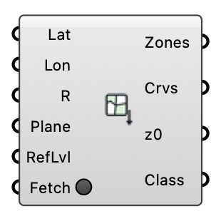

#  Land Cover Roughness - [[source code]](https://github.com/Eddy3D-Dev/Eddy3D/search?q=%22Land%20Cover%20Roughness%22)

Fetch land-cover polygons around a location from OpenStreetMap (open data, Overpass API) — plus surface car parks, pedestrian areas and bare ground — and classify each into an aerodynamic roughness length via the Davenport-Wieringa terrain classification, with the terrain elevation around the site (AWS Terrain Tiles, open data). Outputs ready-made ground roughness zones draped on a terrain mesh for the wind case.

#### Input

| Name | Nickname | Description | Type |
| ---- | -------- | ----------- | ---- |
| Latitude | Lat | Latitude of the SITE (the point the Anchor plane maps to), decimal degrees WGS84 — wire Download Weather's Site Latitude, or read it off a map. Not an EPW header or Deconstruct Weather's Latitude: those give the weather STATION, usually an airport kilometres away. | `Number` |
| Longitude | Lon | Longitude of the SITE, decimal degrees WGS84 (east positive) — wire Download Weather's Site Longitude, or read it off a map. Not an EPW header or Deconstruct Weather's Longitude: those give the weather STATION. | `Number` |
| Radius | R | Half-size (m) of the square query window around the location. Optional; default is 500. | `Number` |
| Terrain Radius | TR | Half-size (m) of the terrain mesh window. Make it cover the WHOLE CFD domain floor (domain radius plus margins) — the land-cover zones only cover Radius, and the terrain must continue beyond them. Keep it at least Radius: land cover beyond the terrain has no ground to become a zone on and is left out (with a Warning). Optional; default is 2 x Radius. | `Number` |
| Anchor | Plane | Model-space plane the lat/lon location maps to (polygons are placed on it, X = east, Y = north). Optional; default is the world XY origin. | `Plane` |
| Refinement Level | RefLvl | Snappy surface refinement level for the zone patches. Optional; default -1 = follow the case's ground level (Mesh Settings' ground refinement, prism layers included), so the land-cover floor is meshed like the ground around it. A document saved before this default keeps the level it was saved with (2). | `Integer` |
| Color By |  | How the preview and the Colored Mesh output colour the ground. 'Land use' paints each zone by what it is (water, grass & parks, forest, paved, residential, ...); 'Roughness' paints it by z0 on a FIXED logarithmic scale anchored on the eight Davenport classes (0.0002 m pale yellow to 2 m dark brown), so a z0 has the same colour in every document and component. Terrain no zone covers is grey in both. Display only: the zones, their z0 and the written case are identical either way. | `Text` |
| Fetch |  | Press to query OpenStreetMap (the land cover, then the paved and bare-soil surfaces) AND download the terrain tiles, in the background — the canvas stays live. Responses are cached on disk, so later solves and document opens read them offline. One press is one attempt: a Fetch held true by a wired toggle does not retry a failed download on every recompute — press again, or flip the toggle off and on. Right-click the component to cancel, or to force a refresh. | `Boolean` |

#### Output

| Name | Nickname | Description | Type |
| ---- | -------- | ----------- | ---- |
| Ground Zones | Zones | Ground roughness zones, clipped to the query window; plug into the wind case's Ground Roughness input. Where polygons overlap, the SMALLEST wins, so a lake inside a park keeps water's z0. With a terrain, each zone is the terrain faces whose centres lie inside its outline, and the wind case re-cuts the terrain along the same outlines at write time, so the zone patches and the remaining ground always tile. A polygon that owns no terrain face (covered by smaller zones, smaller than a terrain cell, or beyond a terrain smaller than the query window) is left out of all four zone outputs, and a message counts it. Without a terrain the zones are flat plates on the anchor plane. Ground Zones, Boundaries, Roughness Lengths and Land Cover are index-aligned. | `Generic Data` |
| Boundaries | Crvs | Closed land-cover outline per zone (index-aligned with Ground Zones), in model space. Draped on the terrain when there is one: every vertex, and every point where the outline crosses a terrain grid line or cell diagonal, lies on the surface the case meshes. Flat on the anchor plane otherwise. | `Curve` |
| Roughness Lengths | z0 | Roughness length z0 (m) per zone, index-aligned with Ground Zones. | `Number` |
| Land Cover | Class | Davenport class and source OSM tag per zone (e.g. 'closed (landuse=forest)'), index-aligned with Ground Zones. | `Text` |
| Terrain | T | The FULL terrain mesh around the site (AWS Terrain Tiles / SRTM-3DEP merge), placed on the anchor plane with elevation RELATIVE to the site (the location sits at the anchor origin); plug into the wind case Terrain input. The wind case splits the zone areas out of it at write time, so the meshed ground and the zone patches always tile without coincident surfaces. Not previewed by this component (its coloured zones cover the same surface). | `Mesh` |
| Site Elevation | Elev | Absolute elevation (m above sea level) of the location — the datum the Terrain mesh's z=0 corresponds to. | `Number` |
| Colored Mesh | Color | The ground as ONE vertex-coloured mesh for display and export: every zone piece in its Color By colour, plus the terrain no zone covers in grey — the tiling the wind case writes. Without a terrain, the flat zone plates. Not previewed by this component, which draws the same colours lit; wire it into a Mesh param or bake it. It is a copy: editing it changes nothing in the case. | `Mesh` |