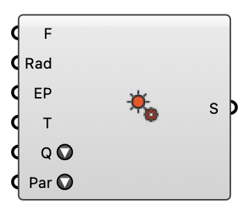

#  MRT Settings - [[source code]](https://github.com/Eddy3D-Dev/Eddy3D/search?q=%22MRT%20Settings%22)

Configuration for the MRT + UTCI analysis. Method: Bourgeois et al. (2008), Building Research & Information 36(1):68-82, doi:10.1080/09613210701446325; Subramaniam (2017), Lawrence Berkeley National Laboratory, tutorial (Nov 2017 revision) Ch. 2, App. B, https://www.radiance-online.org/learning/tutorials/matrix-based-methods.

#### Input

| Name | Nickname | Description | Type |
| ---- | -------- | ----------- | ---- |
| Small Face Cutoff | F | Faces below this area (m²) are ignored by the thermal model. | `Number` |
| Radiance Reflections | Rad | High-fidelity shortwave via the Radiance DDS chain (true, default) vs the pure-C# raycast (false). Requires a Radiance install (or the containerized engine). | `Boolean` |
| EnergyPlus Surfaces | EP | Where the SURROUNDING surfaces' temperatures come from, which is what drives the longwave half of MRT. true (default): EnergyPlus. Eddy3D builds an epJSON from the polygons that matter to the sensors — those inside the cumulative view-factor percentile and above the Small Face Cutoff, with the rest demoted to shading surfaces — runs E+ against the EPW, and maps the surface-specific temperatures out of the ESO back onto the geometry. false: every surface is assumed to sit at air temperature. Note this is EnergyPlus, not Radiance: Radiance transports light and computes no temperatures. Requires an EnergyPlus install (or the containerized engine on the MRT component); a missing engine throws rather than silently falling back to ambient. | `Boolean` |
| Engine Timeout | T | Wall-clock cap in minutes for each external engine run (Radiance DDS, EnergyPlus). Raise for large urban scenes. | `Integer` |
| Radiance Quality | Q | Accuracy of the Radiance shortwave chain (ambient bounces and sampling). 0 Draft: sky and sun only, no interreflection — about 10% off Reference  [-ab 1 -ad 512 -lw 0.0005 (sun -ad 256)] 1 Fast: one reflection, for iterating — about 4% off  [-ab 2 -ad 1024 -lw 0.00025 (sun -ad 256)] 2 Standard: the historical default — about 2% off  [-ab 3 -ad 2000 -lw 0.0001 (sun -ad 256)] 3 Accurate: street-canyon interreflection converging — about 1.4% off  [-ab 5 -ad 4096 -lw 0.00006 (sun -ad 256)] 4 High: deep canyons and high-albedo facades — about 0.9% off  [-ab 8 -ad 8192 -lw 0.00003 (sun -ad 512)] 5 Reference: validation runs — the yardstick the others are measured against  [-ab 12 -ad 10000 -lw 0.000025 (sun -ad 1024)] Percentages are the measured departure from Reference on a triangulated 73k-polygon neighborhood. Total runtime barely moves between levels (1.10-1.14x end to end): the flags do scale the ray tracing 3.6x, but that is only 4-15% of the chain — the rest is the annual sky matrices. So choose on accuracy. Standard is the default and reproduces the flags used before this input existed. Only applies when Radiance Reflections is on. | `Text` |
| Parallelize | Par | How many processes the Radiance chain spreads its sensors over. Auto (default) decides from the chain. With Fast Matrices on (the default) the sun term is finished on the host and the container's multiplies are binary and quick, so Auto stays at ONE process: measured at 4,500 and 14,600 sensors, splitting changed the run time by less than its run-to-run noise. With Fast Matrices off (the ASCII chain), or with tree crowns (their sun multiply stays in the container), the annual multiplies (dctimestep + rmtxop) are most of the run at thousands of sensors and neither program has a threading flag, so Auto splits the sensors over up to the machine's physical cores minus two, never below 500 sensors a block — 4,500 ASCII sensors took 220 s in one process and 117 s in nine. Off is always one process; 2, 4, 8 or 16 processes are honoured as given, which is also the way to cap a shared machine. This never changes the answer: every sensor is traced by identical commands against identical octrees and sky matrices; only which file it was listed in differs. Only applies when Radiance Reflections is on. | `Text` |
| Run Period | HOY | Optional hours of the year (1-8760, e.g. from the HOY component) the study is about. EnergyPlus then simulates only the days spanning them, plus 3 lead-in days, instead of the whole year — its cost is close to linear in simulated hours, so a heat-wave week runs many times faster. The MRT result is still 8760 hours: outside the period the surrounding surfaces are assumed to sit at air temperature, exactly as with EnergyPlus Surfaces off, so read results only for the hours given here. A selection that wraps the new year runs (nearly) the whole year. Empty (default) = full year. Only applies when EnergyPlus Surfaces is on. The Radiance chain works on annual sky matrices and is not shortened by this. | `Integer` |
| Fast Matrices | Fast | true (default): the Radiance chain moves its annual matrices as binary files and the sun term is finished as a sparse product on the host — several times quicker on large sensor grids, a quarter of the disk, and free of the three-digit rounding ASCII sky matrices carry (up to 0.5 % of the beam in an hour). false: the ASCII chain Eddy3D shipped before this input existed, kept as the control and the way back. For Two-Phase DDS the two agree to float rounding apart from that rounding. Two-Phase (preview) reads its beam straight from the sampled ray-traced coefficients, which the ASCII chain does not reproduce from run to run (about 0.7 % of the annual total, and more in single hours); the binary chain does. Only applies when Radiance Reflections is on. | `Boolean` |
| Shortwave Method | Meth | Which Two-Phase (daylight-coefficient) method the Radiance chain runs. Two-Phase DDS (default): the sun is traced separately, one source per fine sky bin (Bourgeois, Reinhart and Ward 2008), so shadows have close to the sun's own edges. Two-Phase (preview): the sun is read off the 145-patch sky, spread over the four patches nearest it, so shadow edges are blurred by several degrees and hourly beam and dMRT at sun altitudes below about 8 degrees are approximate. It skips the sun trace: about twice as quick on a grid of a few hundred sensors or more (five times on a handful). Reflected and diffuse light are the same; the annual total stayed within 2-3 % of Two-Phase DDS on the test cube and can differ more in a street canyon. For choosing a layout, not for a result. Scenes with tree crowns always run Two-Phase DDS. Only applies when Radiance Reflections is on. | `Text` |
| Sun Resolution | Sun | How finely the sky is divided for the traced sun of Two-Phase DDS (the Reinhart subdivision). MF:4 (default): 2,305 suns, bins about 3 degrees across. MF:6: 5,185 suns, about 2 degrees: the traced sun lands closer to the real one (the hourly error of the beam against an exact solar position fell by about a fifth in the check this setting was added with), for about twice the sun-coefficient trace and twice the disk of the transfer matrix. Ignored by Two-Phase (preview) and by scenes with tree crowns. Only applies when Radiance Reflections is on. | `Text` |

#### Output

| Name | Nickname | Description | Type |
| ---- | -------- | ----------- | ---- |
| Settings | S | MRT settings for the MRT component. | `Generic Data` |