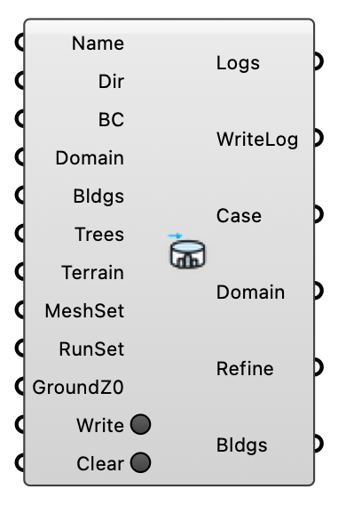

#  Outdoor Case - [[source code]](https://github.com/Eddy3D-Dev/Eddy3D/search?q=%22Outdoor%20Case%22)

Create, write, and manage an Eddy3D outdoor wind simulation case. Method: Kastner & Dogan (2022), Building and Environment 212:108639, doi:10.1016/j.buildenv.2021.108639; Kastner & Dogan (2020), Journal of Building Performance Simulation 13(1):59-68, doi:10.1080/19401493.2019.1692906.

#### Input

| Name | Nickname | Description | Type |
| ---- | -------- | ----------- | ---- |
| Case Name | Name | Case folder name (no spaces). Optional — if left blank, a friendly random name is generated automatically (e.g. swift-otter-fjord-lantern). | `Text` |
| Working Directory | Dir | Folder for case files and results (default: %USERPROFILE%/Eddy3D/Outdoor). | `Text` |
| Boundary Conditions | BC | Boundary conditions from the ABL or Uniform Flow component, carrying the wind directions (required for Write Case). | `Generic Data` |
| Domain Parameters | Domain | Domain parameters from the Box Domain or Cylinder Domain component (box with auto extents when empty). | `Generic Data` |
| Buildings | Bldgs | Closed building meshes (required for Write Case). | `Mesh` |
| Trees |  | Tree canopy meshes or Tree porous-zone objects from the Tree component (optional). | `Generic Data` |
| Terrain |  | Terrain mesh (optional). It becomes the domain FLOOR. A Box domain is sized from the buildings and trees alone, so make the terrain cover its whole footprint — the component warns with the Terrain Radius it needs when it does not. | `Mesh` |
| Mesh Settings | MeshSet | Mesh settings from the Mesh Settings component. | `Generic Data` |
| Run Settings | RunSet | Run settings from the Run Settings component. | `Generic Data` |
| Ground Roughness | GroundZ0 | Ground roughness zones from the Ground Roughness or Land Cover Roughness component (optional). Each zone becomes its own ground patch with an explicit roughness length z0; floor area not covered by a zone keeps the global ABL roughness. With a Terrain, every zone becomes the terrain under its footprint (a Ground Roughness plate included), in list order — where zones overlap the first one wins, and a zone left with no terrain cell is skipped (a Remark counts them). | `Generic Data` |
| Sources |  | Pollutant emission sources from the Pollutant Source component (optional). Each becomes a cell zone in the mesh; every species becomes a passive concentration field (kg/m3) solved alongside the wind on all direction cases. Sources sharing a Species solve as one field. | `Generic Data` |
| Extras |  | Optional user additions from Refinement Region and Custom Function Object components. Applied every time the case is written, so they survive a re-write. Refinement regions go into the meshing cases; function objects into the direction cases, where the solver runs. | `Generic Data` |
| Pedestrian Spacing | PedSpace | Spacing (m) of the pedestrian probe lattice the case writes for itself (2 m is the campaign lattice). Leave empty for none. The probes stand at Run Settings' Pedestrian Height above the terrain. Each direction case then samples U, k and p at every point during the solve, into postProcessing/pedestrianProbes: read it with Probe (Name pedestrianProbes, Points from Pedestrian Points). | `Number` |
| Pedestrian Boundary | PedBound | Optional closed planar curve the pedestrian probes are clipped to (read in plan). Default: the refinement region (a circle for a cylinder domain, the refinement box for a box domain). Points inside buildings are always removed. | `Curve` |
| Engine |  | OpenFOAM execution engine stored on the study and used by Wind Run, Wind Scripts, Probe and Streamlines: BlueCFD, WSL (Windows only) or Containerized (Podman/Docker). Written into the study manifest so a reopened case keeps the engine it was solved with. | `Text` |
| Write |  | Write the case files to the working directory. | `Boolean` |
| Clear Case | Clear | Delete all files for this case in the working directory. | `Boolean` |

#### Output

| Name | Nickname | Description | Type |
| ---- | -------- | ----------- | ---- |
| Logs |  | Case modification logs. | `Text` |
| Write Logs | WriteLog | WriteCase logs formatted for component input. | `Text` |
| Case |  | Wind case; plug into the Wind Run and post-processing components. | `Generic Data` |
| Domain |  | Resolved simulation domain (box, or domain mesh for cylindrical cases). | `Generic Data` |
| Refinement Box | Refine | Refinement box derived from the case. | `Brep` |
| Buildings | Bldgs | Building meshes from the case. | `Mesh` |
| Pedestrian Points | PedPts | The pedestrian probes the case writes, in the order the results list them. Empty unless Pedestrian Spacing is set. | `Point` |