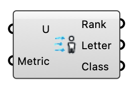

#  Pedestrian Wind Comfort - [[source code]](https://github.com/Eddy3D-Dev/Eddy3D/search?q=%22Pedestrian%20Wind%20Comfort%22)

Classifies pedestrian wind comfort per point from an annual hourly wind-speed series (the Wind Speed output of the Velocity Amplification Factors (VAF) component) against a comfort criterion (Lawson, Davenport, NEN8100). Returns the comfort category, class letter, and activity description for each point. Within about 1.5 building heights leeward of a building a steady-RANS comfort or safety verdict is OPTIMISTIC (too calm): on AIJ Cases A and B the solver reattaches at 1.3–1.5 H (Case B 3.27 H) against the tunnel's 0.38–0.75 H (Case B 1.88–2.62 H) and reads the 88 wake points at 0.30 U_H against the measured 0.451 (FB +0.29; above the roof +0.06). SST URANS and DES do not fix it (0.286 and 0.292 U_H).

#### Input

| Name | Nickname | Description | Type |
| ---- | -------- | ----------- | ---- |
| Wind Speed | U | Annual wind field from the Velocity Amplification Factors (VAF) component (its Wind Speed output): a single object holding every point's 8760-hour wind-speed series. Passed as an object so the millions of values skip the Grasshopper data tree. | `Generic Data` |
| Comfort Metric | Metric | Comfort criterion: Lawson General, Lawson LDDC, Lawson 2001, Davenport, NEN8100 Comfort, NEN8100 Safety, or Wellington (NZ; its safety class reads the 3-second gust); or a planning-authority preset — City Lawson (City of London 2019: worse of mean and GEM, comfort in the worst season, 15 m/s safety annually), Melbourne DDO10, Boston BPDA (effective gust = mean + 1.5σ), San Francisco §148 (equivalent wind speed) or Toronto (GEM, 06:00-23:00, worst season). The authority presets read the gust series — wire Gust Speed for a TKE-based gust. A wired integer 0-11 still selects by index. A Criteria object wired below overrides this pick. | `Text` |
| Color Scheme | Scheme | Categorical palette for the comfort classes: Classic (green through red, the standard wind-comfort plot), Colorblind Safe (Okabe-Ito derived), Muted (desaturated, for underlays), or City of London — the colour code the City of London Wind Microclimate Guidelines (2019) ask planning submissions to use: Frequent Sitting grey, Occasional Sitting blue, Standing green, Walking yellow, Uncomfortable and/or Unsafe red (so any red zone is unacceptable or unsafe). Made for the City Lawson criterion; on another one it is applied by class position, and the component says so. | `Text` |
| Size | S | Marker half-size in model units for the comfort mesh (one quad per point). | `Number` |
| Period |  | Slice of the year to classify: Year (default), a season, or a single month. The exceedance criteria then apply to that period's hours only — winter comfort is usually worse than annual. Seasons are named by their months (Winter = Dec-Feb), so southern-hemisphere EPWs read unambiguously. | `Text` |
| Gust Speed | Gust | Optional annual gust field — the Gust Speed output of Velocity Amplification Factors (needs its TKE input). Read by gust-referenced classes only (Wellington's 20 m/s annual maximum 3-second gust). Without it those classes fall back to mean × Gust Factor. | `Generic Data` |
| Gust Factor | G | 3-second gust / hourly mean ratio used for gust-referenced classes when no Gust Speed field is wired. 1.85 is the ratio New Zealand planning practice writes down (Auckland Unitary Plan: gust equivalent mean = 3-s gust / 1.85), i.e. GEM at ~24% turbulence intensity with g = 3.5. Ignored when Gust Speed is wired. | `Number` |
| Criteria |  | Optional criteria object from the Wind Comfort Criteria component — a jurisdiction's own class table. When wired it replaces the Comfort Metric pick. | `Generic Data` |
| Wind Climate | Climate | Optional long-term wind climate from the Wind Climate component. When wired, the classification is PROBABILISTIC: Wind Speed must then be VAF's Speed Ratios output (per-probe speed / inlet reference speed per direction), and P(U > u) = Σ p·exp(−(u/(r·c))^k) over the climate's sectors replaces the hour count — the City of London Annex A procedure, with no hourly series formed. Period may also read "Worst season" (comfort rows per season, safety rows annual). Gust-referenced classes use VAF's TKE-based gust ratios or the Gust Factor. | `Generic Data` |
| Engine | Eng | Engine for the annual classification sweep. Auto: the OpenCL GPU when one answers, else the CPU — a fallback is reported, never silent. GPU: the same exceedance tallies on the GPU (identical classes). CPU: every core. | `Text` |

#### Output

| Name | Nickname | Description | Type |
| ---- | -------- | ----------- | ---- |
| Comfort Rank | Rank | Comfort category number per point (1 = most comfortable; higher = worse). | `Integer` |
| Class Letter | Letter | Comfort class letter per point (A, B, ... ; S = unsafe). | `Text` |
| Comfort Class | Class | Comfort activity description per point (e.g. Sitting, Walking). | `Text` |
| Mesh | M | Comfort mesh: one colored quad per probe point, class-colored by the selected scheme. Needs points inside the Wind Speed object — wire the probe points into the VAF component's Points input. | `Mesh` |
| Colors | C | Class color per point, aligned with the input series — for coloring custom geometry. | `Colour` |
| Legend Colors | LC | One color per class of the selected metric, best-to-worst — pairs with Legend Labels for annotation. | `Colour` |
| Legend Labels | LL | One label per class of the selected metric ("A — Sitting" style), aligned with Legend Colors. | `Text` |