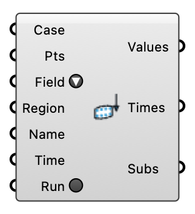

#  Probe - [[source code]](https://github.com/Eddy3D-Dev/Eddy3D/search?q=%22Probe%22)

Sample fields at points on a solved case, post-hoc. With Run it writes a probes function and runs postProcess on the requested Time (latest by default), then reads the results; without Run it reads existing results. Works on a wind case (one sub-result per direction) or a loaded case.

#### Input

| Name | Nickname | Description | Type |
| ---- | -------- | ----------- | ---- |
| Case |  | What to probe: a solved case (wind / loaded / UMF / indoor), or the Case output of LBM Case / LBM Run for either lattice-Boltzmann engine — OpenLB (its final time-averaged field, U only) or FluidX3D (its VTK export, resolved automatically). | `Generic Data` |
| Points | Pts | Probe points in model space. Required when Run is true. | `Point` |
| Field |  | Field to sample. The dropdown lists the fields the solved case holds (the common OpenFOAM fields before a solve); a multi-region case lists them as region/field, e.g. air/UMean. Type or wire any other field name; a bare name on a multi-region case goes to the region that holds it. For a FluidX3D VTK directory: "rho"/"density" → density, otherwise velocity. | `Text` |
| Probe Name | Name | Name of the probe set. Optional — if left blank, a unique name is generated automatically (adjective-animal-place-noun, e.g. swift-otter-fjord-lantern). | `Text` |
| Time |  | Result time to probe — the dropdown lists every time written on disk: latestTime (default) = latest written time, a number = that written time, all = every written time still on disk (empty, as before the dropdown, reads every probed time). Times that were purged (Keep Time Steps) cannot be probed. FluidX3D results also accept avg (mean over every written time) and avg:START-END (mean over a window in seconds, e.g. avg:120-360 to skip the spin-up transient). | `Text` |
| Run |  | True: run postProcess to sample the requested time (Time input), then read. False: read existing results only. | `Boolean` |

#### Output

| Name | Nickname | Description | Type |
| ---- | -------- | ----------- | ---- |
| Values |  | Probe values (numbers or vectors); branch = {sub-result, field, time}, items = one per point. | `Generic Data` |
| Time Steps | Times | Sampled time steps; branch = {sub-result, field}. | `Text` |
| Sub-Results | Subs | Sub-result labels matching the first branch index (e.g. wind direction case names). | `Text` |
| Points | Pts | The probe points actually written and sampled — the input points minus the culled ones. Values items line up with this list, one per point. | `Point` |