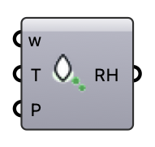

#  Relative Humidity - [[source code]](https://github.com/Eddy3D-Dev/Eddy3D/search?q=%22Relative%20Humidity%22)

Convert specific humidity (w) and temperature (T) to relative humidity (%) — reads the UMF fields w and T, so it lives with Outdoor+, not with the weather inputs.

#### Input

| Name | Nickname | Description | Type |
| ---- | -------- | ----------- | ---- |
| Specific Humidity | w | Specific humidity in kg/kg (from OpenFOAM field 'w'). | `Number` |
| Temperature | T | Air temperature in Kelvin (from OpenFOAM field 'T'). | `Number` |
| Pressure | P | Atmospheric pressure in Pa. Optional; default is 101325 Pa — the reference the UMF inflow humidity is formed at, so leave it unless the case itself was run at another pressure. | `Number` |

#### Output

| Name | Nickname | Description | Type |
| ---- | -------- | ----------- | ---- |
| Relative Humidity | RH | Relative humidity in percent (0–100%). A value the air could not hold (over 100 %) is clamped, and a warning says so: it means the case's humidity field is in the wrong unit, not that the air is foggy. | `Number` |