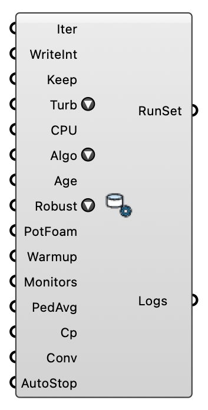

#  Run Settings - [[source code]](https://github.com/Eddy3D-Dev/Eddy3D/search?q=%22Run%20Settings%22)

Configure solver run controls for Eddy3D. PIMPLE (transient) writes Co below 1, three pressure correctors, turbulence on every outer corrector and unbounded convection. Method: Wolf Dynamics (2021), OpenFOAM advanced training, online session, July 2021 GT-79, GT-97, GT-100, https://www.wolfdynamics.com/training/turbulence/OF2021/turbulence_20221_OF8_guided_tutorials.pdf.

#### Input

| Name | Nickname | Description | Type |
| ---- | -------- | ----------- | ---- |
| Iterations | Iter | Total solver iterations (endTime). Optional; default is 1000. | `Integer` |
| Write Interval | WriteInt | Write interval in iterations. Optional; default is 20. | `Integer` |
| Keep Time Steps | Keep | Number of time directories to keep (purgeWrite). Optional; default is 3. | `Integer` |
| Turbulence Model | Turb | RANS turbulence model (OpenFOAM 12). The four best for urban wind: Realizable k-ε (default; AIJ/COST732 best practice for pedestrian wind), Standard k-ε (ABL baseline), RNG k-ε (high-strain / recirculation), and SST k-ω (separation, near-wall). All run on the template's existing fields. | `Text` |
| CPU Count | CPU | Number of CPUs/subdomains for parallel runs. -1 (default) = auto: the machine's physical cores minus two. Optional. | `Integer` |
| Solver Algorithm | Algo | Pressure-velocity coupling for the steady solver. SIMPLE (default) is the robust, conservatively under-relaxed baseline. SIMPLEC adds the consistent correction so it tolerates much higher relaxation (p 0.7, U/turbulence 0.9), which usually converges in fewer iterations on a good urban mesh — try it for speed, fall back to SIMPLE if a hard case stalls or oscillates. Optional; default is SIMPLE. | `Text` |
| Age of Air | Age | Solve the mean age of air (OpenFOAM 'age' function object) during the run. Age [s] is the time since the air at each point entered the domain — the urban ventilation/stagnation map (low = well flushed, high = trapped in canyons/courtyards). Adds a cheap scalar transport solved alongside the flow at every iteration (turbulent diffusion on) and written with the other fields; the 'age' field is then viewable in ParaView or probe-able. Optional; default is false. | `Boolean` |
| Numerics | Num | Numerics as a point on the Accuracy / Robustness / Speed triangle. It sets the convection and gradient schemes, the under-relaxation, the non-orthogonal correctors, the laplacian correction (unless Laplacian Scheme overrides it), the linear-solver relTol and the auto warm-up length together. Accuracy corner: second-order convection, high relaxation, full laplacian correction — captures wakes and eddies but needs a good mesh and warms up first. Robustness corner: first-order upwind, heavy relaxation, three correctors — always converges, smears wakes by numerical diffusion. Speed corner: first-order upwind, one corrector, loose relTol, short warm-up. The old 1-5 levels are named points (right-click, or the picker's buttons); the default is level 4, the shipped baseline, so nothing changes until the dot moves. Accepts a wired "4" or "a,r,s". Standards note: the ASCE/SEI CWE Prestandard's AC 4-3 needs second-order convection — the Accuracy side (levels 1-3); the Robustness/Speed side is first-order upwind. | `Text` |
| Potential Foam Init | PotFoam | Initialise velocity/pressure with a quick potentialFoam (potential-flow Laplace) solve before simpleFoam, so the run starts from a developed, divergence-free field instead of a uniform one. Removes the first-iteration velocity overshoot of a cold start and shortens convergence. Complements the Warm-up Iterations ramp (potentialFoam seeds the field; the ramp damps the first iterations with first-order upwind + heavy turbulence relaxation). Optional; default is off (shipped behaviour). | `Boolean` |
| Warm-up Iterations | Warmup | Run this many initial iterations with robust 1st-order upwind + heavy turbulence under-relaxation, then ramp up to the numerics dial for the rest of the run. Tames the cold-start velocity overshoot without losing final accuracy. -1 (default) = automatic: scales with the robustness dial (robust levels 4-5 warm up, accurate levels 1-2 do not). 0 = force off. >0 = explicit count. | `Integer` |
| Field Monitors | Monitors | Write the domain min/max-magnitude and volume-average of the solved fields (U, p, k, ε/ω, νt) each write-time, and the domain max \|U\| every iteration. Cheap convergence + stability monitor — a max \|U\| climbing past any physical value is the earliest sign of a cold-start overshoot or divergence. Default on. | `Boolean` |
| Pedestrian Average | PedAvg | Write the area-average of U on a horizontal plane at the Pedestrian Height (default 1.75 m) each write — the comfort-relevant mean wind speed, sampled from the live mesh (no topoSet). Default off. | `Boolean` |
| Pressure Coefficient | Cp | Write the surface pressure coefficient (Cp) field each write, computed from the ABL wind speed at building height (dynamic pressure reference). View it on the building surfaces in ParaView. Default off. Method: Dogan & Kastner (2021), Building Simulation 14(4):1189-1200, doi:10.1007/s12273-020-0727-x; Dogan & Kastner (2018), IBPC 2018, Syracuse NY 1139-1144, doi:10.14305/ibpc.2018.ms-5.05. | `Boolean` |
| Convergence | Conv | Auto-stop tolerance: the solver stops once the p, U and k initial residuals (plus omega for k-omega models; never epsilon, whose residual cannot reach a tolerance) all drop below this value (SIMPLE residualControl) — typically 30-60 % faster than running the full iteration count. Default 1e-4; 0 disables auto-stop (always runs all iterations). | `Number` |
| Auto-stop on Plateau | AutoStop | Watches the live residuals while the run is going; once every field's residual has been flat for about 100 iterations after any warm-up ramp, writes stopAt=writeNow — exactly what the manual right-click 'Stop Simulation Gracefully' action does — so the solver finishes its current iteration, writes the latest fields, and exits cleanly instead of grinding out the rest of the iteration count. Requires a Live Residuals component monitoring the case. Optional; default is off. | `Boolean` |
| Duration | Dur | PIMPLE only: how long to simulate, in SECONDS of physical time (the steady solver's Iterations input is ignored). Size it from the domain flow-through time L/U - the statistics need several flow-throughs before they settle, and a run that is too short produces a confident-looking mean of the start-up transient. 0 or blank defaults to 600 s and says so on the component. Optional. | `Number` |
| Time Step | dt | PIMPLE only: initial time step in seconds. This is only a SEED - the run uses adjustTimeStep, so the step is re-derived every iteration from the Max Courant limit and climbs away from this value within a few steps. Leave at 0 for the default (0.01 s), which is small enough never to start a run unstable. Optional. | `Number` |
| Max Courant | Co | PIMPLE only: Courant number cap that sets the time step. 0 defaults to 1: PIMPLE's outer correctors keep Co > 1 stable, not time-accurate, and a wake's shedding needs Co below 1 (Wolf Dynamics, GT-100). Raising it buys wall-clock at the cost of time accuracy; lower it if the run goes unstable. Optional. | `Number` |
| Averaging Window | Win | PIMPLE only: averaging time constant in SECONDS. A transient run's U is an instantaneous, gusty snapshot, so the case also writes UMean/pMean (plus UPrime2Mean, the resolved variance) - read THOSE downstream, not U. The window damps the start-up transient exponentially, weighting a contribution by about exp(-age/window); it does NOT hard-cut it, because OpenFOAM 12's fieldAverage has no timeStart. So keep the run long relative to the window. 0 or blank uses half the Duration. Optional. | `Number` |
| Pressure Solver | pSolver | Linear solver for the pressure equation. GAMG (default): algebraic multigrid, GaussSeidel smoother — measured 4× faster wall time than PCG on a 311k-cell urban mesh at 8 ranks, same iteration count, same field. PCG/DIC is the template's original and stays available for comparison. | `Text` |
| Laplacian Scheme | Laplacian | Non-orthogonal correction of the laplacian terms. 'limited 0.5' (the standard snappyHexMesh choice: half the explicit correction, bounded) or 'corrected' (full correction, the template's original). The default is the one that measured better on two urban configurations — see the Run Settings log for what was written. | `Text` |
| Mesh Quality Preset | MeshQ | What the mesh's own checkMesh verdict does to the numerics before Simulate. checkMesh runs as the last step of Mesh; Simulate reads its 06_checkMesh.txt (after checking it describes the mesh on disk) and presets the numerics PATH: 'auto' (default) — a failed check, or max skewness > 4 / non-orthogonality > 70° (checkMesh's own limits) solves on the 'robust' path (p 0.3 / U 0.5 / turbulence 0.25, three correctors, a longer warm-up); skewness ≥ 10, non-orthogonality ≥ 80° or inverted cells on 'hardened' (that path plus a potentialFoam start and a doubled warm-up). A mesh that passes changes nothing. 'off' keeps the Numerics above whatever the mesh looks like; 'robust' / 'hardened' apply that preset unconditionally. The convection, gradient and laplacian schemes and the convergence criterion are never touched, so the answer is the one the Numerics input asks for — only the route to it moves. Run All applies it too: unless this is 'off' it meshes in its own window and opens Simulate once the new mesh is built and checked. The Wind Run component says what was applied. Optional. | `Text` |
| Pedestrian Height | PedH | The study's pedestrian (comfort sampling) height above ground, m. Where Pedestrian Average samples, and recorded in the case (controlDict marker + eddy3d-study.json) so Study Report can print it and check it against an authority — the City of London guideline asks for 1.5 m — and ParaView's pedestrian slice follows it. Default 1.75 m, the value used before this was a setting, so existing studies are unchanged. It declares the height; place your probe points at it. | `Number` |
| Guideline | Guide | The planning guideline this study is set up for. City of London (2019): SETS the pedestrian height to 1.5 m (unless Pedestrian Height is wired or changed) and prism layers that put three cells below 1.5 m (absolute sizes: 0.3 m first layer, ratio 1.2); RECORDS itself, so Study Report checks against it without its Authority input; and WARNS — on this component and on Outdoor Case — about what it cannot set for you: 36 directions at 10°, 400 m of modelled context, the Harris & Deaves inlet (ABL → Inlet Profile), cell sizes, a turbulence model it advises against. None (the default) changes nothing. | `Text` |
| Concurrent Directions | Concurrent | How many wind directions Run All solves AT ONCE (Docker / WSL). CPU Count is the budget they share: 4 directions on 16 CPUs run on 4 ranks each, which beats 16 ranks one after another once MPI scaling flattens (about 1M cells). Each direction logs to its own run_concurrent.txt; one failed direction fails the run. blueCFD stays sequential. 1 (the default) = one at a time. | `Integer` |
| Empty Domain Check | EmptyDomain | The ASCE/SEI CWE prestandard's two-step process (PO 4-1 / AC 5-9): every direction gets an EMPTY twin (empty_NNN on mesh*_empty) — the same domain, mesh settings, inlet and numerics without the buildings, their volume refined in their place — meshed and solved with it, sampled on the vertical through the site centre. The Study Report's ABL self-sustainment verdict then reads the twin (the incident location proper) instead of the building run's approach station. Costs one extra mesh and solve per direction. Off by default. | `Boolean` |

#### Output

| Name | Nickname | Description | Type |
| ---- | -------- | ----------- | ---- |
| Run Settings | RunSet | Run settings for the solver. | `Generic Data` |
| Debug Logs | Logs | Debug logs from settings generation. | `Text` |