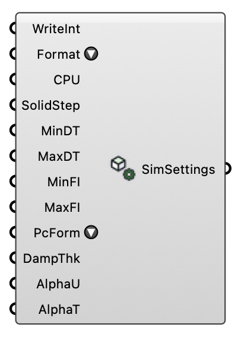

#  Simulation Settings - [[source code]](https://github.com/Eddy3D-Dev/Eddy3D/search?q=%22Simulation%20Settings%22)

Configure simulation control settings for UMF. OutdoorPlus

#### Input

| Name | Nickname | Description | Type |
| ---- | -------- | ----------- | ---- |
| Write Interval | WriteInt | Write interval in time steps. Optional; uses solver default if omitted. | `Integer` |
| Write Format | Format | Write format: 'ascii', 'binary', or 'compressed'. | `Text` |
| CPU Count | CPU | Number of CPUs/subdomains to use. -1 = auto: sized from the air mesh when one exists (50k cells per core), else physical cores minus two. Optional; default is 1. | `Integer` |
| Initial Solid Time Step Factor | SolidStep | Initial solid time step factor for UMF controlDict. Optional. | `Number` |
| Min Delta T | MinDT | Minimum time step between iterations. Optional. | `Number` |
| Max Delta T | MaxDT | Maximum time step between iterations. Optional. | `Number` |
| Min Fluid Iterations | MinFI | Minimum fluid iterations per hourly step before the residual controls may end it. Template default 200: the bulk field of a warm-started hour is stationary by ~150-200 iterations. Optional. | `Number` |
| Max Fluid Iterations | MaxFI | Maximum fluid iterations per hourly step (template default 1000). The residual controls normally end a warm-started hour at ~200-300 iterations; the first, cold-started hour needs ~350-500. Optional. | `Number` |
| PC Equation Form | PcForm | 'pc-based' or 'mixed' (default is pc-based). | `Text` |
| Damping Thickness | DampThk | Blending layer damping thickness [m] from the lateral boundaries. Written to the blendingCoeffs block of system/controlDict, which urbanMicroclimateFoam reads only when controlDict 'blending' is true. The case keeps it off (the blending layer looks up patches west/east/north/south; this case's are front/back/left/right), so the value has no effect. Optional. | `Number` |
| Alpha Coeff U | AlphaU | Blending layer strength for velocity U (alphaCoeffU). Written to the blendingCoeffs block of system/controlDict, which urbanMicroclimateFoam reads only when controlDict 'blending' is true. The case keeps it off (the blending layer looks up patches west/east/north/south; this case's are front/back/left/right), so the value has no effect. Optional. | `Number` |
| Alpha Coeff T | AlphaT | Blending layer strength for temperature T (alphaCoeffT). Written to the blendingCoeffs block of system/controlDict, which urbanMicroclimateFoam reads only when controlDict 'blending' is true. The case keeps it off (the blending layer looks up patches west/east/north/south; this case's are front/back/left/right), so the value has no effect. Optional. | `Number` |

#### Output

| Name | Nickname | Description | Type |
| ---- | -------- | ----------- | ---- |
| Simulation Settings | SimSettings | Simulation control settings. | `Generic Data` |