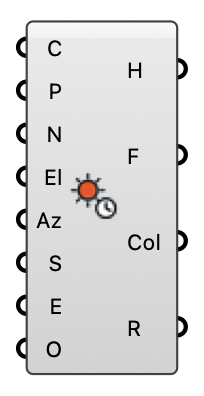

#  Sun Hours - [[source code]](https://github.com/Eddy3D-Dev/Eddy3D/search?q=%22Sun%20Hours%22)

Direct sun hours and shadow by ray casting — an interactive preview, not a Radiance simulation.

#### Input

| Name | Nickname | Description | Type |
| ---- | -------- | ----------- | ---- |
| Context | C | Shading geometry: buildings, terrain, canopies. Meshes, Breps and Surfaces are all accepted and triangulated internally. | `Geometry` |
| Points | P | Analysis points. | `Point` |
| Normals | N | Optional point-specific surface normals. When supplied, a sun below a point's own horizon counts as shaded without tracing — a floor cannot be lit from beneath. | `Vector` |
| Weather | W | Weather record from Download Weather or Open Weather. The sun's position for every hour comes from this file, so nothing else has to be wired to run a study. | `Generic Data` |
| Start Hour | S | First hour of the period (0-8759). | `Integer` |
| End Hour | E | Last hour of the period, exclusive. | `Integer` |
| Timestep | T | Sun samples per hour. 1 is hourly; 10 gives a 6-minute step. An hour moves the sun ~15°, so against a sharp shadow edge an hourly step misses transitions — measured at 3.33 h of error on 245 sunlit point-hours, where a 6-minute step is 12.5× closer (docs/SUN_ANALYSIS.md). Cost is linear: 10 is 10× the rays. | `Integer` |
| North | Nth | Counter-clockwise degrees from the model's +Y axis to true north (Ladybug's convention). The sun is rotated, not the model. | `Number` |
| Offset | O | Distance to lift each point off its surface before tracing. Analysis grids usually sit ON geometry that also shades, and without this every point shadows itself. | `Number` |
| Canopy | Cn | Optional canopy layers from the Canopy component. Vegetation here ATTENUATES the beam and can drop out of leaf seasonally, instead of blocking it like Context. Sun hours become fractional. Slower: attenuating geometry cannot use the any-hit early-out. | `Generic Data` |
| Engine | Eng | Who traces the rays. Auto: the OpenCL GPU when there is one, else the CPU. GPU: the OpenCL GPU (NVIDIA, AMD, Intel, Apple), 15-20x the CPU; a fallback to the CPU is reported, never silent. CPU: the SIMD BVH on every core. | `Text` |
| Date |  | A report date — equinox (20 Mar), summer solstice (21 Jun) or winter solstice (21 Dec) — runs that whole day's daylight hours and overrides Start Hour / End Hour. Custom leaves the hour inputs in charge. One component per date feeds the Sun Report. | `Text` |

#### Output

| Name | Nickname | Description | Type |
| ---- | -------- | ----------- | ---- |
| Sun Hours | H | Hours of direct sun at each point. | `Number` |
| Fraction | F | Sunlit hours as a fraction of the daylight hours considered (0-1). | `Number` |
| Colors | Col | Point-specific colour ramp over the sunlit fraction, for a mesh or point preview. | `Colour` |
| Report | R | Rays traced, daylight hours, and elapsed time. | `Text` |
| Morning Hours | AM | Hours of direct sun BEFORE solar noon at each point (the sun east of the meridian). Morning + Afternoon is Sun Hours. | `Number` |
| Afternoon Hours | PM | Hours of direct sun AFTER solar noon at each point. | `Number` |