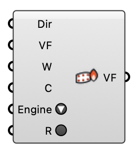

#  SurfaceTemp (EnergyPlus) - [[source code]](https://github.com/Eddy3D-Dev/Eddy3D/search?q=%22SurfaceTemp%20%28EnergyPlus%29%22)

Surface temperatures via EnergyPlus, mapped onto a solved VF Model. The counterpart of the FFT SurfaceTemp component for the staged MRT pipeline: it consumes MRT View Factors' output (the E+ surface selection depends on the view factors) and its output feeds MRT Solve. Skipping this stage leaves surfaces at ambient temperature unless they carry FFT temperatures from MRT Surface. Method: Dogan, Kastner & Mermelstein (2021), Building and Environment 196:107762, doi:10.1016/j.buildenv.2021.107762.

#### Input

| Name | Nickname | Description | Type |
| ---- | -------- | ----------- | ---- |
| Working Directory | Dir | Folder the EnergyPlus case is written to. Unwired = a folder named after this document's study under the Eddy3D MRT folder in your home directory. | `Text` |
| VF Model | VF | Solved view-factor model from MRT Scene. | `Generic Data` |
| EPW | W | Path to the EPW weather file. | `Text` |
| Settings | C | Optional MRT Settings — view-factor cutoff percentile, small-face cutoff and the engine timeout are read here. | `Generic Data` |
| Engine |  | Run EnergyPlus natively, via the bundled container image (Podman/Docker), or with the in-house host/GPU thermal + EcoRoof solver (zero EnergyPlus). | `Text` |
| Run | R | Run EnergyPlus. | `Boolean` |

#### Output

| Name | Nickname | Description | Type |
| ---- | -------- | ----------- | ---- |
| VF Model | VF | The same model with EnergyPlus surface temperatures applied — feed to MRT Solve. | `Generic Data` |