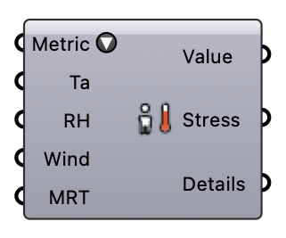

#  Thermal Comfort - [[source code]](https://github.com/Eddy3D-Dev/Eddy3D/search?q=%22Thermal%20Comfort%22)

Compute a thermal comfort metric at a point: UTCI (Ta, RH, wind, MRT), PET (adds the personal inputs), NOAA Heat Index (Ta, RH only), outdoor WBGT (Ta, RH, wind at the subject, MRT: ISO 7243 outdoor weighting with the globe temperature derived from the MRT and Stull's wet bulb, as ECMWF thermofeel computes it; bands of the Japanese heat-stroke guideline) or SET* (the Gagge two-node Standard Effective Temperature with the MRT as the radiant field; adds activity and clothing), or Environment Canada's Humidex (Ta, RH) and Wind Chill (Ta, wind; the formula is calibrated on 10 m wind and defined from -50 to 0 °C), or SPMV (Standard Predicted Mean Vote: the EN ISO 7730 vote evaluated at the SET* of the same Ta, RH, wind, MRT, activity and clothing, so solar load and humidity enter through the two-node model). Pick the metric from the dropdown — the inputs adapt. Wire hourly lists (e.g. EPW series) to compute annual values.

#### Input

| Name | Nickname | Description | Type |
| ---- | -------- | ----------- | ---- |
| Metric |  | Comfort metric to compute; the inputs adapt to the choice. | `Text` |
| Air Temperature | Ta | Air temperature [°C]. | `Number` |
| Relative Humidity | RH | Relative humidity [%]. | `Number` |
| Wind Speed | Wind | Wind speed at the subject [m/s]. | `Number` |
| MRT |  | Mean radiant temperature [°C]. | `Number` |

#### Output

| Name | Nickname | Description | Type |
| ---- | -------- | ----------- | ---- |
| Value |  | Metric value [°C]; the dimensionless vote (-3 cold … +3 hot) for SPMV. | `Number` |
| Stress |  | Thermal stress category. | `Text` |
| Details |  | Calculation details. | `Text` |
| Metric Type | Metric | Metric identifier for metric-aware downstream components such as UTCI Legend. | `Text` |