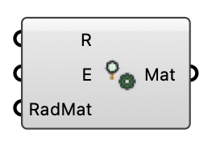

#  Tree Settings - [[source code]](https://github.com/Eddy3D-Dev/Eddy3D/search?q=%22Tree%20Settings%22)

Canopy material properties for an MRT tree surface: optics, and how the crown transmits radiation. Defaults are SOLWEIG's (Lindberg & Grimmond 2011): 3 % of the beam through a crown in leaf (Konarska et al. 2014 measured 1.3-5.3 % in leaf, 40-52 % bare), 50 % out of leaf, leaves at air temperature for longwave. Deciduous crowns follow the SITE's leaf season from the EPW air temperature (ETCCDI growing season, Zhang et al. 2011): bare through the cold spell, in leaf all year where no six-day spell drops below 5 C. A leaf area density switches the in-leaf crown to Beer-Lambert over the path inside CLOSED crown meshes. With Radiance reflections on, the crowns are partially transparent in the Radiance scene too, one scene per leaf state (a Beer-Lambert crown's sky and reflections at its mean-chord transmittance). Method: Zhang et al. (2011), WIREs Climate Change 2(6):851-870, doi:10.1002/wcc.147.

#### Input

| Name | Nickname | Description | Type |
| ---- | -------- | ----------- | ---- |
| Reflectivity | R | Canopy shortwave reflectivity 0–1. | `Number` |
| Emissivity | E | Canopy longwave emissivity 0–1. | `Number` |
| Radiance Material | RadMat | Optional custom Radiance material string for the tree canopy. | `Text` |
| Leaf-On Transmittance | Ton | Fraction of shortwave (beam and diffuse sky) a WHOLE crown in leaf passes, 0-1. SOLWEIG default 0.03. Ignored in leaf when Leaf Area Density > 0. | `Number` |
| Leaf-Off Transmittance | Toff | Fraction a bare crown passes, 0-1. SOLWEIG default 0.5. | `Number` |
| Leaf On | On | First day of year in leaf (1-365). Leave both leaf days at 0 for the SITE's leaf season from the EPW air temperature: in leaf from the first 6-day spell above 5 C to the first 6-day spell below it after mid-year (ETCCDI growing season, Zhang et al. 2011), so a site that never stays that cold keeps its leaves all year. | `Integer` |
| Leaf Off | Off | Last day of year in leaf (1-365). A window that wraps the new year is allowed. | `Integer` |
| Evergreen | Ev | In leaf all year (SOLWEIG's conifer switch). | `Boolean` |
| Leaf Area Density | LAD | Leaf area density, m2/m3. 0 uses Leaf-On Transmittance per crown; > 0 attenuates an in-leaf ray by exp(-0.5 LAD s) over its path s inside the crown (Beer-Lambert, spherical leaf angles) — needs closed crown meshes. LAD is roughly LAI / crown depth. | `Number` |
| Air Temperature | Air | Leaves radiate at air temperature in the longwave (SOLWEIG). False takes the temperature from the MRT Surface's Simulated input (EnergyPlus or ambient) as before. | `Boolean` |

#### Output

| Name | Nickname | Description | Type |
| ---- | -------- | ----------- | ---- |
| Material | Mat | Tree/canopy material for the MRT Surface component's Material input. | `Generic Data` |