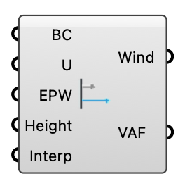

#  Velocity Amplification Factors (VAF) - [[source code]](https://github.com/Eddy3D-Dev/Eddy3D/search?q=%22Velocity%20Amplification%20Factors%20%28VAF%29%22)

Compute Velocity Amplification Factors (VAF) and annual wind speed at probes from CFD or ML wind-prediction results and EPW weather data. VAF (the term used in the wind-engineering literature for what Eddy3D historically called "wind factors") is the local wind speed normalized by the reference speed. Method: Kastner & Dogan (2022), Building and Environment 212:108639, doi:10.1016/j.buildenv.2021.108639; Kastner & Dogan (2019), Building Simulation 2019, Rome 621-628, doi:10.26868/25222708.2019.210458.

#### Input

| Name | Nickname | Description | Type |
| ---- | -------- | ----------- | ---- |
| Boundary Conditions | BC | OutdoorBoundaryConditions object from the ABL or Uniform Flow component. | `Generic Data` |
| Wind Velocity | U | DataTree {direction}[probe] of velocity vectors from the CFD probe results, OR of scalar wind speeds (m/s) from the Wind Predictor's Values output — either engine feeds the same annual wind field. | `Generic Data` |
| EPW |  | Path to the EPW weather file. | `Text` |
| Probe Height | Height | Probing/pedestrian height in meters. | `Number` |
| Interpolate | Interp | How each weather hour's direction is mapped onto the simulated directions — for any number of them. Interpolate blends the two BRACKETING directions by angular proximity; Nearest snaps to the closest simulated direction. A wired boolean from an older document still works: True means Interpolate, False means Nearest. | `Text` |
| Points | P | Optional probe points in the same order as the Wind Velocity tree's branches. Embedded into the Wind Speed output so downstream components — the Pedestrian Wind Comfort mesh — know where each series lives without extra wiring. | `Point` |
| Factors |  | What the Velocity Amplification Factors output carries. Annual (per hour) — the default: {hour}(probes), 8760 branches, each hour's factor resolved from the EPW's wind direction through the Interpolate setting; needs the EPW and is built only while the output is wired (prefer the one-item Annual VAF output into Deconstruct Wind). Spatial (per direction): {direction}(probes), one branch per simulated direction. | `Text` |
| TKE | k | Optional turbulent kinetic energy k (m²/s²) at the probes, one branch per simulated direction like Wind Velocity (the probe's k field). With the EPW it yields the Gust Speed output: U + g·√(2k/3), the Gust Equivalent Mean the ML predictor uses, scaled per hour by (EPW speed / reference speed)². Needed by gust-referenced criteria such as Wellington's 20 m/s safety class. | `Generic Data` |
| Peak Factor | g | Gust peak factor g in U_gust = U + g·σ_u. 3.5 is the 3-second gust used by the Lawson family and Wellington; 3.0 is common for NEN 8100 / Davenport. | `Number` |
| Wind Conditions | WC | Optional Wind Conditions record (from the Wind Conditions component). When it carries a station-to-site transfer, the EPW's hourly speeds are scaled by the SAME factor the inlet speeds were, so the annual field is consistent with the CFD reference. Without it the EPW speeds are used as recorded at the station. | `Generic Data` |

#### Output

| Name | Nickname | Description | Type |
| ---- | -------- | ----------- | ---- |
| Wind Speed | Wind | Annual wind field object (every point's 8760-hour wind-speed series) for the Pedestrian Wind Comfort component. A single object rather than a data tree, so a few thousand probes stay fast. | `Generic Data` |
| Velocity Amplification Factors | VAF | Velocity Amplification Factors (VAF) — local wind speed normalized by the reference (undisturbed) speed at probe height of each direction's own inlet (its own z0 when the ABL has z0 per Direction). Indexing follows the Factors setting: {direction}(probes) per simulated direction (default), or {hour}(probes) across all 8760 weather hours when Factors is set to Annual. | `Number` |
| Annual VAF | AVAF | The direction-mapped Velocity Amplification Factor at every probe for every weather hour, carried as ONE object (probes × 8760, dimensionless) — wire it into Deconstruct Wind for statistics, a colored mesh and per-hour values. Needs the EPW; empty until it is connected. This is the fast path: the tree output above materializes the same numbers as millions of items on the canvas. | `Generic Data` |
| Gust Speed | Gust | Annual 3-second gust field (probes × 8760, m/s) from the TKE input: U + g·√(2k/3). Wire it into Pedestrian Wind Comfort's Gust Speed input for a gust-referenced criterion (Wellington WIND-S1). Empty until TKE and the EPW are connected. | `Generic Data` |
| Speed Ratios | Ratios | Per-probe speed / inlet reference speed for every simulated direction, as one object (probes × directions, no hours; with TKE wired, the 3-second gust ratio too). Feed it to Pedestrian Wind Comfort's Wind Speed together with a Wind Climate for the probabilistic classification. Needs no EPW. | `Generic Data` |