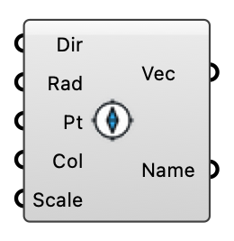

#  Wind Compass - [[source code]](https://github.com/Eddy3D-Dev/Eddy3D/search?q=%22Wind%20Compass%22)

Visualize a wind direction on a compass circle. Direction is meteorological degrees (0=N, 90=E, 180=S, 270=W); outputs the flow vector and the 16-point cardinal name.

#### Input

| Name | Nickname | Description | Type |
| ---- | -------- | ----------- | ---- |
| Wind Direction | Dir | Wind direction in degrees (0=N, 90=E, 180=S, 270=W). | `Number` |
| Radius | Rad | Radius of the compass circle. | `Number` |
| Base Point | Pt | Center of the compass. | `Point` |
| Color | Col | Display color. | `Colour` |
| Arrow Scale | Scale | Scale of the directional arrow. | `Number` |
| Weather |  | Optional Eddy3D Weather object. When connected, replaces the direction arrow with a 16-sector wind rose over Start–End Month (whole year by default). Radial length is occurrence frequency and stacked colors are wind-speed ranges in m/s. | `Generic Data` |
| Start Month | StartMonth | First month [1-12] of the hours the wind rose counts. | `Integer` |
| End Month | EndMonth | Last month [1-12] of the hours the wind rose counts, inclusive. Earlier than Start Month wraps the year end: Start 11, End 2 is November to February. | `Integer` |

#### Output

| Name | Nickname | Description | Type |
| ---- | -------- | ----------- | ---- |
| Vector | Vec | Wind direction (flow) vector. | `Vector` |
| Direction Name | Name | 16-point cardinal name (e.g. NNE). | `Text` |