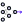
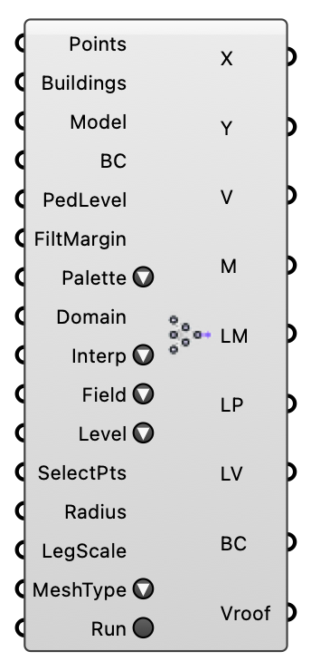

#  Wind Predictor - [[source code]](https://github.com/Eddy3D-Dev/Eddy3D/search?q=%22Wind%20Predictor%22)

Run ONNX wind-field prediction end-to-end. Computes SDF, building height, Zrelative, U/Uref, direction features from geometry, assembles the 8-channel input tensor, runs ONNX inference, and outputs predicted wind speeds. Supports legacy 1ch (U), 2ch (U + k) and new 4ch (U + k + Uroof + kroof) models. ML screening prediction, not CFD: use it to compare options, then confirm anything that matters with a Wind Study (planning authorities do not accept surrogate results). Check a result with Prediction Confidence and Verify Prediction. Method: Kastner et al. (2026), SSRN preprint 6401886, doi:10.2139/ssrn.6401886.

#### Input

| Name | Nickname | Description | Type |
| ---- | -------- | ----------- | ---- |
| Points |  | List of 3D points. Each point's Z must be absolute elevation (m). | `Point` |
| Buildings |  | List of Brep or Mesh objects representing buildings. | `Geometry` |
| Model |  | Full file path to the ONNX model. Connect the FilePath output from the ML Model component. | `Text` |
| Boundary Conditions | BC | Boundary conditions from the ABL or Uniform Flow component. Uref, zRef, z0, wind directions, and EPW path are extracted automatically. | `Generic Data` |
| Pedestrian Level | PedLevel | Pedestrian mount height (m). Default = 1.8 | `Number` |
| Filter Margin | FiltMargin | Margin (in meters) to mask out from the outer perimeter of the prediction plane due to unstable boundary effects. Default = 100.0 | `Number` |
| Palette |  | Color palette for visualization. | `Text` |
| Legend Domain | Domain | Optional custom domain [min, max] to lock the color bounds. If empty, the colors scale dynamically to the data. | `Domain` |
| Interpolate | Interp | Visualization style. Flat (pixelated) vs Smooth (interpolated colors). | `Text` |
| Field |  | Field to visualize. Affects M, LM, LP, LV outputs. | `Text` |
| Level |  | Visualization level. Roof Level only applies when a 4-channel model is loaded. | `Text` |
| Selection Points | SelectPts | Optional locations to output. The model still runs on all input Points; each selection receives the result of its nearest input sensor, in selection order. | `Point` |
| Radius |  | Marker size (m): circle radius or square half-width. | `Number` |
| Legend Scale | LegScale | Uniform scale factor for the legend bar and label spacing. | `Number` |
| Mesh Type | MeshType | Prediction marker topology. Square uses one quad per point and is fastest; Circle uses a 16-sided n-gon. | `Text` |
| Engine | Eng | Who measures the SDF and building-height grid the model reads (not the inference provider — that is the right-click menu). Auto (the default): the OpenCL GPU when every building is a mesh or a Brep with only planar faces, where it measures exactly what Rhino does; the CPU otherwise (curved faces, or no GPU), and the Remark says which. GPU: the OpenCL GPU on every building, curved ones on their render mesh; a fallback to the CPU is reported, never silent. CPU: Rhino's Brep rule on every core, the one the model was trained on. | `Text` |
| Run |  | Sticky on/off switch for the prediction (a toggle, not a momentary button). On: every input change re-runs inference. Off: inference is skipped and the last result stays on the outputs, so the canvas can be rewired without paying for a solve. A wired boolean works the same as the inline switch. | `Boolean` |

#### Output

| Name | Nickname | Description | Type |
| ---- | -------- | ----------- | ---- |
| Points | Pts | The location of each predicted value, in Values order, at the input points' own height: the input Points, or the Selection Points when those are wired. | `Point` |
| Values | V | Predicted field values at each valid input point. Outputs wind speed (m/s) or turbulent kinetic energy (m²/s²) depending on the Field input. Branches represent different wind directions. | `Number` |
| Grid Mesh | M | A fast-rendering contiguous coloured preview mesh of the predictions. | `Mesh` |
| Legend Mesh | LM | A colored mesh strip acting as a visual legend. | `Mesh` |
| Legend Points | LP | Locations for the legend text in the 3D viewport (Generic type to prevent red cross preview). | `Generic Data` |
| Legend Values | LV | Text values corresponding to the generated legend. | `Text` |
| Boundary Conditions | BC | Automated simulation boundary conditions metadata. | `Generic Data` |
| Values (Roof) | Vroof | Predicted roof-level field values at each valid input point. Outputs wind speed or TKE depending on the Field input. Branches represent different wind directions. Empty unless a 4-channel model is used. | `Number` |