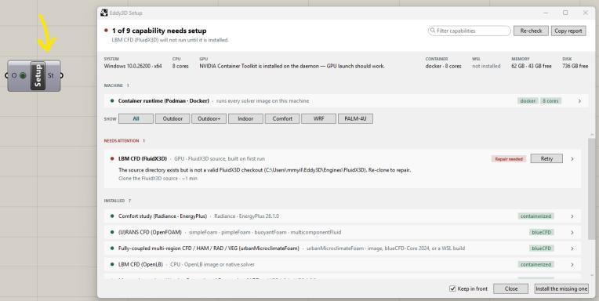
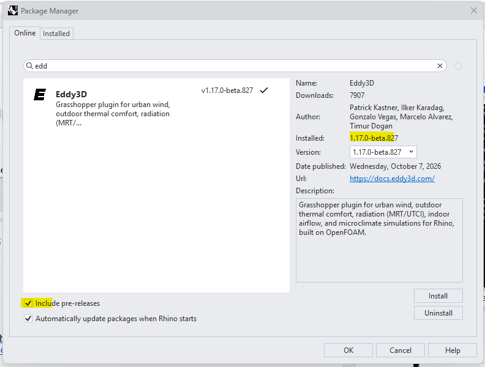
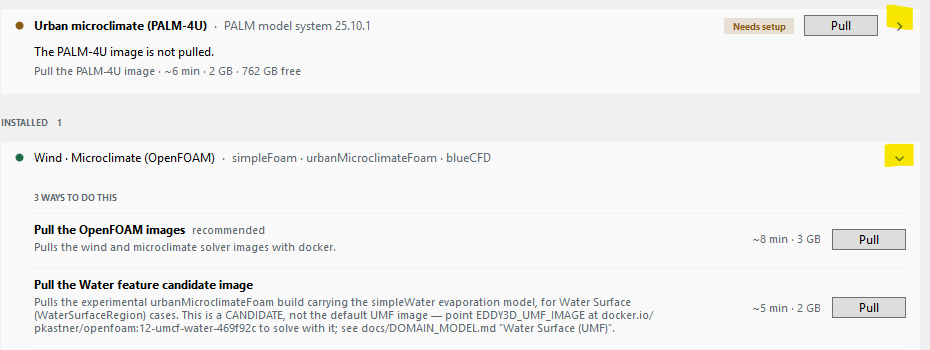
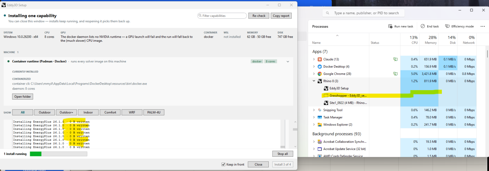
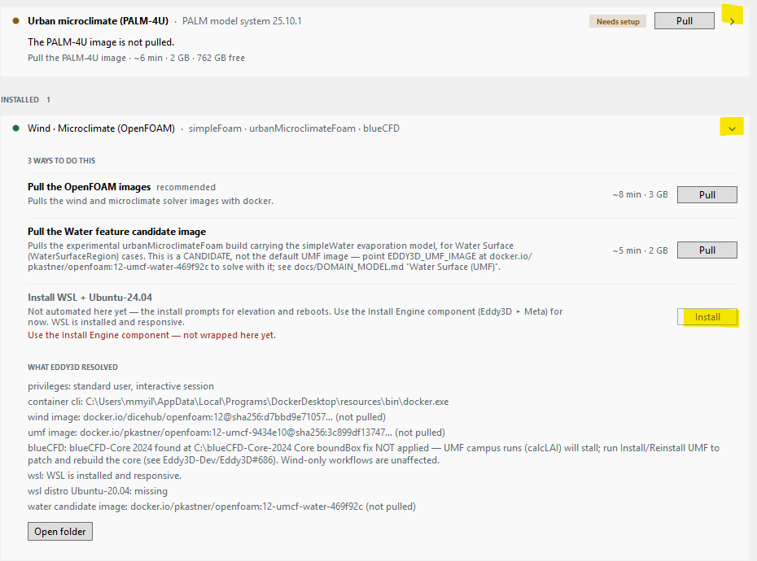
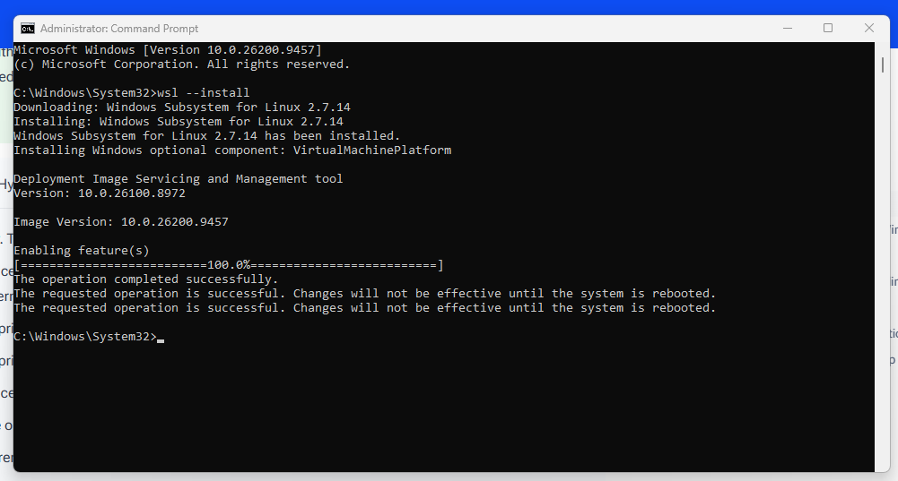
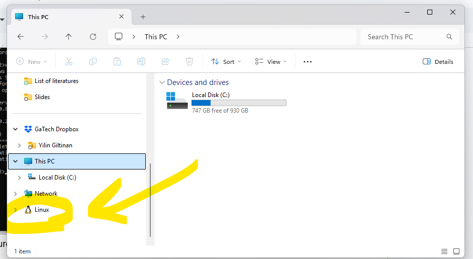
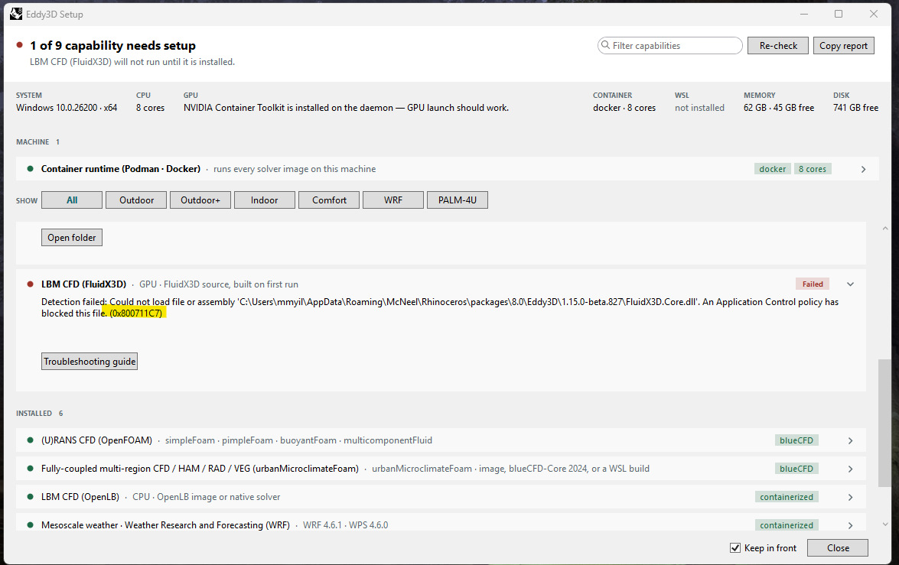

# Setup Troubleshooting Notes

Field notes from getting Eddy3D running on a fresh Windows machine, covering a few snags that
aren't obvious from the Setup dialog alone. These are community notes rather than official
guidance — for the authoritative install flow see [Downloads](index.md#downloads) and
[Outdoor+ First Steps](first_steps.md).

## Before you run Setup

- Skim the [development docs](https://dev.docs.eddy3d.com/){ target="_blank" rel="noopener noreferrer" aria-label="Eddy3D development docs (opens in a new tab)" } before running Eddy3D's **Setup** component, so you know what each capability needs.
- Of the container engines, **Podman is preferable** (daemonless, rootless, no licensing restrictions). If you're new to Podman on Windows, the [Podman for Windows tutorial](https://github.com/podman-container-tools/podman/blob/main/docs/tutorials/podman-for-windows.md){ target="_blank" rel="noopener noreferrer" aria-label="Podman for Windows tutorial (opens in a new tab)" } walks through the install.
- **Launch your container engine (Podman or Docker) before opening Rhino/Grasshopper.** Setup doesn't always start the engine automatically — if it isn't already running, start it by hand first, or the capability checks below will fail to detect it.

{ loading=lazy }

## Install the latest beta

Use the Rhino **Package Manager** (run the `PackageManager` command) to install Eddy3D, and check **"Include pre-releases"** to get the latest beta build rather than the last stable release.

{ loading=lazy }

## Installing capabilities: use "Pull", not "Install"

For each capability, click the arrow to expand its detailed instructions, and click **Pull** rather than **Install** — `Pull` fetches a prebuilt image into Docker/Podman, which is faster and more reliable than building it locally.

!!! tip "You likely don't need every capability"
    Check which simulation modules your workflow actually needs (Outdoor, Outdoor+, Indoor, and so on) before pulling all of them — most projects only need a handful of the capabilities listed.

{ loading=lazy }

!!! warning "If you click Install instead"
    Clicking **Install** can leave the process stuck, repeating `0 B written` in the log with no progress:

    { loading=lazy }

    If this happens, stop the install and use **Pull** instead.

## Missing WSL

If Setup warns that WSL (Windows Subsystem for Linux) is missing, you can install it from the capability panel (via the **Install Engine** component) or by hand:

{ loading=lazy }

To install it by hand, open an **administrator** Command Prompt and run:

```powershell
wsl --install
```

{ loading=lazy }

Reboot when prompted. There's also a [video walkthrough of installing WSL](https://www.youtube.com/watch?v=wz0QBNy9i7w){ target="_blank" rel="noopener noreferrer" aria-label="Video walkthrough of installing WSL (opens in a new tab)" } if you'd rather follow along.

**To confirm WSL is installed:** open File Explorer, select **This PC**, and look for a **Linux** entry in the sidebar.

{ loading=lazy }

## LBM CFD (FluidX3D) blocked by Windows

On some Windows machines — often ones under an organization's IT policy — `FluidX3D.Core.dll` gets blocked by an Application Control policy, and LBM CFD (FluidX3D) fails detection:

{ loading=lazy }

If you hit this, it's a local machine policy issue rather than an Eddy3D bug: check the **Troubleshooting guide** link in the Setup dialog, or ask your IT administrator about an Application Control exception. FluidX3D isn't required for most outdoor or indoor CFD workflows, so it's safe to leave for later while you continue with the other capabilities.
