

Setup

<a href="/components/Deconstruct_Weather/" class="GhComponentItem" above-dataComment="Deconstruct Weather">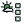</a>

<a href="/components/Weather/" class="GhComponentItem" above-dataComment="Weather">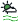</a>

Pre

<a href="/components/Manual_Inflow_Profile/" class="GhComponentItem" below-dataComment="Manual Inflow Profile">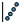</a>

<a href="/components/Mesh_Settings/" class="GhComponentItem" below-dataComment="Mesh Settings">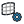</a>

<a href="/components/Tree/" class="GhComponentItem" below-dataComment="Tree">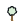</a>

Outdoor

<a href="/components/Building_Material/" class="GhComponentItem" above-dataComment="Building Material">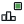</a>

<a href="/components/Terrain_Mesh_Settings/" class="GhComponentItem" above-dataComment="Terrain Mesh Settings">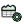</a>

<a href="/components/Vegetation_Mesh_Settings/" class="GhComponentItem" above-dataComment="Vegetation Mesh Settings">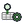</a>
<a href="/components/Vegetation_Properties/" class="GhComponentItem" below-dataComment="Vegetation Properties">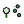</a>
<a href="/components/Vegetation_Region/" class="GhComponentItem" above-dataComment="Vegetation Region">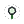</a>

<a href="/components/Outdoor+_Case/" class="GhComponentItem" above-dataComment="Outdoor+ Case">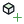</a>
<a href="/components/Simulation_Mesh_Settings/" class="GhComponentItem" below-dataComment="Simulation Mesh Settings">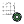</a>

<a href="/components/ViewFactors/" class="GhComponentItem" above-dataComment="ViewFactors">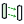</a>

Outdoor+

<a href="/components/Occupant_CO2/" class="GhComponentItem" above-dataComment="Occupant CO2">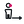</a>
<a href="/components/Window_Air_Exchange/" class="GhComponentItem" below-dataComment="Window Air Exchange">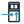</a>
<a href="/components/Indoor_Inlet/" class="GhComponentItem" above-dataComment="Indoor Inlet">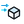</a>

<a href="/components/Manikin/" class="GhComponentItem" below-dataComment="Manikin">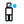</a>

<a href="/components/Viral_Emitter/" class="GhComponentItem" above-dataComment="Viral Emitter">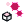</a>
<a href="/components/Indoor_Species_Case/" class="GhComponentItem" below-dataComment="Indoor Species Case">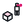</a>

Indoor

Sun Shadow Daylight

<a href="/components/MRT_Settings/" class="GhComponentItem" above-dataComment="MRT Settings">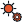</a>

<a href="/components/Tree_Settings/" class="GhComponentItem" below-dataComment="Tree Settings">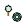</a>
<a href="/components/Vegetation_Settings/" class="GhComponentItem" above-dataComment="Vegetation Settings">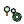</a>

MRT

<a href="/components/Cull_Ground_Mesh/" class="GhComponentItem" above-dataComment="Cull Ground Mesh">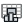</a>

Post

<a href="/components/Thermal_Comfort/" class="GhComponentItem" below-dataComment="Thermal Comfort">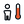</a>

<a href="/components/Pedestrian_Wind_Comfort/" class="GhComponentItem" above-dataComment="Pedestrian Wind Comfort">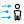</a>

Post Comfort

Stormwater

<a href="/components/FluidX3D_Run_Settings/" class="GhComponentItem" above-dataComment="FluidX3D Run Settings">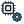</a>

LBM

<a href="/components/ML_Model/" class="GhComponentItem" above-dataComment="ML Model">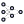</a>

<a href="/components/Wind_Predictor/" class="GhComponentItem" below-dataComment="Wind Predictor">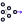</a>

<a href="/components/Wind_Comfort_Predictor_ML/" class="GhComponentItem" below-dataComment="Wind Comfort Predictor ML">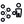</a>
<a href="/components/Dataset_Curator/" class="GhComponentItem" above-dataComment="Dataset Curator">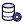</a>

<a href="/components/Interpolate_UMag/" class="GhComponentItem" above-dataComment="Interpolate UMag">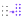</a>

ML

CHT

WRF

PALM-4U

Noise

Earthworks

